> 来源链接：https://www.bilibili.com/video/BV1pDWXzaEbW

## 目录

- [计算机硬件基础](#计算机硬件基础)
- [ALU与程序执行原理](#ALU与程序执行原理)
- [存储层次与汇编语言](#存储层次与汇编语言)
- [程序的底层执行逻辑](#程序的底层执行逻辑)
- [操作系统的演进：从单道到分时](#操作系统的演进从单道到分时)
- [操作系统的演进：实时与分布式](#操作系统的演进实时与分布式)
- [内存保护机制与特权级](#内存保护机制与特权级)
- [特权指令、中断与系统调用](#特权指令中断与系统调用)

---

## 计算机硬件基础
[原片 @ 00:06](https://www.bilibili.com/video/BV1pDWXzaEbW?t=6)

我们从一个机箱开始探索。打开机箱可以看到大家熟悉的主板，主板上搭载了 CPU、内存、硬盘等部件。其中最为核心的是 CPU。
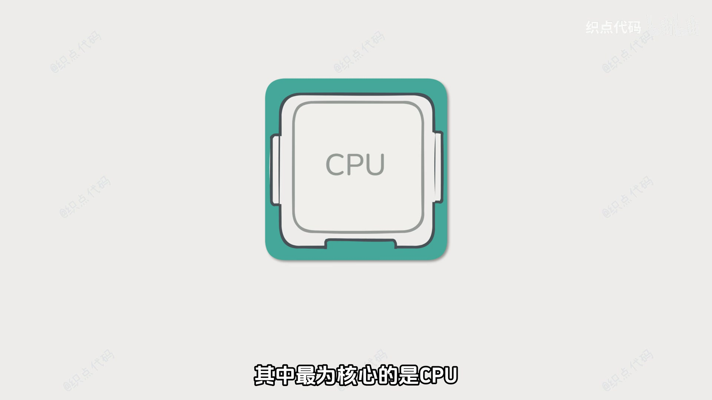

CPU 内部大致由多个部分组成，最为核心的是算术逻辑单元（ALU，Arithmetic Logic Unit）。它的主要工作是处理加减法、逻辑运算和移位等操作。
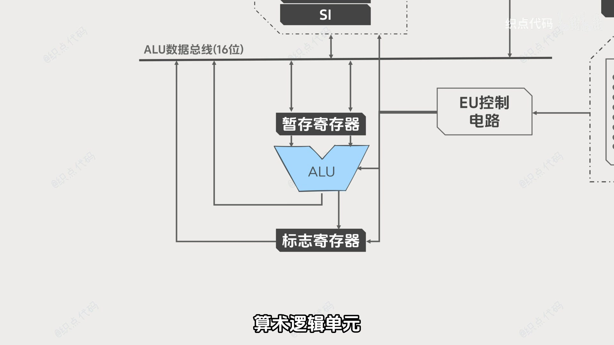

## ALU与程序执行原理
[原片 @ 00:24](https://www.bilibili.com/video/BV1pDWXzaEbW?t=24)

以计算器为比喻，ALU 有两个输入端（接收两个数字）、一个操作端（接收操作方式）和一个输出端（输出结果）。例如要计算 \(6+7\)，可以把 \(6\) 和 \(7\) 接到输入端，然后指定一个加法操作码，经过电路处理后，输出结果 \(13\)。
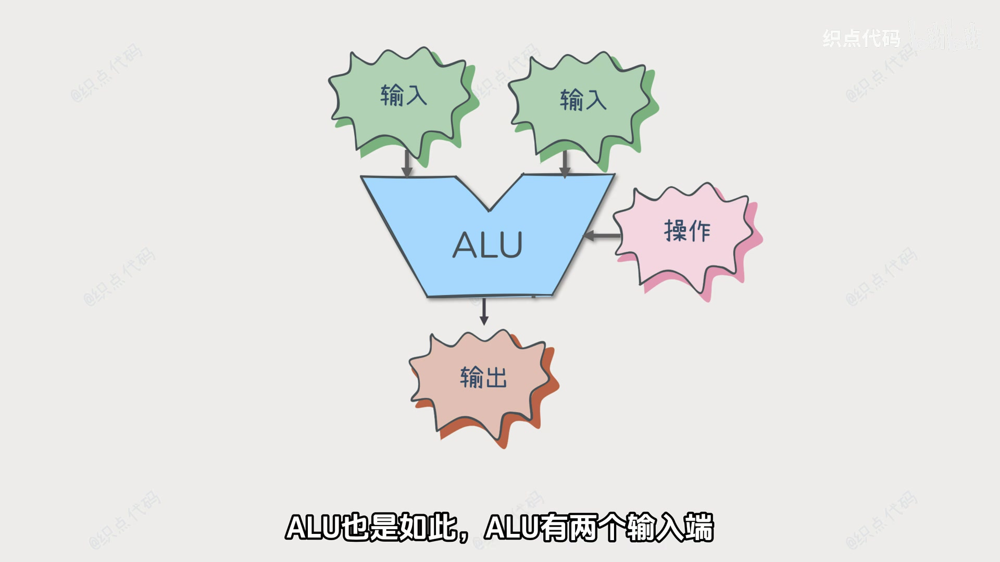

计算机电路中实际使用的是二进制表示数值和操作码。可以把二进制数当成插排——插电表示 1，不插电表示 0；输出结果当成电灯——亮灯表示 1，熄灯表示 0。
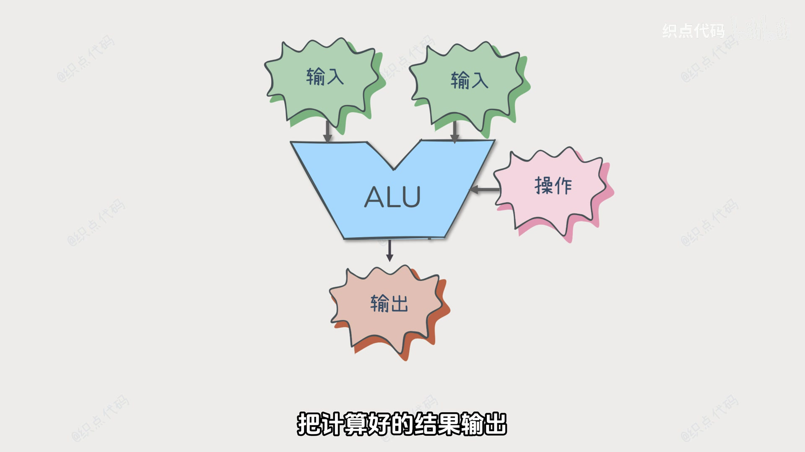

早期的计算机确实是通过手动重新插线来操作的，虽然 ALU 算得很快，但人工参与导致效率无法发挥。因此后来使用了纸带。纸带上有挖孔和不挖孔两种状态，给纸带装上传感器后，挖孔通电，不挖孔不通电，就能实现手工插拔连接电路的效果。
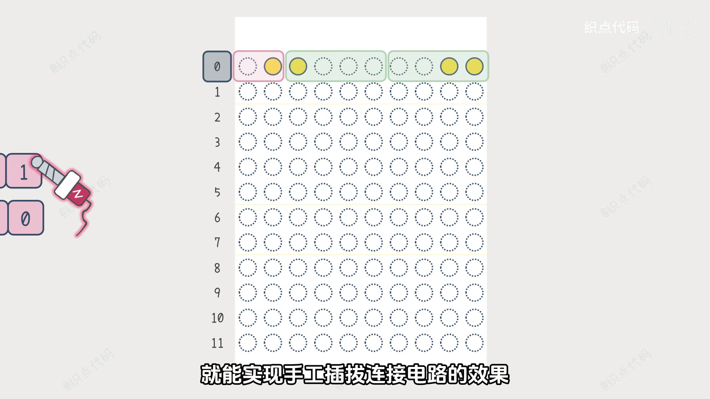

将传感器对应的位置分别连接到 ALU 的两个输入端和操作码端，ALU 就能直接给出结果。纸带推动子代进入下一行，对应的内容会送入 ALU 计算，这样我们就可以提前把需要计算的任务通过打孔方式放到纸带上，依次执行。这就是计算机程序执行最直观的样子。

纸带的每一行称作指令，多条指令组合称作程序。现在电机的行数是顺序加载的，我们还可以改进——如果操作码表示是跳转，就将纸带上的值赋值给电机行数。例如这一行指令给出的值是 1，电机行数就会变更为 1，从而跳转到第一行指令，这就是指令的无条件跳转，可以实现死循环。
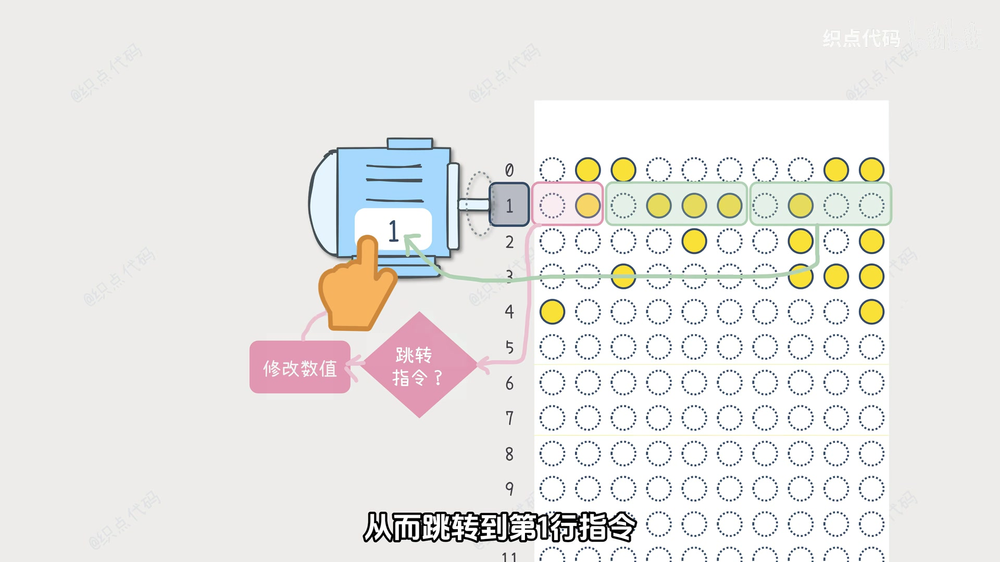

## 存储层次与汇编语言
[原片 @ 02:42](https://www.bilibili.com/video/BV1pDWXzaEbW?t=162)

存储介质无论是纸带、现代的内存还是上古的磁芯内存，原理都是一样的。但直接阅读这些 0 和 1 非常不方便，因此我们采用适合人阅读的词语（助记符）来代替二进制代码，例如用 `SUB` 表示减法，用 `ADD` 表示加法，还有 `JMP` 表示跳转等，这就是汇编程序。
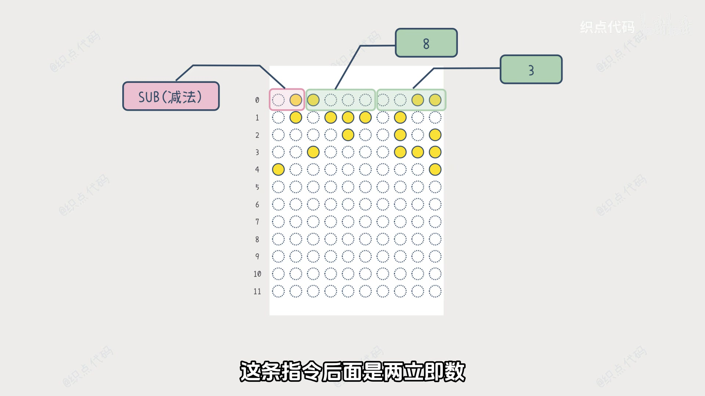

汇编程序非常接近机器码，是对机器码的简单映射，人可以更直观地阅读。例如 `ADD 8 7` 即使不懂汇编也能猜出是在执行 8+7 的操作。
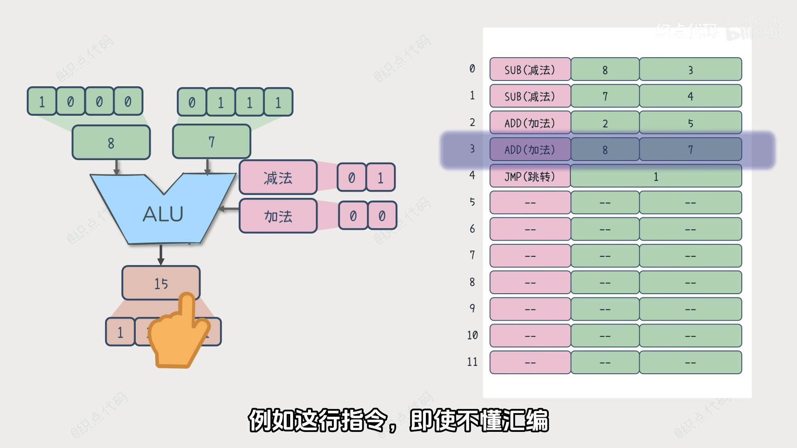

## 程序的底层执行逻辑
[原片 @ 03:18](https://www.bilibili.com/video/BV1pDWXzaEbW?t=198)

虽然 ALU 给出了结果，但无法把结果保存出来。我们需要一个存数据的地方，可以是硬盘、内存或寄存器。程序执行时，需要从硬盘读取程序加载到内存，从内存复制到寄存器方便 CPU 处理，结果再写回内存。
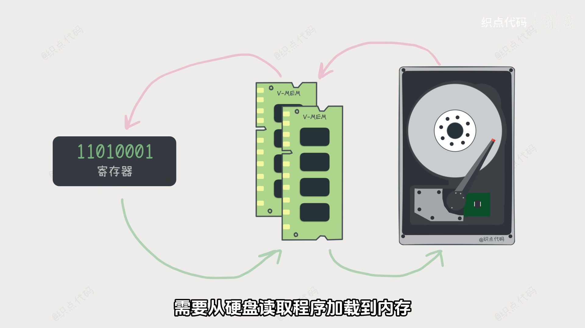

CPU 内部有一系列寄存器，它们职责不尽相同，但本质都是存放数据的地方。数据可以从一个寄存器复制到另一个，也可以从内存复制到寄存器，或者从寄存器复制到内存。这需要用到复制指令（如 `MOV`）。例如 `MOV [7] 8` 表示把数值 8 复制到第 7 行内存。
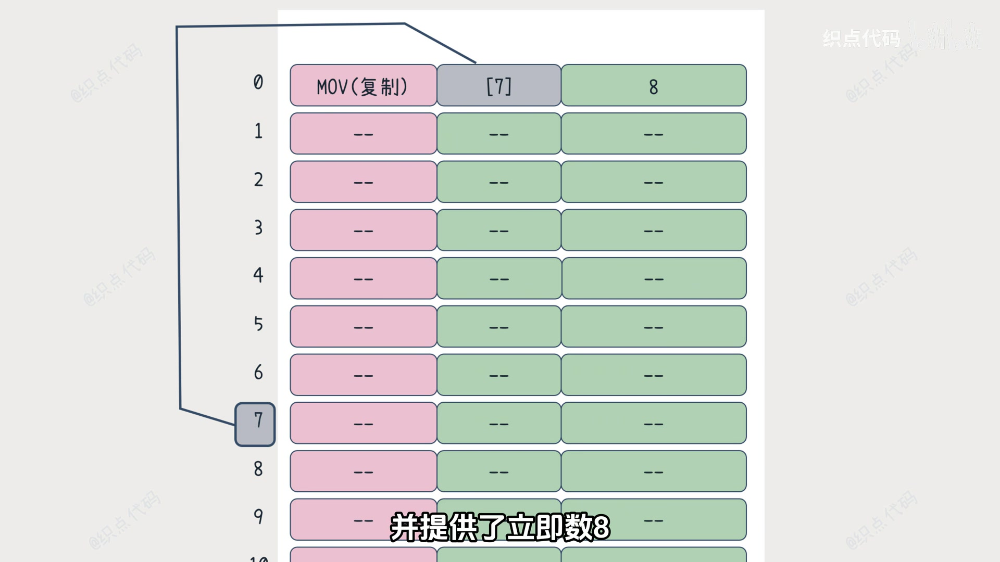

执行完赋值后，我们可以用 `MOV AX [7]` 把内存中的 8 复制到寄存器 AX 上。接下来执行加法指令 `ADD AX 5`，电路会把 AX 寄存器的数值复制到 ALU 门口的暂存寄存器，再把立即数 5 复制到暂存寄存器，经过计算得出结果，结果会写回寄存器 AX 中。最后执行 `MOV [7] AX`，把寄存器中计算好的数值复制到第七行内存中，完成了复制、计算、存结果的过程。
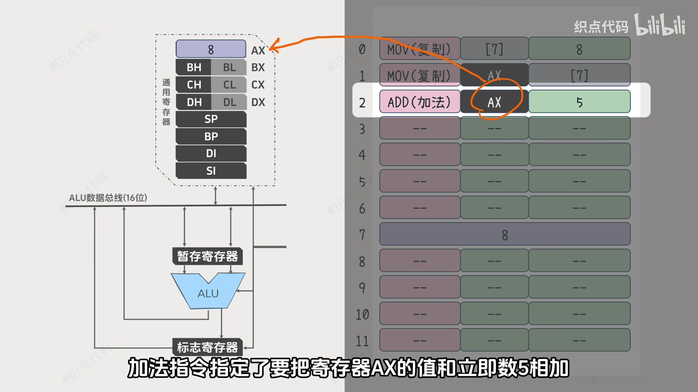

如果你有接触过编程语言，会发现这就是定义变量、计算并重新赋值变量的过程。无论是代码还是数据都存放在一起，这也是冯·诺依曼架构的特点。

在 CPU 内部有一个标志寄存器。每次 ALU 计算后，会把相关的状态信息存放在这个寄存器里。例如结果为零时，零标志位（ZF）会变为 1。此外还有进位标志（CF）、溢出标志（OF）、允许中断标志（IF）等，我们可以利用这些标志位做逻辑处理。
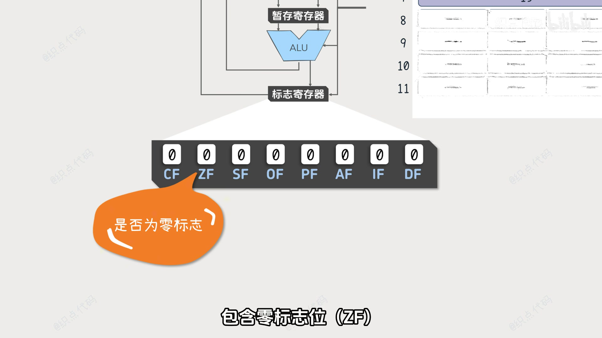

例如实现条件语句：使用对比指令 `CMP`（相当于减法），指令执行时会用内存值减去立即数 13。执行后标志信息写入标志寄存器。由于两数相等，零标志位（ZF）为 1，表示减结果为零。之后再使用有条件跳转指令 `JZ`（Jump if Zero），意思是结果为零时才跳转。该指令利用零标志位判断，满足条件则会跳过中间的指令，直接进入指定行，实现分支效果。
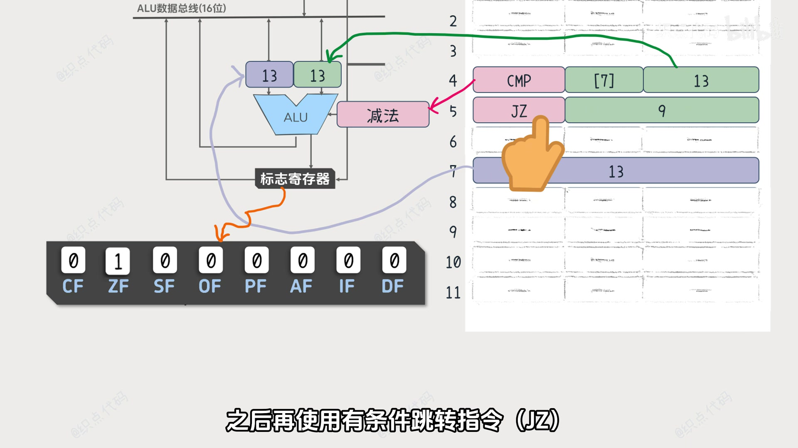

此外还可以使用跳转实现函数的效果。使用调用指令 `CALL`，它与无条件跳转类似，不同的是 `CALL` 会把当前位置记录下来，等函数执行完毕后通过返回指令 `RET` 跳转回原来的位置继续顺序执行。现在我们实现了变量、分支、函数、计算，利用这些就可以编写任意我们想要的程序。
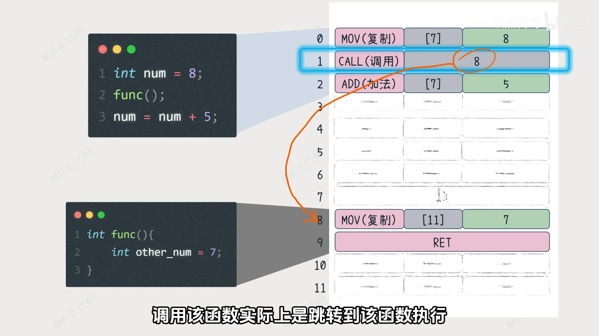

## 厨房比喻
[原片 @ 06:36](https://www.bilibili.com/video/BV1pDWXzaEbW?t=396)

我们已经了解到 CPU 中最核心的是 ALU，它支持加减乘除等操作，就像一口锅可以用来煎炒烹炸。
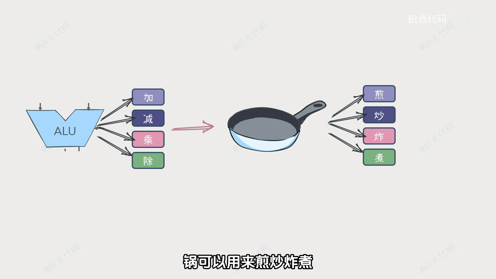

可以将这些部件进行生动的比喻：
- ALU：灶台上的锅
- 寄存器：装东西的盘子
- CPU：整个灶台
- 内存：放了很多盘子的工作台
- 磁盘：放更多盘子的仓库

程序执行就像做一道菜（例如番茄炒蛋）。菜谱和食材存放在仓库（磁盘）里，为了操作，需要搬到工作台（内存）之后按顺序处理。首先根据食谱将西红柿放入 AX 盘子中，其次将鸡蛋放入 BX 盘子中，然后启动灶台（ALU）炒 AX 和 BX 盘子的内容并放回 AX 盘子中，最后把 AX 中的内容搬回工作台（内存）对应的位置。这道番茄炒蛋程序就执行完了。
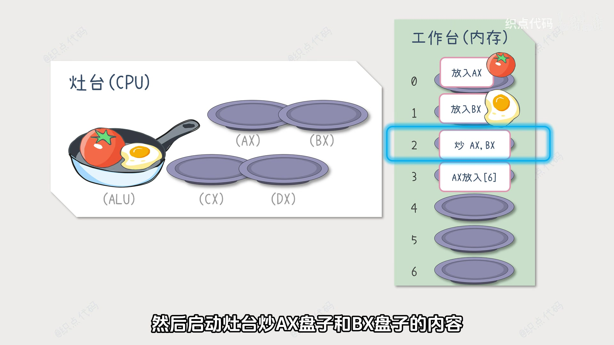

## 操作系统的演进：从单道到分时
[原片 @ 07:30](https://www.bilibili.com/video/BV1pDWXzaEbW?t=450)

不难发现，这道番茄炒蛋程序是独占整个内存的，并且从磁盘搬运到内存是由手工操作的，这是计算机早期阶段的实际情况。程序的加载需要手工插拔插头布线来实现。计算机会因为人工介入而拖累性能。
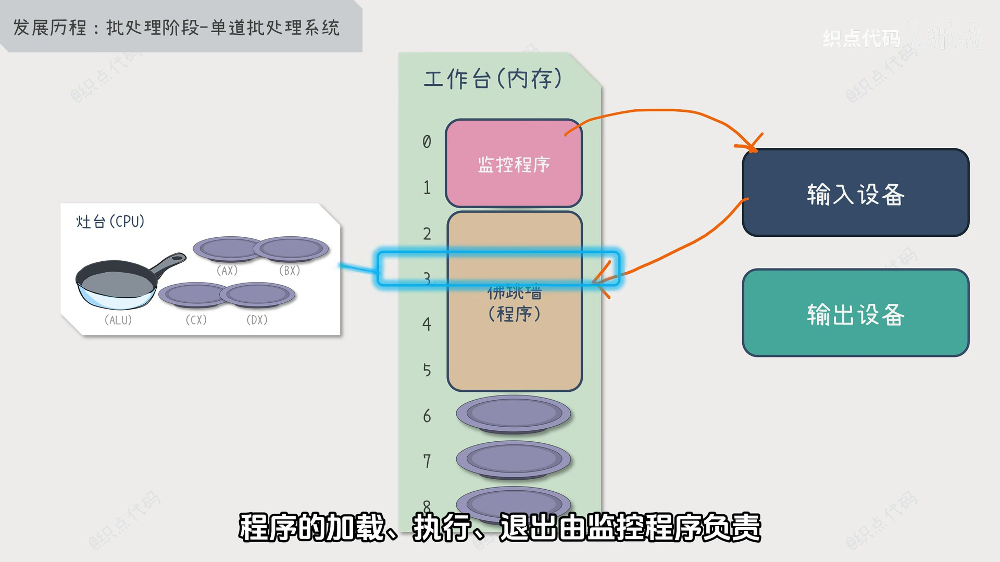

### 单道批处理系统
为了解决手工效率问题，出现了监控程序，程序的加载、执行、退出由监控程序负责。可以将要处理的任务编排好，系统自动加载执行并自动输出结果到输出设备，程序执行完毕再加载下一个程序。每次只有一个任务在执行，因此也被称作单道批处理系统。
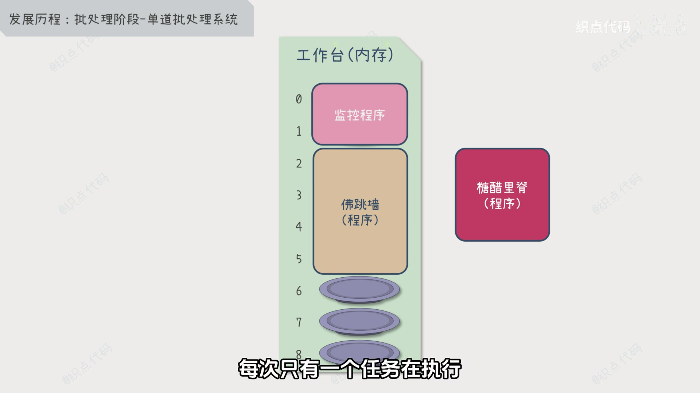

然而单道批处理系统存在缺陷。有时候一个程序可能需要等待 I/O 设备（例如等待打印机就绪）。假设“佛跳墙”程序的第一行指令需要使用到“水龙头”这个 I/O 设备，此时水龙头没水，这条指令就一直等待。此时锅是空闲的，做“糖醋里脊”的师傅很想用这个锅，但必须等到“佛跳墙”程序执行完毕后才轮到“糖醋里脊”使用，这就造成了 CPU 的利用率不高和资源浪费。
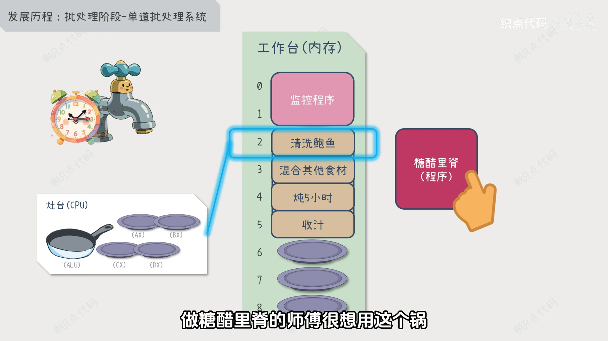

### 多道批处理系统
为了改进这个问题，操作系统允许同时加载两个程序，程序之间可以自由切换交替执行。这样其中一个程序在等待 I/O 设备的时候，可以把 CPU 让出来给另一个程序使用。实现让出 CPU 这一动作使用的是**中断**。
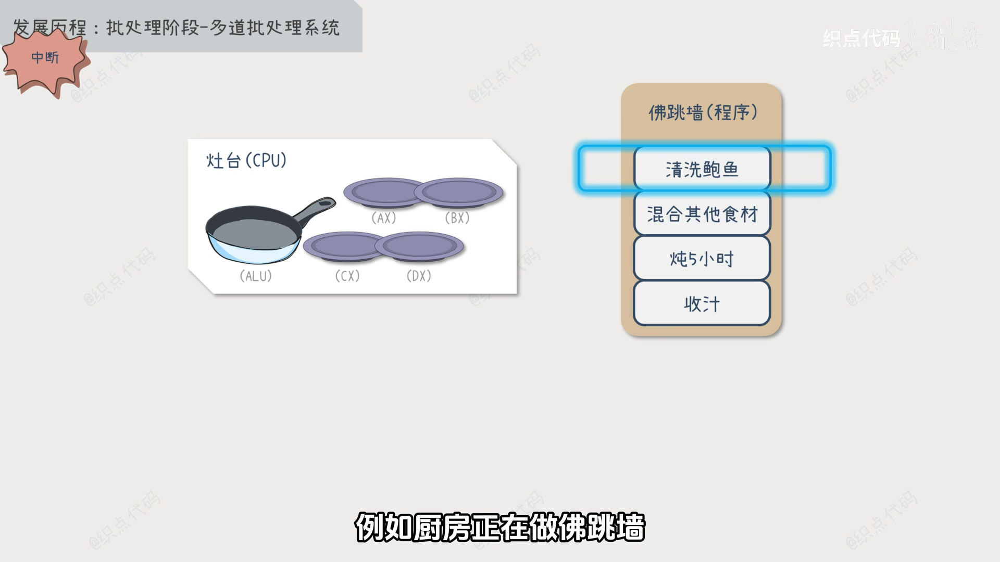

在切换时，需要把当前程序的状态（如 AX、BX 寄存器中放着的数据）保存起来。这就好比把灶台上的盘子依次叠起来，最后记录下当前执行的步骤也叠起来。这一叠盘子称作**栈**（Stack），叠盘子叫**入栈**，取下来叫**出栈**。这个过程也叫**保护现场**。保存好后，让另一个程序执行。当程序执行完毕交还给原程序时，需要把栈搬出来出栈，定位好当前步骤，把食材放回灶台，恢复现场。在多道批处理系统中，CPU 没有一刻是空闲的，利用率更高。
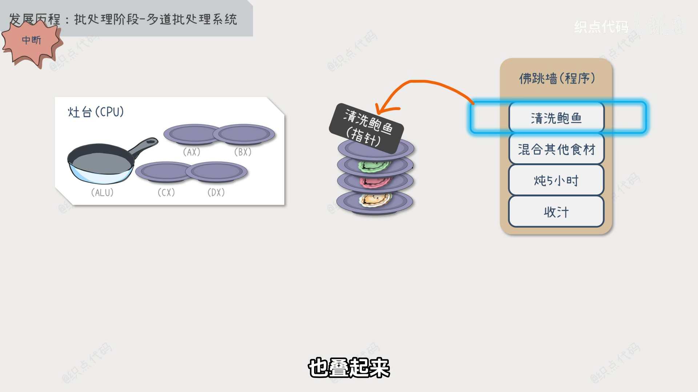

不过，如果是长时间持续使用 CPU 的场景（如“佛跳墙”需要炖 5 个小时），多道批处理系统依然会使得后续程序（如终端）长时间等待响应。类似的交互式场景用多道批处理系统是不合适的。
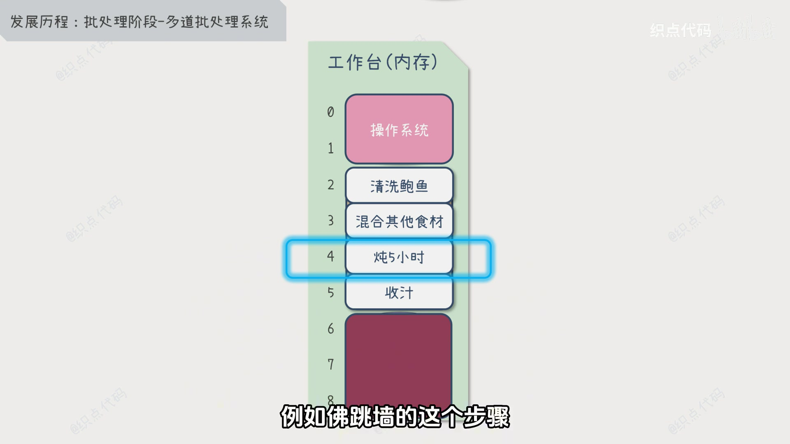

### 分时操作系统
因此出现了分时操作系统，它增加了一个计时器。每个任务使用 CPU 的时间不能超过限定时间。时间一到，不管该任务执行到哪一步，都强制剥夺，把 CPU 给下一个任务。这样就不会让某个耗时任务长期霸占 CPU，从而在交互式场景可以及时响应。观察发现，任务前进一点就轮到下一个任务前进一点，如此循环。只要计时器的时间间隔足够短，比人的反应时间还短，那么人的直观感受是它们同时进行的。这就是**并发**（Concurrency）的概念。
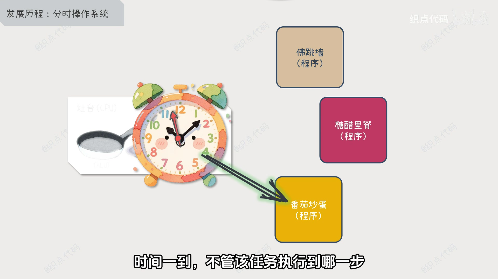

并发从微观上仍然是轮流使用，但是时间间隔很短，给人同时进行的错觉。与之对应的概念是**并行**（Parallelism），可以理解成有多个灶台，每个任务可以独享一个灶台，从微观上是同时的，多个灶台对应的是多核处理器。
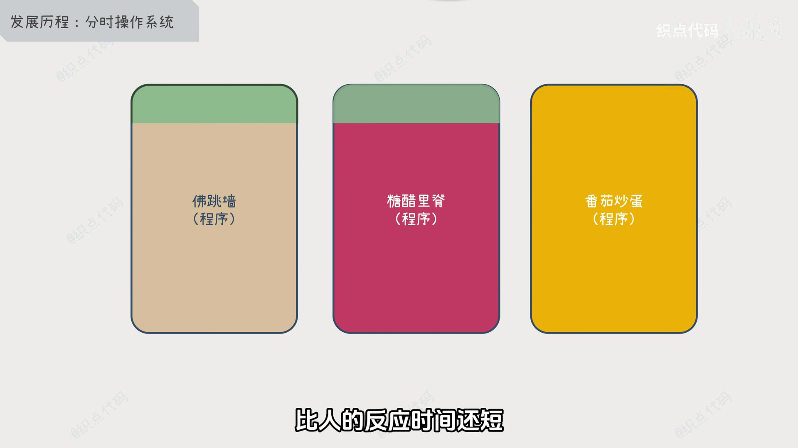

## 操作系统的演进：实时与分布式
[原片 @ 11:06](https://www.bilibili.com/video/BV1pDWXzaEbW?t=666)

大家熟悉的个人计算机操作系统（如 Windows, macOS, Linux, Android, iOS, HarmonyOS）属于个人计算机操作系统，追求的是**高吞吐量**，也就是同一时间内尽可能多做几道菜，但每道菜具体耗时多少并不严格要求。

但在特殊领域（如汽车电子），执行时间不固定会带来严重后果。例如汽车安全气囊本应在 30ms 内弹出，但由于此时操作系统在执行其他任务，导致安全气囊延迟弹出，导致人员伤亡。这是不可接受的。

因此在类似场景需要使用**实时操作系统**（RTOS）。实时操作系统采用固定的调度算法、任务优先级固定、不可抢占等措施，保证每个任务的执行时间可预测，通过牺牲一定的通用性和吞吐量，换来了对时间行为的绝对掌控。
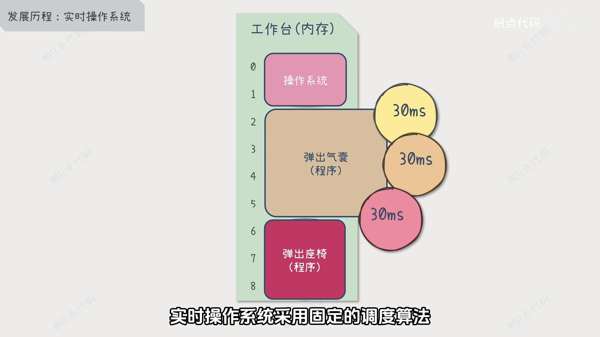

在错过时间会发生灾难的场景（如汽车电子、航空航天、医疗设备），需要时间严格可控，这类实时系统也叫**硬实时系统**。而对时间有严格要求，但偶尔时间不准不至于致命，只是质量下降的场景（如多媒体、金融交易），叫做**软实时系统**。例如视频播放需要帧率稳定，偶尔掉一两帧不影响观看。
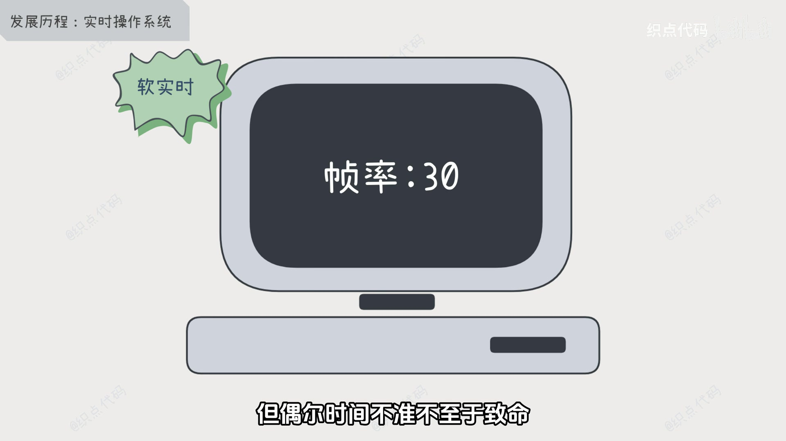

最后则是**网络操作系统**或**分布式操作系统**。我们所看到的短视频等网络内容，背后可能对应了多个 Nginx 服务器，每个 Nginx 服务器又对应了多个应用服务器、数据库服务器等。一个 App 由整个服务器集群组成，这就是分布式操作系统的概念。

## 内存保护机制与特权级
[原片 @ 12:48](https://www.bilibili.com/video/BV1pDWXzaEbW?t=768)

程序执行时从磁盘加载到内存，CPU 处理后的数据也存放在内存，程序需要临时存放的数据也在内存。操作系统本身也是一个特殊的程序，和用户程序一样都在内存里。假如用户程序想搞事情，直接修改操作系统的内存内容，会带来严重的后果。这需要一套保护机制。
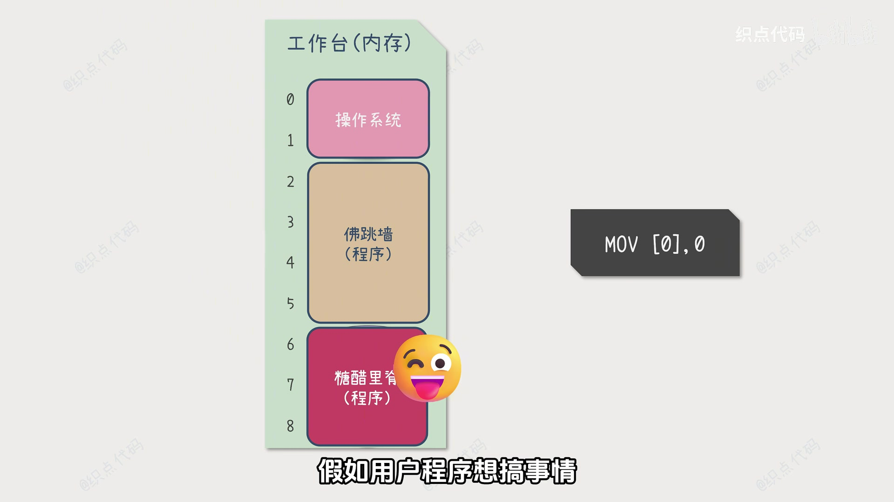

在了解保护机制之前，先了解内存和编制的基本原理。内存就是一个工作台，每一行都有对应的地址存放数据。在取数据时需要用到**地址寄存器**，它指定了内存的地址，内存会把对应的数据复制到**数据寄存器**中。
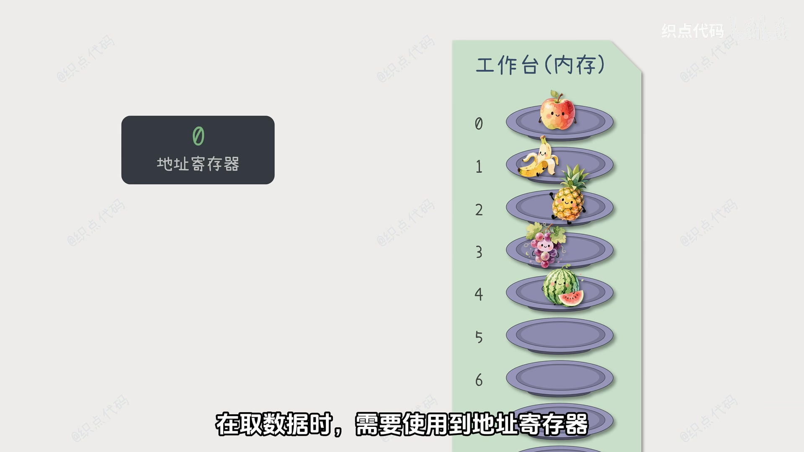

寄存器底层使用的是二进制表示。假如地址寄存器有 16 位，那么可表示的范围是 0 到 65535，一共可以表示 65536 个地址。如果每个地址对应一个盘子容量（1 Byte），那么一共可以表示 64KB 容量的内存。随着内存技术的发展，16 位地址不够用了。因此可以将两个寄存器拼接起来使用。例如增加一个**段寄存器**，段寄存器左移 4 位，加上地址寄存器，构成了一个 20 位的合成地址，能够表示的内存容量达到 1MB，极大提高了可表示容量。
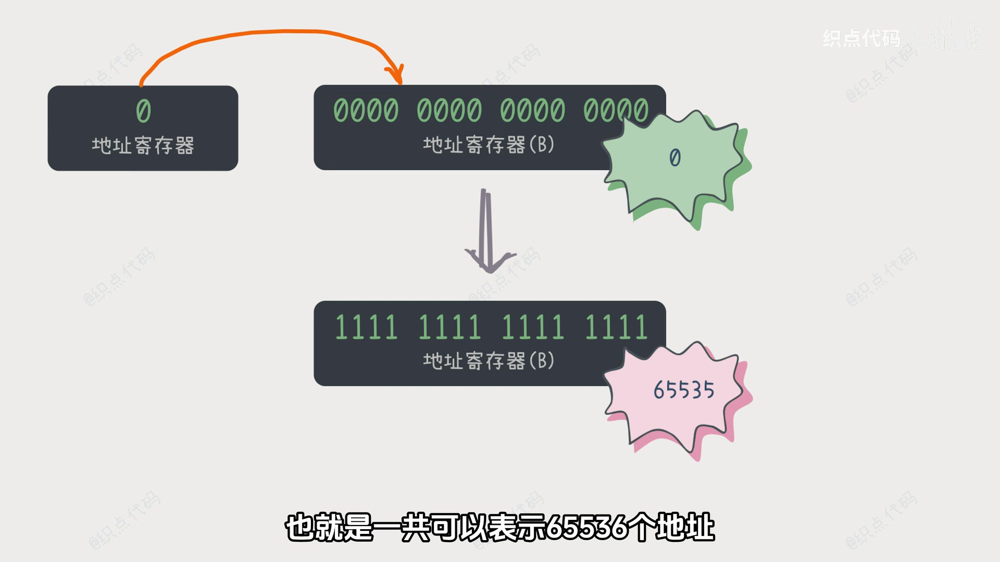

CPU 内部有许多段寄存器，分别代表代码段、数据段、堆栈段和扩展段。在程序中指定某个主存地址，需要先指定好段地址，再指定段内地址。虽然使用了段式存储，但用户程序仍然能够直接修改操作系统的内容，这种方式也称作**实模式**。
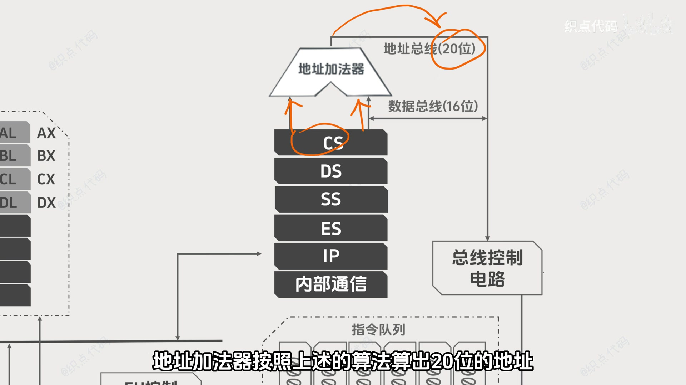

要做到对操作系统的保护，我们需要的是**保护模式**。保护模式的核心是采用**特权级**（Privilege Levels）来区分权限。特权级有 4 种，数值越小，权限越高。最高的权限称作**内核态**（0），最低的权限称作**用户态**（3）。在现代计算机中，通常只使用内核态和用户态两种特权级。有了特权级，就可以对不同段的程序或者数据进行权限标记，例如操作系统的代码段标记为内核态，终端程序的代码段标记为用户态。这个标记称作 **DPL**（Descriptor Privilege Level，描述符特权级）。
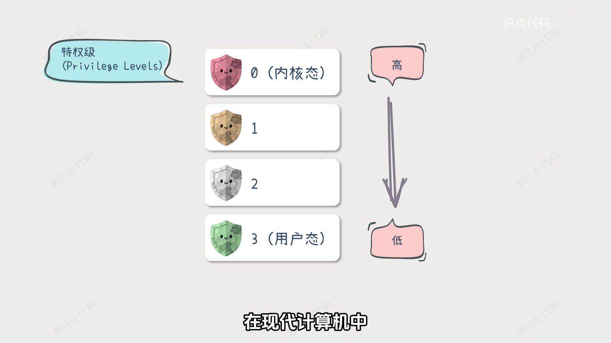

此外还有 **CPL**（Current Privilege Level），指的是当前代码段的特权级。可以通过比对 CPL 和 DPL 来实现保护。例如用户态的程序访问用户态的内存段，由于 CPL 和 DPL 相等，允许访问；但如果用户态内存段想要访问内核态内存段，由于权限不够，拒绝访问，需要切换到内核态才允许访问。而内核态访问用户态是允许的，因为高权限的内存段可以访问低权限的内存段。
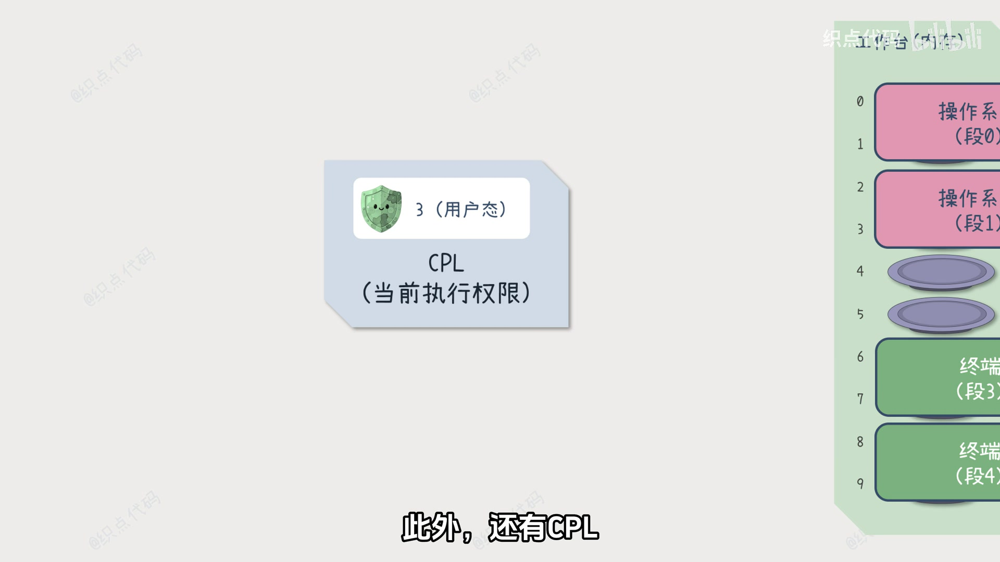

除了 CPL 还可以增加 **RPL**（Requested Privilege Level），允许当前程序段用另一个身份来访问。例如内核态的程序以用户态的身份来访问用户态内存段，而用户态程序使用内核态身份访问内核态内存段时会被拒绝访问。因为底层硬件判断权限时，会从 CPL 和 RPL 中取最大值来和 DPL 比对。
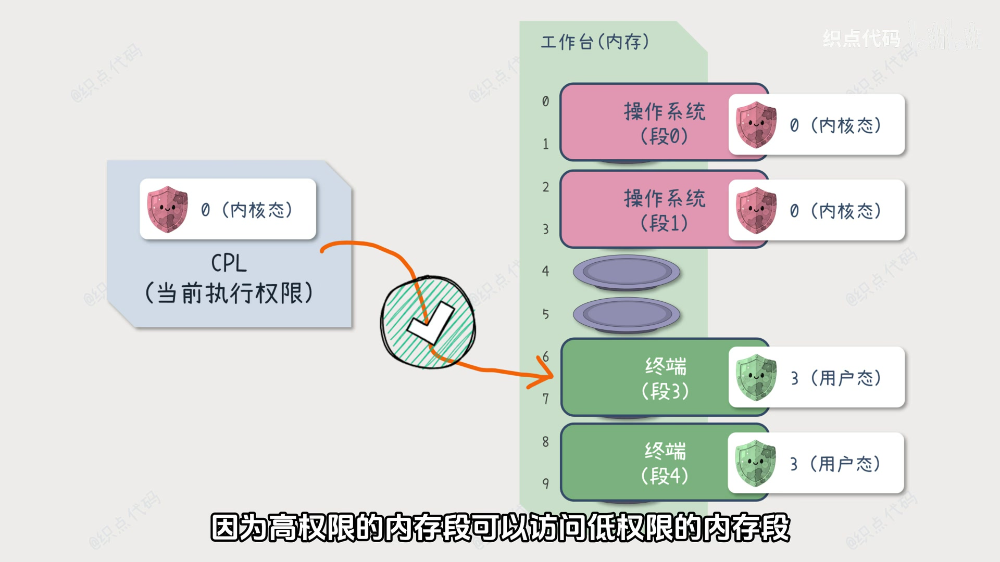

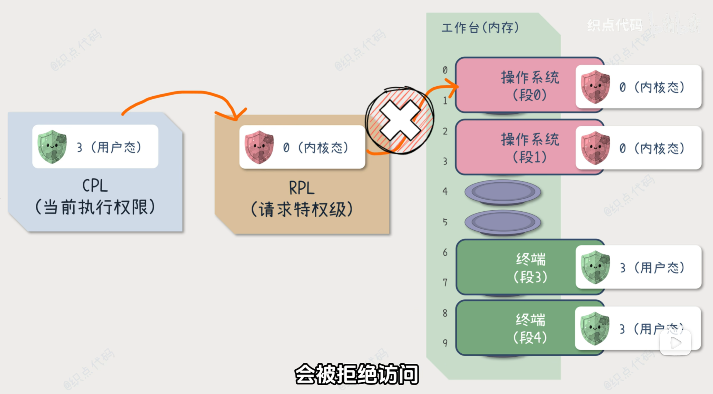

DPL 实际上存放在**全局描述符表**（GDT）中，这个表还记录了内存段的开始位置（基址）以及段长等信息。此外还有**局部描述符表**（LDT），结构是一样的。而段寄存器不再直接存放段基址，而是存放全局描述符表的索引。此外还有表选择位和 RPL 在寻址时，表选择位决定了从全局描述符表查找还是从局部描述符表查找。
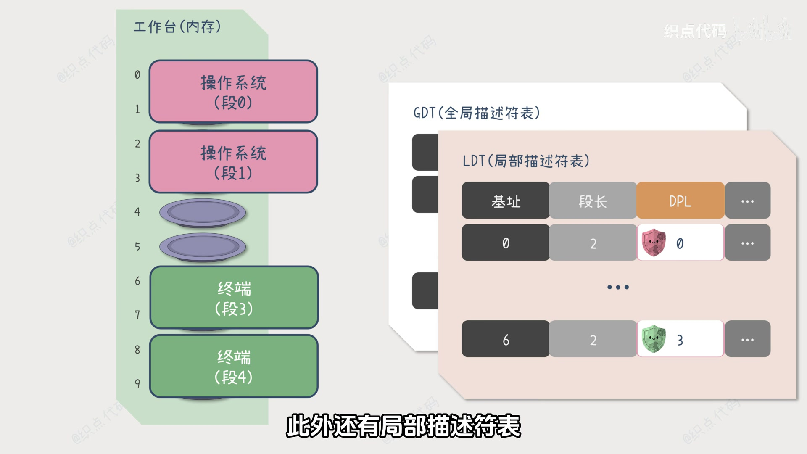

通过描述符表找到段描述信息后，就可以根据表中记录的基址地址找到内存段的实际位置。结合描述符表中的 DPL、段寄存器的 RPL 和代码段寄存器的 CPL，就可以完成上面所说的权限判断（MAX(CPL, RPL) <= DPL）。无论是 GDT 还是 LDT，都存放于内存中，它们是一种数据结构。
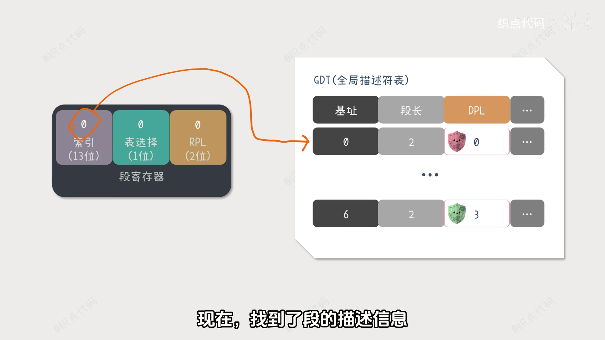

## 特权指令、中断与系统调用
[原片 @ 16:42](https://www.bilibili.com/video/BV1pDWXzaEbW?t=1002)

除了内存段的权限保护，还需要将指令进行区分，分为**特权指令**和**非特权指令**。特权指令有加载描述符表、开关中断、I/O 指令等。特权指令只允许内核态访问，如果用户态使用特权指令会触发异常。
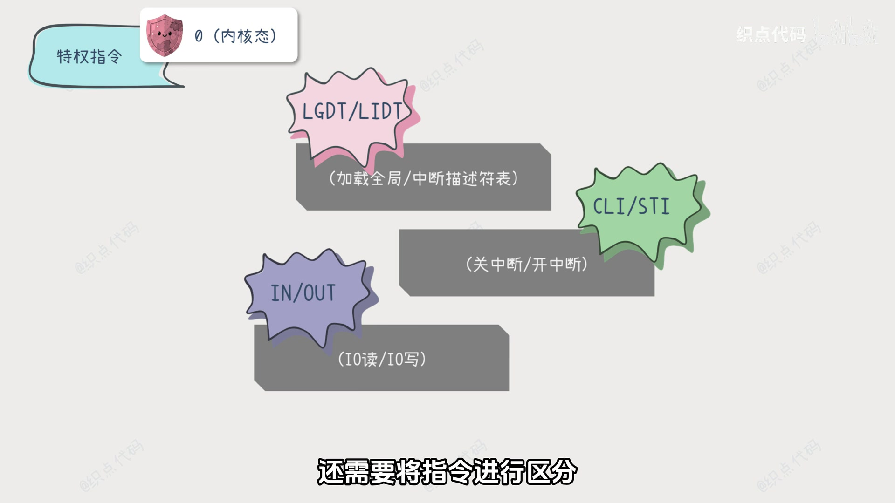

这样一来，操作系统程序就被安全地保护了起来。之后用户态想要访问被保护的资源，需要透过操作系统“代理”访问。通常采用**中断**的方式实现代理。例如用户态想要读取文件，需要发出中断指令，中断指令也有对应的描述符表，记录着中断号的 DPL。也就是说中断号也是分权限的。

**是仅发请求，内核自己执行。** 用户程序不能修改内核、不能代替内核执行任何东西。它唯一能做的是：**触发一个硬件机制，让 CPU 强制把控制权交给内核预先登记好的入口**。之后所有实际操作都是内核代码在 CPL=0 下自己完成的。

打个比方：你去银行办业务，你不能自己进金库拿钱，你只能填一张单子递给柜台，柜台里面的工作人员自己去金库操作。你“触发”了服务，但执行的是工作人员。这里的“柜台窗口”就是中断门/系统调用入口，“工作人员”就是内核。

**中断 = CPU 在执行当前指令流时，被一个事件强制打断，转去执行一段预先登记好的处理程序，处理完再回来**

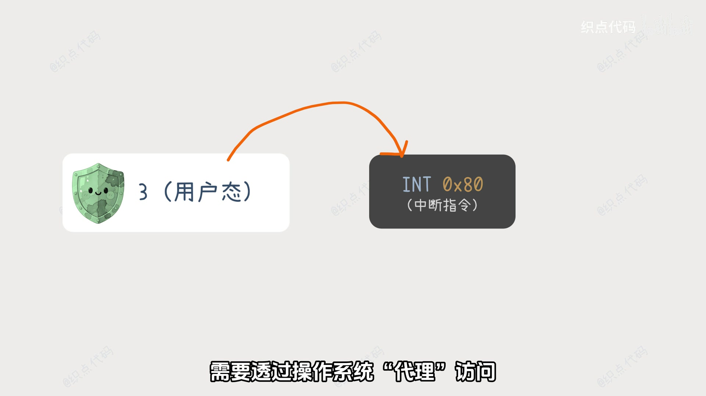

和内存段的保护类似，通过**中断描述符表**（IDT）查询 DPL，决定是否有权限发起中断。如果允许，接着要找到对应的中断程序。中断描述符表中记录着中断号对应的段选择符，通过段选择符从描述符表中找到对应段的描述信息，找到基址加上中断描述符表中的偏移量，就可以定位到中断处理程序的入口。跳转到该入口执行程序，执行后返回。这样完成用户态借操作系统之手访问被保护资源。
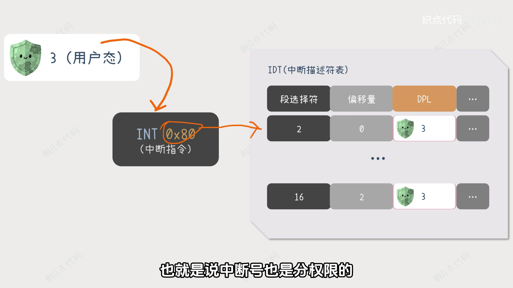

---

## AI 总结

本视频从计算机硬件的基础组成入手，通过生动的比喻详细讲解了操作系统与底层硬件的协同工作原理。首先介绍了 CPU 内部 ALU（算术逻辑单元）的数据处理机制，以及从纸带打孔到汇编语言、程序指令的执行流程（包含变量、分支、函数实现）。随后，视频以“厨房做菜”为比喻，生动再现了内存、寄存器和 CPU 的关系。接着，回顾了操作系统从手工操作、单道批处理、多道批处理到分时操作系统、实时操作系统及分布式操作系统的演进过程，解释了并发与并行的区别。最后，详细剖析了保护模式下的内存保护机制，包括特权级（CPL/RPL/DPL）、全局和局部描述符表（GDT/LDT），以及通过特权指令和中断机制实现用户态与内核态的安全隔离与“代理”访问。