> 来源链接：https://www.douyin.com/video/7694042061850381622

## 目录

- [网络数据链路层概述](#网络数据链路层概述)
- [组帧原理与技术](#组帧原理与技术)
- [物理层编码与调制](#物理层编码与调制)
- [信道容量定理](#信道容量定理)
- [网络互联设备与差错控制](#网络互联设备与差错控制)
- [可靠传输协议](#可靠传输协议)
- [介质访问控制](#介质访问控制)
- [以太网与交换机](#以太网与交换机)
- [无线局域网](#无线局域网)

## 网络数据链路层概述
[原片 @ 00:00](https://www.douyin.com/video/7694042061850381622)

本节通过“管子传声”的生动比喻，引出数据链路层的核心功能。数据链路层相当于将上层交下来的数据封装成帧，进行差错检测、流量控制以及可靠传输。

## 组帧原理与技术
[原片 @ 00:24](https://www.douyin.com/video/7694042061850381622)

在传输过程中，为了让接收方能正确识别每一段数据，需要将比特流切分成一个个“帧”。这就是组帧。组帧主要解决**帧定界**的问题（即帧从哪里开始，到哪里结束）。

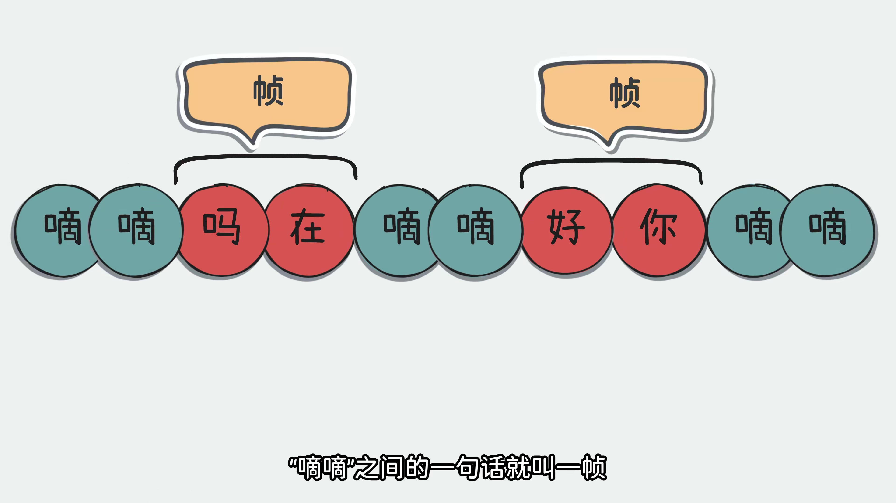

### 字符计数法
[原片 @ 02:13](https://www.douyin.com/video/7694042061850381622)
在帧的开头使用一个计数字段，标明该帧的字符数。但如果计数字段在传输中出错，会导致后续所有的帧全部解析错误，因此现在几乎不使用。
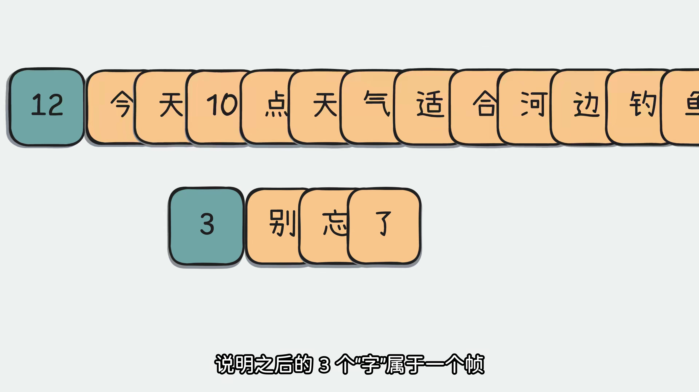

### 零比特填充法
[原片 @ 00:48](https://www.douyin.com/video/7694042061850381622)
为了保证定界符 `01111110` 不会在数据部分出现，发送方在数据中每遇到连续的 5 个 `1`，就在后面插入一个 `0`（发送 `011111` 时变成 `0111110`）。接收方收到数据后，每遇到连续的 5 个 `1`，就将后面的 `0` 去掉。
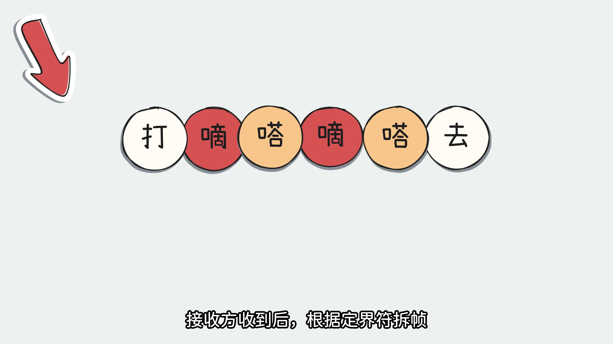
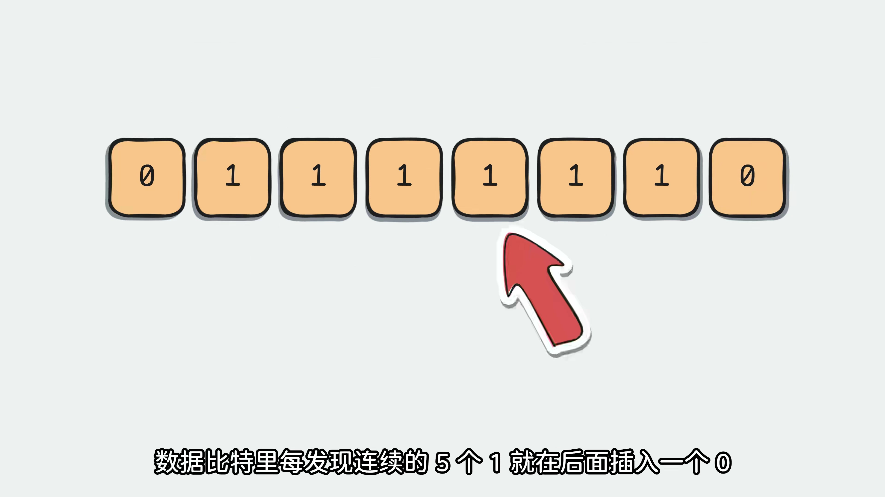
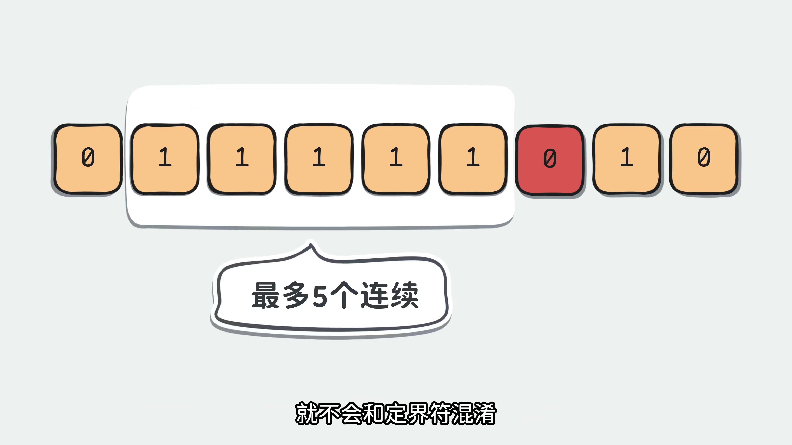

### 字符填充法
[原片 @ 01:18](https://www.douyin.com/video/7694042061850381622)
使用特定的字符作为定界符（如 `SOH` 和 `EOT`）。如果数据内部出现了定界符，则在前面插入转义字符（如 `ESC`）。接收方处理时再将其移去。典型的应用是 **PPP协议**。

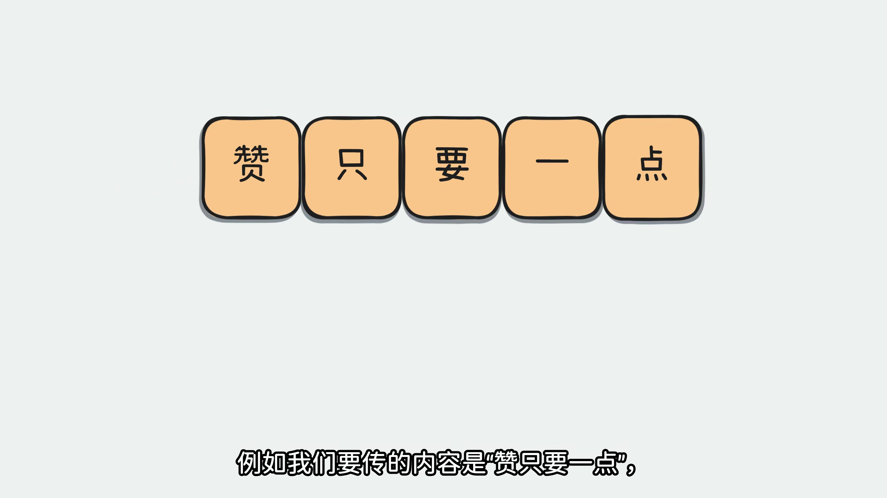

### 违规编码法
[原片 @ 02:39](https://www.douyin.com/video/7694042061850381622)
在物理层编码中，如果某种码型本身存在无效的编码组合（例如曼彻斯特编码中 `00` 或 `11` 是不允许的），可以借用这些违规的波形来作为帧的定界符。

## 物理层编码与调制
[原片 @ 02:48](https://www.douyin.com/video/7694042061850381622)

在物理层，比特流需要转换为对应的电信号或光信号传输。为了在接收端更好地提取时钟信号，采用了一系列复杂编码：
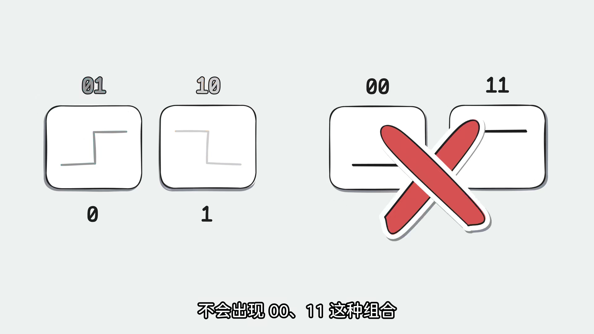

- **曼彻斯特编码**：每个比特中间都有一次电平跳变。`10` 表示 `0`，`01` 表示 `1`。编码效率为 50%（即 1B/2B 编码）。常用于 10Base-T 以太网。
- **差分曼彻斯特编码**：根据电平是否跳变来判断比特值。常用于令牌环网。
- **4B/5B 编码**：每 4 个比特用 5 个比特来表示。通过挑选有明显跳变（不含过多连续 `0`）的 5 位编码组合来表示原始数据。编码效率为 80%（1B/1.25B）。常用于 100Base-TX 以太网。
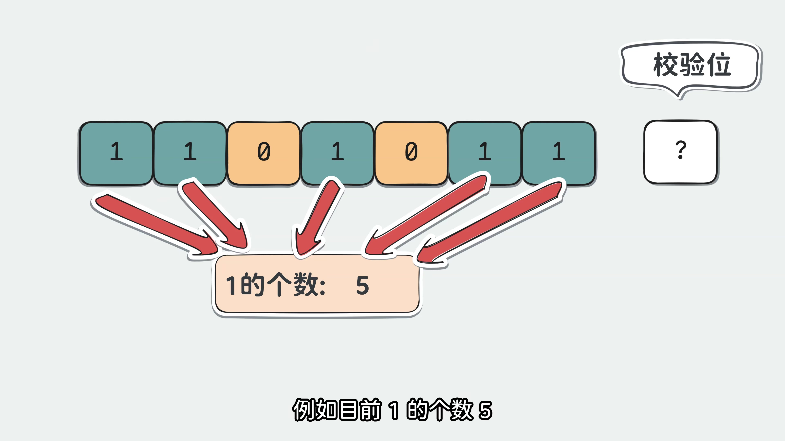
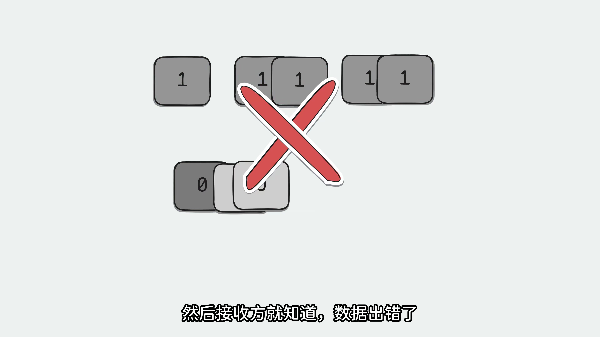
- **NRZI 编码**：非归零反转编码。遇到 `0` 不跳变，遇到 `1` 跳变，配合 4B/5B 使用。
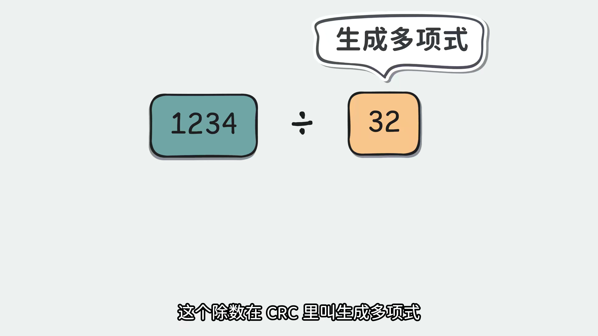

### 调制技术
[原片 @ 05:36](https://www.douyin.com/video/7694042061850381622)
为了实现将数字信号搭载到高频载波上传输：
- **ASK (幅移键控)**：有载波表示 `1`，无载波表示 `0`。
- **FSK (频移键控)**：高频表示 `1`，低频表示 `0`。
- **PSK (相移键控)**：利用载波相位的不同来表示 `0` 和 `1`。
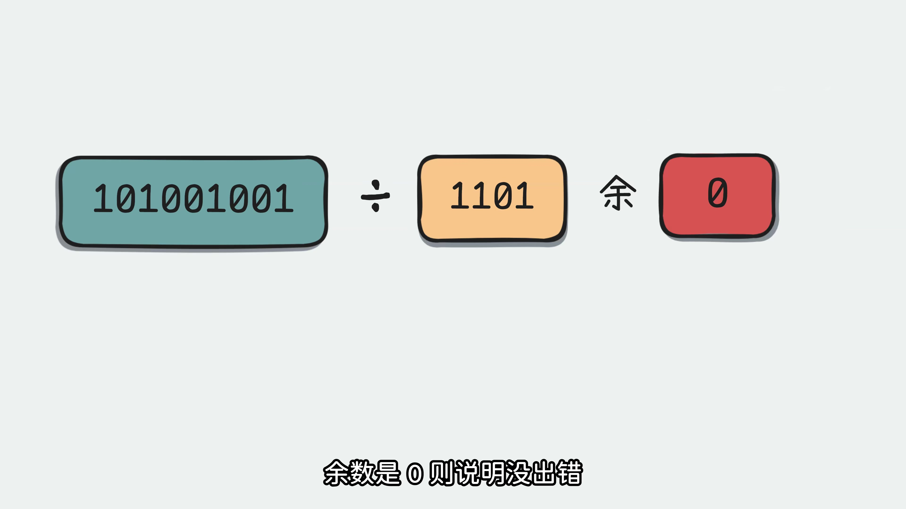
- **QAM (正交振幅调制)**：将 ASK 和 PSK 结合，即在改变幅度的同时也改变相位，可以在一个码元内携带多个比特（例如 16-QAM 一个码元携带 4 个比特）。

## 信道容量定理
[原片 @ 08:24](https://www.douyin.com/video/7694042061850381622)

- **奈奎斯特定理（无噪声理想信道极限）**：
  $$
  C(\max) = 2W \times \log_2V \text{ (b/s)}
  $$
  其中 \(W\) 为带宽，\(V\) 为码元的离散电平数目（状态数）。
  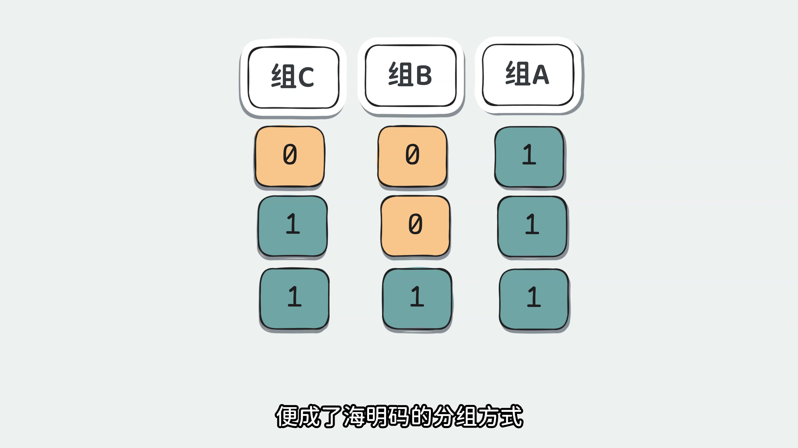
- **香农定理（有噪声实际信道极限）**：
  $$
  C = W \times \log_2(1 + S/N) \text{ (b/s)}
  $$
  其中 \(S/N\) 为信噪比。
  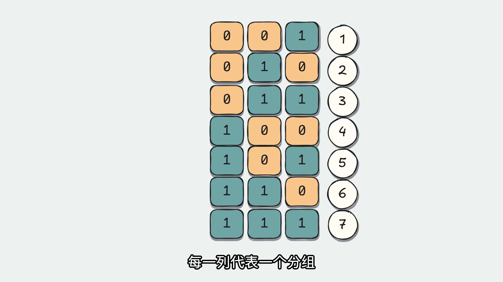

## 网络互联设备与差错控制
[原片 @ 08:48](https://www.douyin.com/video/7694042061850381622)

### 物理层设备
- **中继器 (Repeater)**：对衰减的信号进行再生和放大，延长传输距离，相当于一条不会衰减的导线。
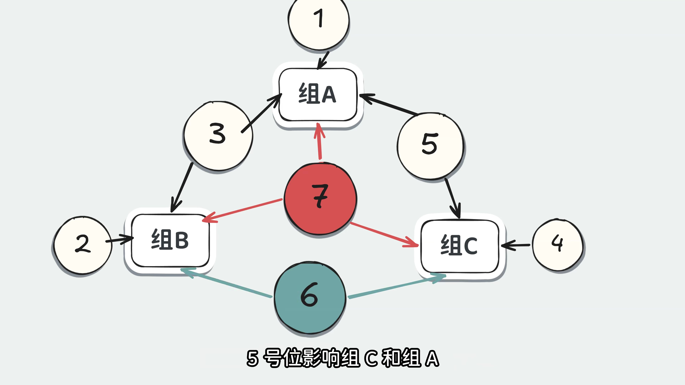
- **集线器 (Hub)**：多端口的中继器，所有端口同属一个冲突域和广播域。
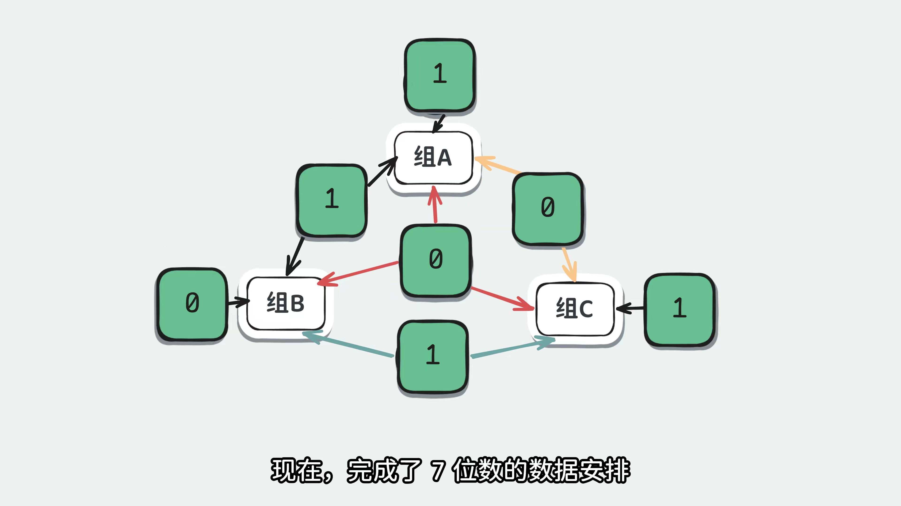

### 差错控制 (纠错与检错)
[原片 @ 09:54](https://www.douyin.com/video/7694042061850381622)
- **奇偶校验码**：增加一位校验位，使得 `1` 的个数凑成奇数或偶数。只能检测奇数个比特错误，无法纠错。
- **CRC (循环冗余校验)**：利用模二除法（XOR 运算），计算出余数附加在数据后。接收端如果计算余数不为 0 则说明出错。CRC 检错能力强，但不能纠错。
- **海明码 (Hamming Code)**：将数据位按 2 的幂次划分为多个组（如组 A、组 B、组 C），进行多重奇偶校验。通过多个错误校验组的交集，不仅能检测出错，还能精确定位并纠正出错的比特位。
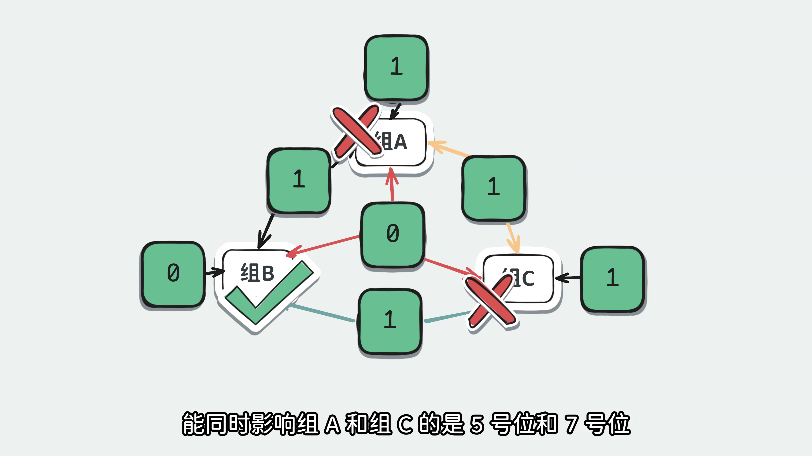
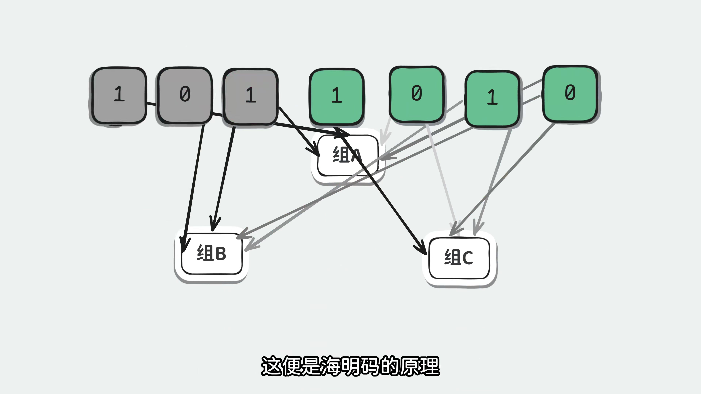

## 可靠传输协议
[原片 @ 10:10](https://www.douyin.com/video/7694042061850381622)

为了让接收方按其处理能力接收数据，并应对数据丢失和出错，采用了以下协议：

### 停止-等待协议 (Stop-and-Wait ARQ)
[原片 @ 10:18](https://www.douyin.com/video/7694042061850381622)
发送方发送一帧后必须等待接收方回复 ACK，才能发送下一帧。为了解决 ACK 丢失导致重复发送的问题，引入了 **帧序号 (0 和 1)**。信道利用率较低：
$$
U = \frac{T_D}{T_D + RTT + T_A}
$$

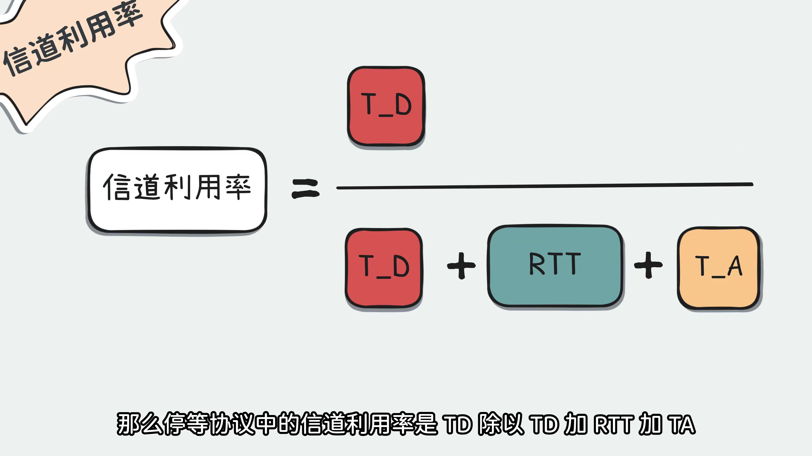

### 滑动窗口协议
[原片 @ 12:20](https://www.douyin.com/video/7694042061850381622)
为了提高信道利用率，允许发送方在未收到确认的情况下连续发送多个帧。每收到一个 ACK，窗口就向前滑动一格。
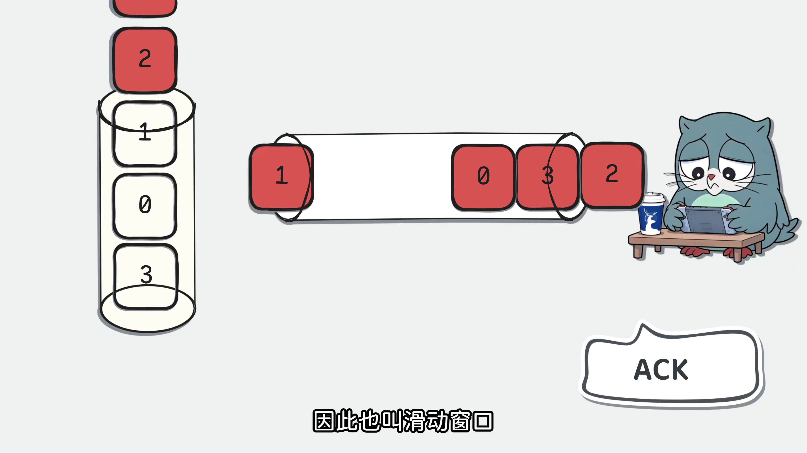
- **后退 N 帧协议 (GBN)**：接收方只按序接收。如果某一帧丢失，后续送到的帧也会被迫丢弃，发送方超时后需要重发该帧及其之后的所有帧。

- **选择重传协议 (SR)**：接收方设置缓存，对乱序到达的帧进行缓存。当缺失的帧到达后，将有序的整组帧上交。发送方只重发出错或丢失的具体帧。
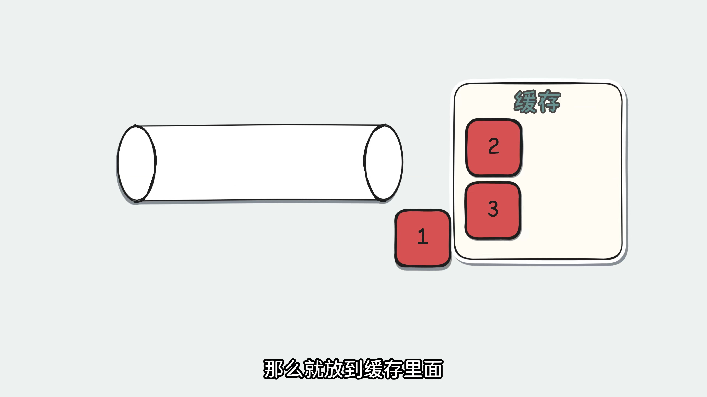

## 介质访问控制
[原片 @ 14:24](https://www.douyin.com/video/7694042061850381622)

当多台设备共享信道时，需要通过介质访问控制来解决冲突。

### 信道划分协议
[原片 @ 14:36](https://www.douyin.com/video/7694042061850381622)
- **频分复用 (FDM)**：不同的人用不同的频率。
- **时分复用 (TDM)**：不同的人占用不同的时间片，即使轮空其他站点也不能用。
- **统计时分复用 (Statistic TDM)**：动态分配时间片，提高利用率。
- **波分复用 (WDM)**：波长的频分复用，用于光纤。
- **码分复用 (CDM)**：利用正交向量（码片序列）的内积，在同一时间、同一频段传输，通过数学计算分离出各个用户的信号。

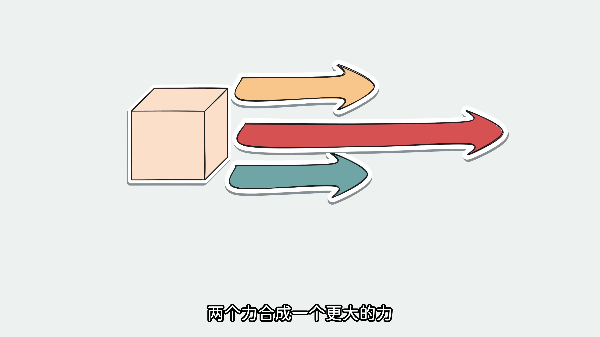

### 随机访问协议
[原片 @ 17:30](https://www.douyin.com/video/7694042061850381622)
- **ALOHA 协议**：想发就发，没收到 ACK 就随机重发。
- **时隙 ALOHA**：只能在规定的时间起点发送，减少冲突。
- **CSMA (载波监听多路访问)**：先听后发。

- **CSMA/CD (载波监听多路访问/冲突检测)**：用于有线以太网。**边听边发**，发现冲突立即停止发送，并发送干扰信号 (JAM)，然后通过**二进制指数退避算法**进行重发。为了保证冲突能被发现，以太网规定了最短帧长为 **64 字节**。

- **CSMA/CA (载波监听多路访问/冲突避免)**：用于无线局域网。因为无线信号功率差距大，无法实现冲突检测，因此采用**预约机制**。通过 RTS/CTS 报文提前预约信道，解决隐蔽站问题。
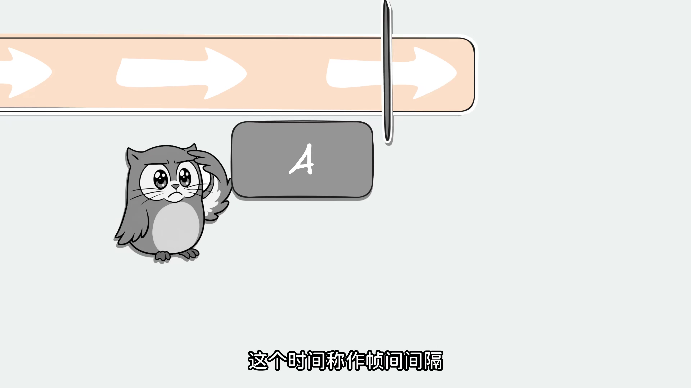
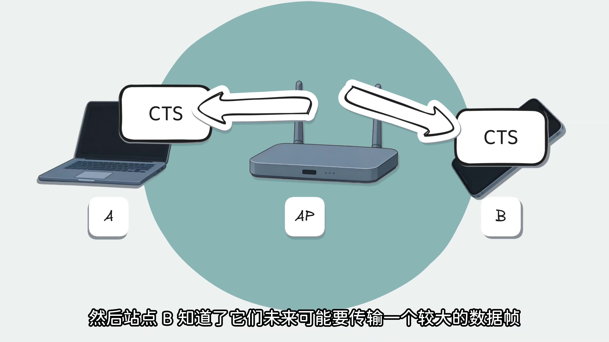

### 轮询访问协议
[原片 @ 24:24](https://www.douyin.com/video/7694042061850381622)
- **令牌环 (Token Ring)**：站点组成环状，数据单方向传递。通过一个特殊的“令牌帧”来控制发送权。只有拿到空令牌的站点才能发送数据。

## 以太网与交换机
[原片 @ 25:48](https://www.douyin.com/video/7694042061850381622)

IEEE 802 委员会定义了局域网标准。其中 802.3 是以太网，802.5 是令牌环。以太网凭借 CSMA/CD 和后续的交换机技术胜出。
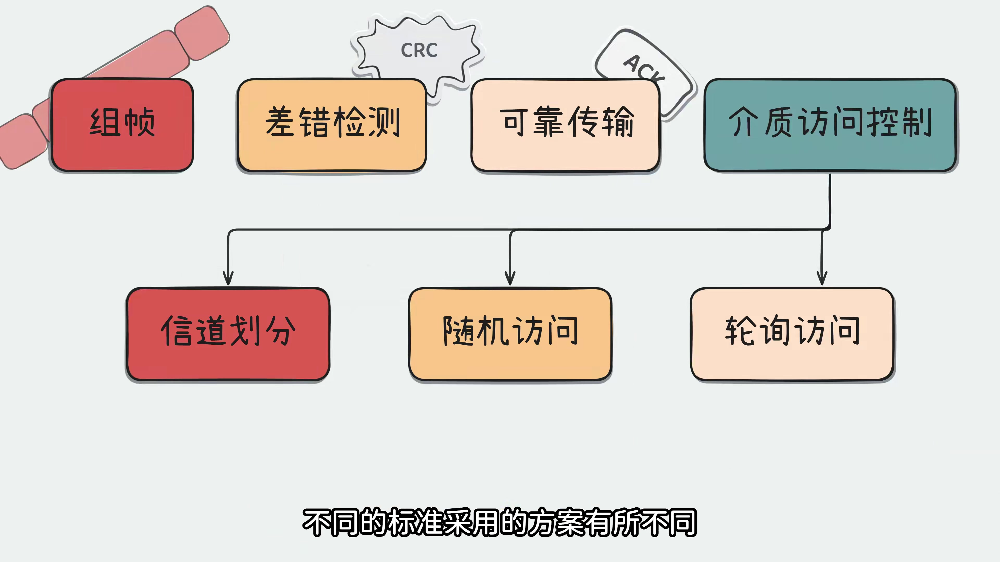

### 以太网帧结构
[原片 @ 26:24](https://www.douyin.com/video/7694042061850381622)
- 目的地址 (6B)
- 源地址 (6B)
- 类型 (2B)
- 数据 (46~1500B)
- 校验位 FCS (4B)
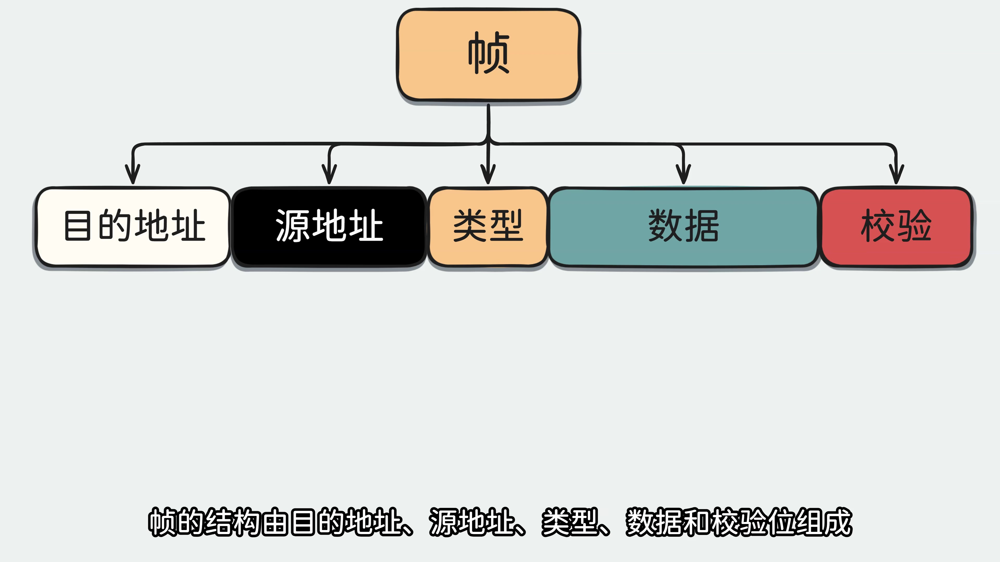
- **MAC 地址**：全球唯一，前 3 字节是厂商编号，后 3 字节是厂商自行分配。第一字节的最低位区分单播或广播。
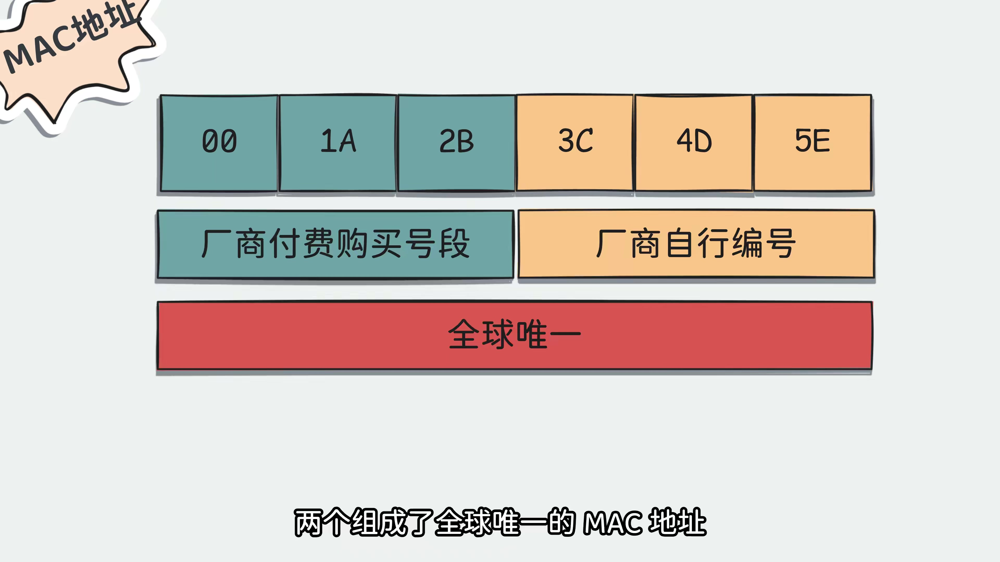

### 交换机 (Switch)
[原片 @ 27:30](https://www.douyin.com/video/7694042061850381622)
交换机将冲突域隔离开。它内部维护一个 **MAC 地址-端口映射表**。通过记录数据帧的源 MAC 地址学习端口，通过目的 MAC 地址进行精确转发。如果找不到目标地址，则向所有端口泛洪。
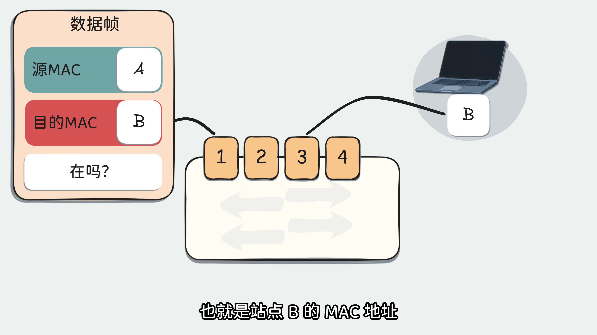
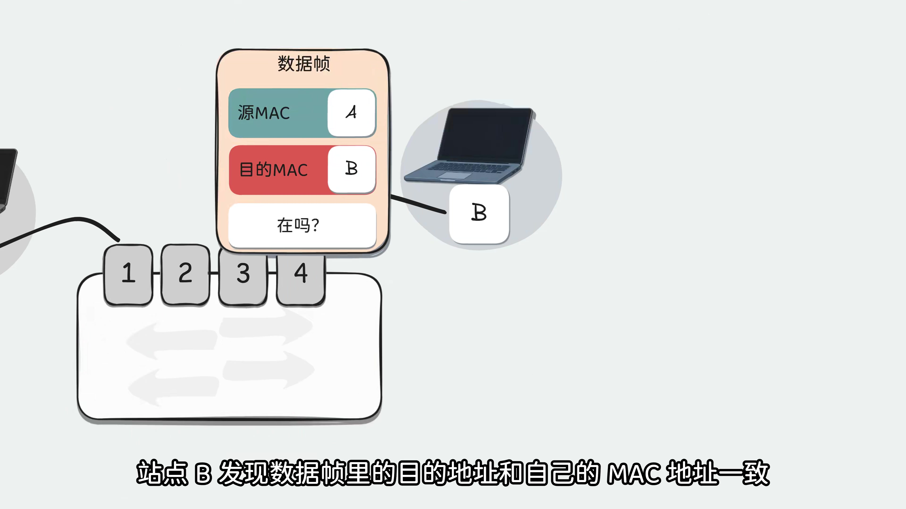

### VLAN (虚拟局域网)
[原片 @ 28:54](https://www.douyin.com/video/7694042061850381622)
通过逻辑分组，在物理交换机上划分出不同的广播域。通过 **Trunk 端口** 打上 VLAN 标签，实现跨交换机的 VLAN 通信。

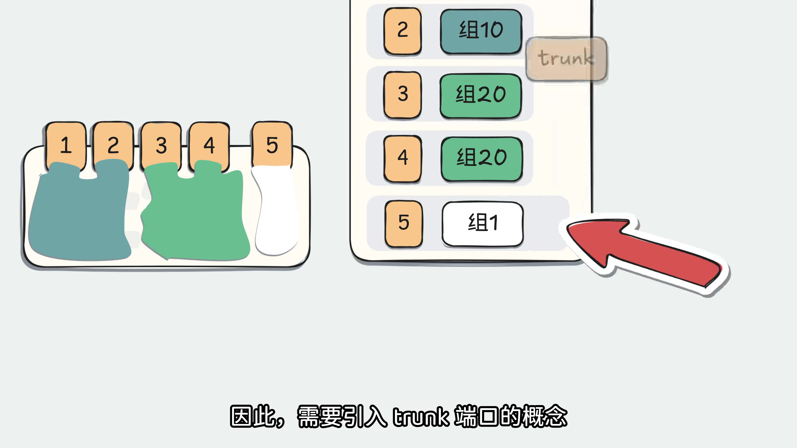

## 无线局域网
[原片 @ 30:12](https://www.douyin.com/video/7694042061850381622)

WLAN 采用 802.11 标准（如 Wi-Fi）。
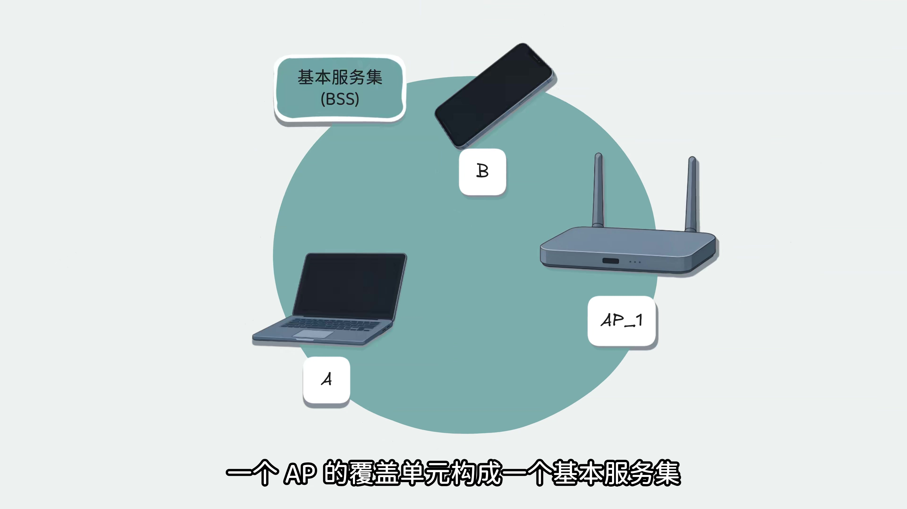

### 802.11 帧结构
[原片 @ 30:24](https://www.douyin.com/video/7694042061850381622)
由于无线局域网需要经过 AP 转发，框架结构最多包含 **4 个地址**：
1. 接收端地址
2. 发送端地址
3. **目的 MAC 地址 (DA)**（最终接收者）
4. **源 MAC 地址 (SA)**（最终发送者）
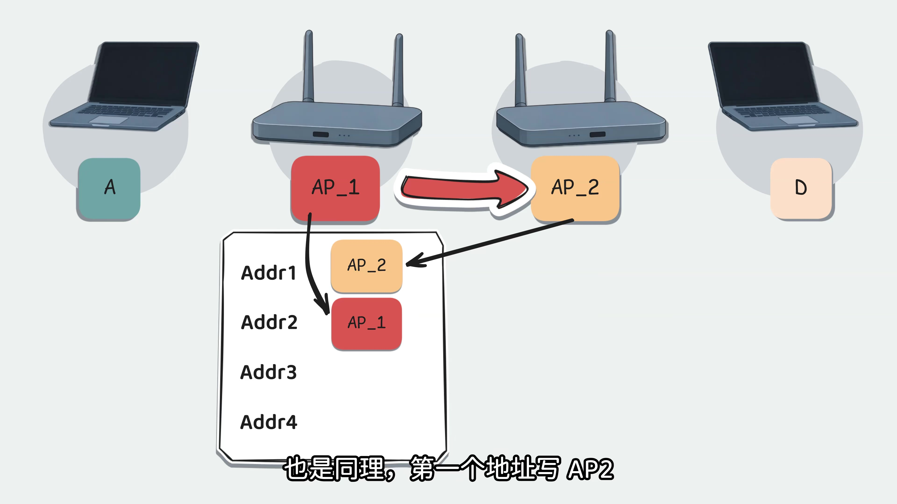
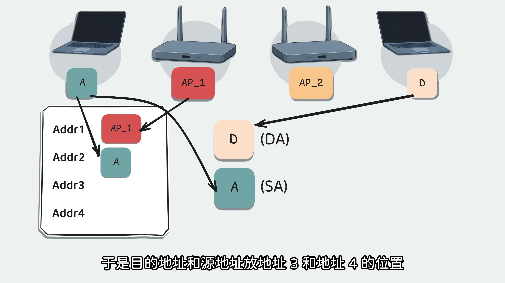

为了指示数据帧的方向，引入了两个控制字段：
- **To DS**：表示发送给分布式系统（给其他 AP）。
- **From DS**：表示由分布式系统发出（给终端）。
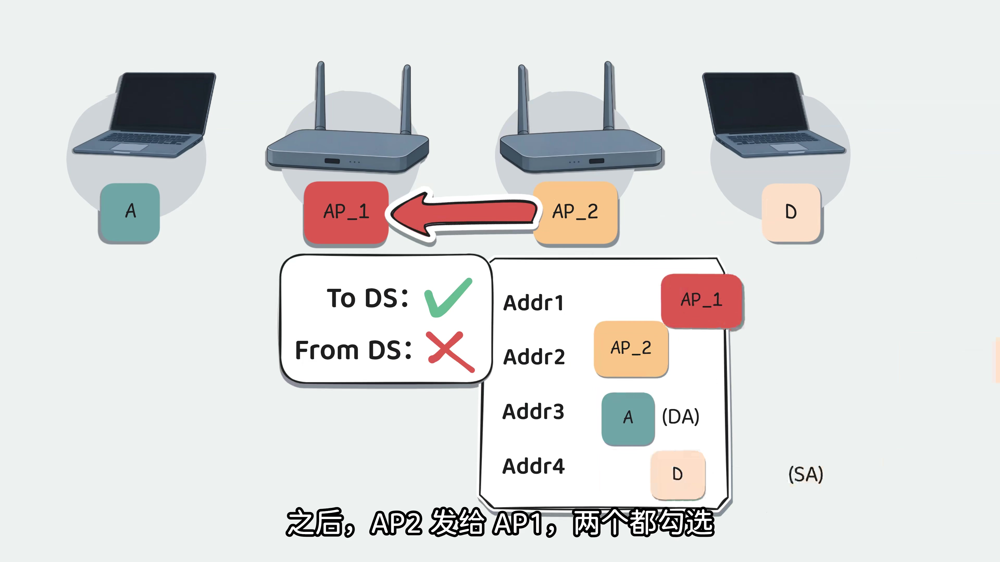

通过这四个地址和两个方向字段，可以完美解决无线网络的多跳和漫游问题。
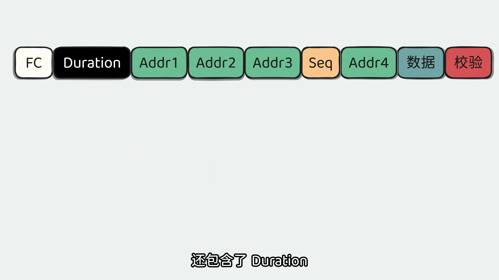

## AI 总结

本视频作为计算机网络数据链路层的“透视版”，以生动形象的比喻和详尽的图示，拆解了底层通信的奥秘。从最基础的组帧、差错检测与纠错（CRC、海明码），到保障数据安全送达的可靠传输协议（停止等待、GBN、SR），再到多设备共享信道时的介质访问控制（CSMA/CD、CSMA/CA），以及以太网的帧结构、交换机与 VLAN 机制，最后延伸至无线局域网的 802.11 帧结构。整个视频涵盖了数据链路层核心概念的底层逻辑，为后续学习网络层（IP、路由）打下了坚实基础。