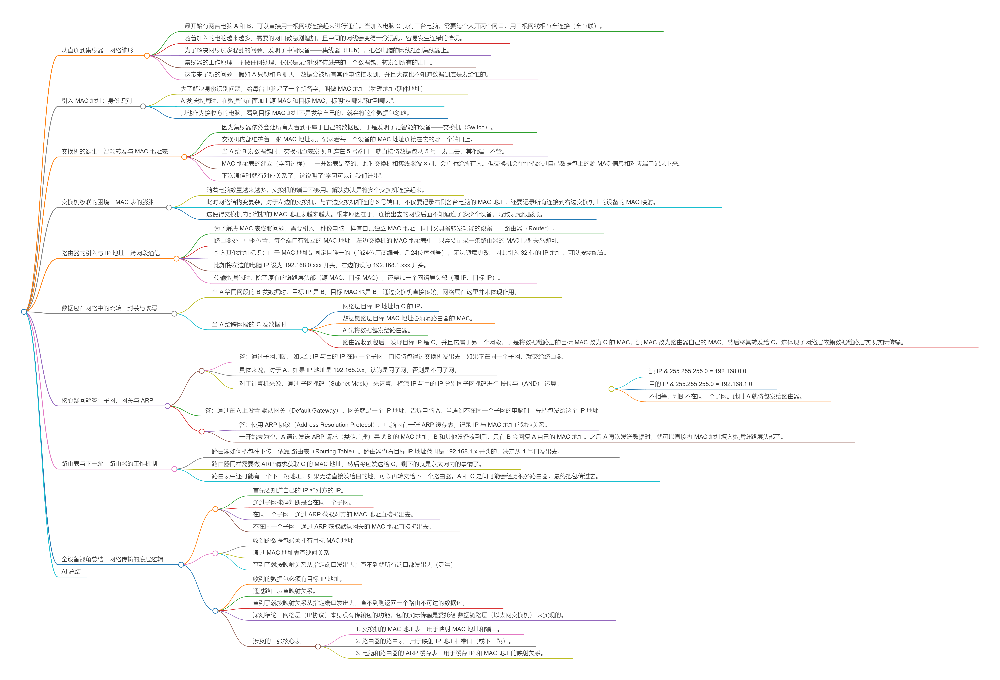

> 来源链接：https://www.bilibili.com/video/BV1tseyzCEoF

**目录**
- [从直连到集线器：网络雏形](#从直连到集线器网络雏形)
- [引入 MAC 地址：身份识别](#引入mac地址身份识别)
- [交换机的诞生：智能转发与 MAC 地址表](#交换机的诞生智能转发与mac地址表)
- [交换机级联的困境：MAC 表的膨胀](#交换机级联的困境mac表的膨胀)
- [路由器的引入与 IP 地址：跨网段通信](#路由器的引入与ip地址跨网段通信)
- [数据包在网络中的流转：封装与改写](#数据包在网络中的流转封装与改写)
- [核心疑问解答：子网、网关与 ARP](#核心疑问解答子网网关与arp)
- [路由表与下一跳：路由器的工作机制](#路由表与下一跳路由器的工作机制)
- [全设备视角总结：网络传输的底层逻辑](#全设备视角总结网络传输的底层逻辑)

## 从直连到集线器：网络雏形

[原片 @ 00:00](https://www.bilibili.com/video/BV1tseyzCEoF?p=1&t=0)

- 最开始有两台电脑 A 和 B，可以直接用一根网线连接起来进行通信。当加入电脑 C 就有三台电脑，需要每个人开两个网口，用三根网线相互全连接（全互联）。
- 随着加入的电脑越来越多，需要的网口数急剧增加，且中间的网线会变得十分混乱，容易发生连错的情况。
- 为了解决网线过多混乱的问题，发明了中间设备——**集线器（Hub）**，把各电脑的网线插到集线器上。
- 集线器的工作原理：不做任何处理，仅仅是无脑地将传进来的一个数据包，**转发到所有的出口**。
  
- 这带来了新的问题：假如 A 只想和 B 聊天，数据会被所有其他电脑接收到，并且大家也不知道数据到底是发给谁的。

## 引入 MAC 地址：身份识别
[原片 @ 00:48](https://www.bilibili.com/video/BV1tseyzCEoF?p=1&t=48)

- 为了解决身份识别问题，给每台电脑起了一个新名字，叫做 **MAC 地址（物理地址/硬件地址）**。
- A 发送数据时，在数据包前面加上源 MAC 和目标 MAC，标明“从哪来”和“到哪去”。
- 其他作为接收方的电脑，看到目标 MAC 地址不是发给自己的，就会将这个数据包**忽略**。
  

## 交换机的诞生：智能转发与 MAC 地址表
[原片 @ 01:18](https://www.bilibili.com/video/BV1tseyzCEoF?p=1&t=78)

- 因为集线器依然会让所有人看到不属于自己的数据包，于是发明了更智能的设备——**交换机（Switch）**。
- 交换机内部维护着一张 **MAC 地址表**，记录着每一个设备的 MAC 地址连接在它的哪一个端口上。
  
- 当 A 给 B 发数据包时，交换机查表发现 B 连在 5 号端口，就直接将数据包从 5 号口发出去，其他端口不管。
- **MAC 地址表的建立（学习过程）**：一开始表是空的，此时交换机和集线器没区别，会广播给所有人。但交换机会偷偷把经过自己数据包上的源 MAC 信息和对应端口记录下来。
  
- 下次通信时就有对应关系了，这说明了“学习可以让我们进步”。

## 交换机级联的困境：MAC 表的膨胀
[原片 @ 02:15](https://www.bilibili.com/video/BV1tseyzCEoF?p=1&t=135)

- 随着电脑数量越来越多，交换机的端口不够用。解决办法是将多个交换机连接起来。
- 此时网络结构变复杂。对于左边的交换机，与右边交换机相连的 6 号端口，不仅要记录右侧各台电脑的 MAC 地址，还要记录所有连接到右边交换机上的设备的 MAC 映射。
  
- 这使得交换机内部维护的 MAC 地址表越来越大。根本原因在于，连接出去的网线后面不知道连了多少个设备，导致表无限膨胀。

## 路由器的引入与 IP 地址：跨网段通信
[原片 @ 03:07](https://www.bilibili.com/video/BV1tseyzCEoF?p=1&t=187)

- 为了解决 MAC 表膨胀问题，需要引入一种像电脑一样有自己独立 MAC 地址，同时又具备转发功能的设备——**路由器（Router）**。
- 路由器处于中枢位置，每个端口有独立的 MAC 地址。左边交换机的 MAC 地址表中，只需要记录一条路由器的 MAC 映射关系即可。
- **引入其他地址标识**：由于 MAC 地址是固定且唯一的（前24位厂商编号，后24位序列号），无法随意更改。因此引入 32 位的 **IP 地址**，可以按需配置。
  
- 比如将左边的电脑 IP 设为 `192.168.0.xxx` 开头，右边的设为 `192.168.1.xxx` 开头。
- 传输数据包时，除了原有的链路层头部（源 MAC、目标 MAC），还要加一个**网络层头部**（源 IP、目标 IP）。
  

## 数据包在网络中的流转：封装与改写
[原片 @ 05:30](https://www.bilibili.com/video/BV1tseyzCEoF?p=1&t=330)

- 当 A 给同网段的 B 发数据时：目标 IP 是 B，目标 MAC 也是 B，通过交换机直接传输，网络层在这里并未体现作用。
- 当 A 给跨网段的 C 发数据时：
  
  - 网络层目标 IP 地址填 C 的 IP。
  - 数据链路层目标 MAC 地址必须填**路由器**的 MAC。
  - A 先将数据包发给路由器。
  - 路由器收到包后，发现目标 IP 是 C，并且它属于另一个网段，于是将数据链路层的目标 MAC 改为 C 的 MAC，源 MAC 改为路由器自己的 MAC，然后将其转发给 C。这体现了网络层依赖数据链路层实现实际传输。

## 核心疑问解答：子网、网关与 ARP
[原片 @ 06:24](https://www.bilibili.com/video/BV1tseyzCEoF?p=1&t=384)

**问题一：A 怎么判断是否需要通过路由器转发？**
- 答：通过**子网**判断。如果源 IP 与目的 IP 在同一个子网，直接将包通过交换机发出去。如果不在同一个子网，就交给路由器。
  
- 具体来说，对于 A，如果 IP 地址是 `192.168.0.x`，认为是同子网，否则是不同子网。
- 对于计算机来说，通过 **子网掩码（Subnet Mask）** 来运算。将源 IP 与目的 IP 分别同子网掩码进行 **按位与（AND）** 运算。
  
  - `源 IP & 255.255.255.0` = `192.168.0.0`
  - `目的 IP & 255.255.255.0` = `192.168.1.0`
  - 不相等，判断不在同一个子网。此时 A 就将包发给路由器。

**问题二：A 怎么知道哪个设备是路由器？**

- 答：通过在 A 上设置 **默认网关（Default Gateway）**。网关就是一个 IP 地址，告诉电脑 A，当遇到不在同一个子网的电脑时，先把包发给这个 IP 地址。

**问题三：我怎么知道路由器的 MAC 地址呢？**

- 答：使用 **ARP 协议（Address Resolution Protocol）**。电脑内有一张 **ARP 缓存表**，记录 IP 与 MAC 地址的对应关系。
  
- 一开始表为空，A 通过发送 ARP 请求（类似广播）寻找 B 的 MAC 地址，B 和其他设备收到后，只有 B 会回复 A 自己的 MAC 地址。之后 A 再次发送数据时，就可以直接将 MAC 地址填入数据链路层头部了。
  

## 路由表与下一跳：路由器的工作机制
[原片 @ 09:54](https://www.bilibili.com/video/BV1tseyzCEoF?p=1&t=594)

- 路由器如何把包往下传？依靠 **路由表（Routing Table）**。路由器查看目标 IP 地址范围是 `192.168.1.x` 开头的，决定从 1 号口发出去。
- 路由器同样需要做 ARP 请求获取 C 的 MAC 地址，然后将包发送给 C，剩下的就是以太网内的事情了。
  
- 路由表中还可能有一个**下一跳地址**，如果无法直接发给目的地，可以再转交给下一个路由器。A 和 C 之间可能会经历很多路由器，最终把包传过去。

## 全设备视角总结：网络传输的底层逻辑
[原片 @ 10:30](https://www.bilibili.com/video/BV1tseyzCEoF?p=1&t=630)

**电脑视角**：
- 首先要知道自己的 IP 和对方的 IP。
- 通过子网掩码判断是否在同一个子网。
- 在同一个子网，通过 ARP 获取对方的 MAC 地址直接扔出去。
- 不在同一个子网，通过 ARP 获取默认网关的 MAC 地址直接扔出去。

**交换机视角**：
- 收到的数据包必须拥有目标 MAC 地址。
- 通过 MAC 地址表查映射关系。
- 查到了就按映射关系从指定端口发出去；查不到就所有端口都发出去（泛洪）。

**路由器视角**：
- 收到的数据包必须有目标 IP 地址。
- 通过路由表查映射关系。
- 查到了就按映射关系从指定端口发出去；查不到则返回一个路由不可达的数据包。

- 深刻结论：**网络层（IP协议）本身没有传输包的功能**，包的实际传输是委托给 **数据链路层（以太网交换机）** 来实现的。

- 涉及的三张核心表：
  1. **交换机的 MAC 地址表**：用于映射 MAC 地址和端口。
  2. **路由器的路由表**：用于映射 IP 地址和端口（或下一跳）。
  3. **电脑和路由器的 ARP 缓存表**：用于缓存 IP 和 MAC 地址的映射关系。

## AI 总结
该视频以通俗易懂的动画和白话，推演了数据包从两台电脑直连，到集线器、交换机、再到路由器的网络拓扑演进史。深入浅出地解释了 MAC 地址、IP 地址、子网掩码、默认网关、ARP 协议和路由表等核心概念。最终揭示了网络通信的本质逻辑：**网络层（IP）负责全局路由指引，而实际的数据搬运工作是由数据链路层（交换机）完成的**，这三张核心表（MAC 表、路由表、ARP 表）共同撑起了庞大的互联网传输体系。