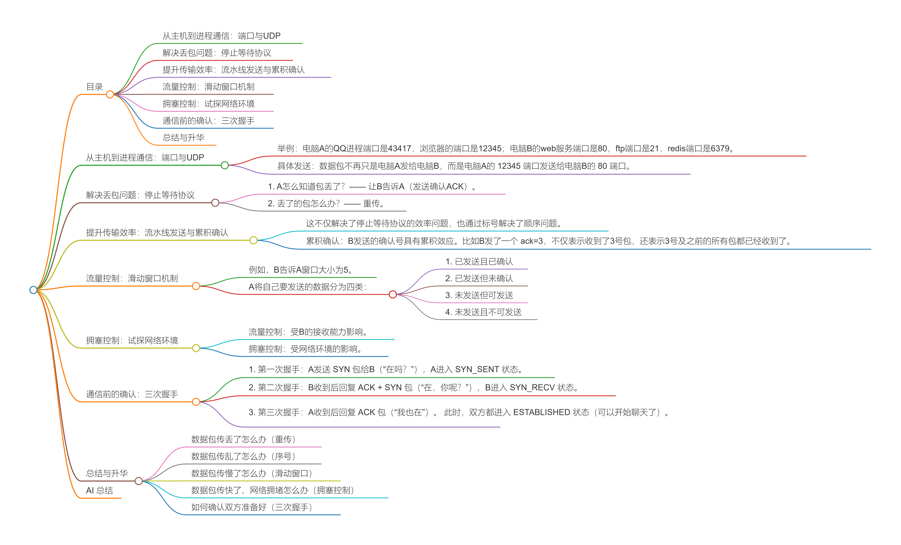
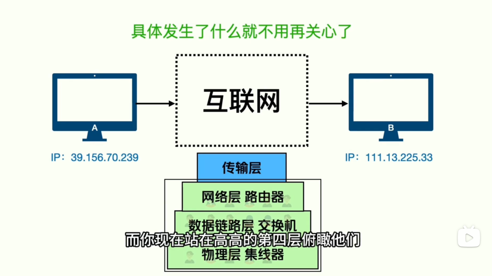
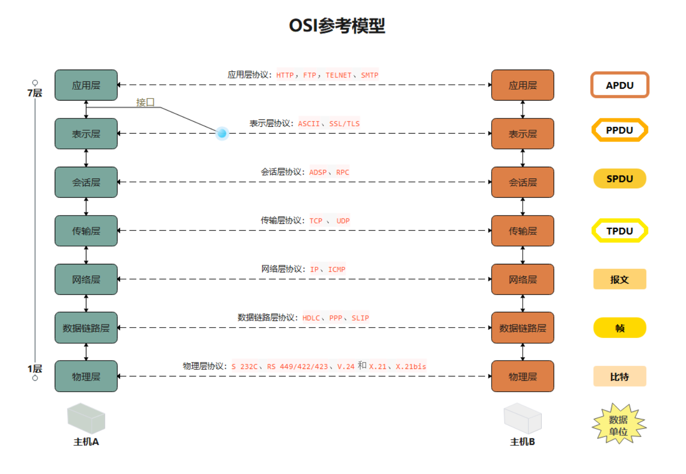

> 来源链接：https://www.bilibili.com/video/BV1tseyzCEoF?p=2

## 目录

- [从主机到进程通信：端口与UDP](#从主机到进程通信端口与udp)
- [解决丢包问题：停止等待协议](#解决丢包问题停止等待协议)
- [提升传输效率：流水线发送与累积确认](#提升传输效率流水线发送与累积确认)
- [流量控制：滑动窗口机制](#流量控制滑动窗口机制)
- [拥塞控制：试探网络环境](#拥塞控制试探网络环境)
- [通信前的确认：三次握手](#通信前的确认三次握手)
- [总结与升华](#总结与升华)

## 从主机到进程通信：端口与UDP

[原片 @ 00:00](https://www.bilibili.com/video/BV1tseyzCEoF?p=2&t=0)

在前面的内容中，我们构建了由物理层、数据链路层、网络层组成的网络环境（前三层）。现在你只需要知道对方B的IP地址，就可以把数据包发给对方，至于具体怎么找到的不用操心。

你可以把前三层想象成教室里帮你传递纸条的同学，他们一定可以把纸条从A传到B，对于站在第四层（传输层）的你来说，他们就是为你服务的。

但前三层协议只能把数据包从一个电脑搬到另一台电脑，这只是“主机到主机”的通信。实际上电脑里有很多程序（进程），数据包具体发给哪个程序并没有说明。

为了解决这个问题，我们需要给每个进程分配一个数字编号，即**端口号（Port）**。
*   **举例**：电脑A的QQ进程端口是43417，浏览器的端口是12345；电脑B的web服务端口是80，ftp端口是21，redis端口是6379。
*   **具体发送**：数据包不再只是电脑A发给电脑B，而是电脑A的 `12345` 端口发送给电脑B的 `80` 端口。

此时，我们需要在原有的前三层（数据链路层头部、网络层头部）的基础上，再加一个**传输层头部**，写上源端口号和目标端口号。

就这么一步，你将原本主机到主机的通信，升级为了进程到进程的通信。你不知不觉中已经实现了 **UDP协议**。此时你和B就可以在UDP协议下无忧无虑地聊天了。

## 解决丢包问题：停止等待协议
[原片 @ 01:30](https://www.bilibili.com/video/BV1tseyzCEoF?p=2&t=90)

但由于网络环境的不可靠，数据包可能在半路丢失，而A和B却无法察觉，就像传纸条中间被坏同学没收了一样。

解决这个问题只需要搞定两件事：
1.  A怎么知道包丢了？—— **让B告诉A（发送确认ACK）**。
2.  丢了的包怎么办？—— **重传**。

于是你设计了如下方案：A每发一个包，都必须收到来自B的确认ACK，再发下一个。如果一定时间内没有收到确认，就重传这个包。这被称为**停止等待协议**。虽然A无法保证B一定能收到，但能确认B是否收到，尽最大努力让通信变得可靠，实现了**可靠交付**。

## 提升传输效率：流水线发送与累积确认
[原片 @ 02:33](https://www.bilibili.com/video/BV1tseyzCEoF?p=2&t=153)

停止等待协议虽然能解决问题，但效率太低：B必须等数据包到达B，且B的确认包又回到A，A才可以继续发第二个包。

为了改进，我们采用了**流水线**的方式，不再傻傻地等，而是一连串地发送。

但这也引来了新问题：数据包走不同的路由到达B，无法保证和发送时的顺序一致（乱序）。

聪明的你想到了解决办法：在发送的数据包中增加一个**序号（seq）**，同时B在响应的确认包（ack）上也增加一个确认号。
*   这不仅解决了停止等待协议的效率问题，也通过标号解决了顺序问题。
*   **累积确认**：B发送的确认号具有累积效应。比如B发了一个 `ack=3`，不仅表示收到了3号包，还表示3号及之前的所有包都已经收到了。

## 流量控制：滑动窗口机制
[原片 @ 03:36](https://www.bilibili.com/video/BV1tseyzCEoF?p=2&t=216)

有时候A发送数据包的速度太快，而B的接收能力不够，但B没有告知A。

解决办法是让B告诉A自己的接收能力。B在每次发送数据包给A时，顺带传来一个值叫**窗口大小（Window Size）**，A根据这个值控制自己的发送速度。
*   例如，B告诉A窗口大小为5。
*   A将自己要发送的数据分为四类：
    1.  已发送且已确认
    2.  已发送但未确认
    3.  未发送但可发送
    4.  未发送且不可发送

A不断发送数据包时，已发送的最后一个序号向右移动，直到碰上窗口的上边界，此时A就无法继续发包，达到了**流量控制**。

同时，A也会收到来自B的确认包，整个窗口就会往后移动，上边界往右移，A就能发更多的数据包了。如果A收到了新的窗口大小值（比如从5变成6或4），A也会随之动态调整窗口边界。这种机制被称为**滑动窗口（Sliding Window）**。

## 拥塞控制：试探网络环境
[原片 @ 05:36](https://www.bilibili.com/video/BV1tseyzCEoF?p=2&t=336)

有时候不是B的接收能力不够，而是网络本身不太好，造成了**网络拥塞**。
*   **流量控制**：受B的接收能力影响。
*   **拥塞控制**：受网络环境的影响。

网络环境不可能主动告诉A它好不好，只能由A单方面通过不断试探来感知，进而确定自己的**拥塞窗口（cwnd）**大小。具体怎么做呢？比如先发一个，再发两个，再发三个试试，一点点试探网络极限。

最终，通信窗口的大小，需要取两者（拥塞窗口和滑动窗口）的最小值：
`win = min(cwnd, rwnd)`

## 通信前的确认：三次握手
[原片 @ 06:48](https://www.bilibili.com/video/BV1tseyzCEoF?p=2&t=408)

有时候B还没有准备好（比如挂掉了或者在睡觉），A就开始发送数据包，导致了一定程度的浪费。

这就好比你打电话，还没确认对方有没有在听，就巴拉巴拉说了一大堆。问题的关键在于A在通信前没有先确认B是否准备好了。这就引出了程序员的噩梦——**三次握手**。

三次握手的过程：
1.  **第一次握手**：A发送 `SYN` 包给B（“在吗？能收到我的信息吗？”），A进入 `SYN_SENT` 状态。
2.  **第二次握手**：B收到后回复 `ACK + SYN` 包（“在，你呢？”），B进入 `SYN_RECV` 状态。
3.  **第三次握手**：A收到后回复 `ACK` 包（“我也在”）。
此时，双方都进入 `ESTABLISHED` 状态（可以开始聊天了）。

## 总结与升华
[原片 @ 07:48](https://www.bilibili.com/video/BV1tseyzCEoF?p=2&t=468)

回顾一下，站在第四层（传输层）的责任非常重大。前三层网络可以帮我们把包发到目的地，但无法解决：
*   数据包传丢了怎么办（重传）
*   数据包传乱了怎么办（序号）
*   数据包传慢了怎么办（滑动窗口）
*   数据包传快了、网络拥堵怎么办（拥塞控制）
*   如何确认双方准备好（三次握手）

你通过停止等待、累积确认、滑动窗口、拥塞窗口、三次握手等机制，在一个不可靠的网络上，实现了一个**可靠传输，这就是 TCP**。

这就像我们的人生：前三层（出身、环境、身体、命运）就像不可靠的物理网络，我们掌控不了。但我们依然可以通过自己的努力站在更高的层级（传输层），在不可靠的环境中实现属于自己的可靠人生。

## 应用层

[(99+ 封私信 / 81 条消息) 一文看懂网络七层协议/OSI七层模型 - 知乎](https://zhuanlan.zhihu.com/p/296670054)

## AI 总结

本视频深入浅出地讲解了传输层（第四层）如何在上三层不可靠的网络基础上实现可靠传输。核心内容包括：引入**端口号**将主机通信升级为进程通信（UDP协议）；通过**停止等待协议**解决丢包与重传；利用**序号与累积确认**解决乱序并提升效率；利用**滑动窗口**实现接收端的流量控制；通过A端的不断试探实施**拥塞控制**，并取两者最小值作为最终窗口大小；最后通过**三次握手**确保通信前双方都已准备就绪。视频结尾将网络分层与人生哲理巧妙结合，发人深省。