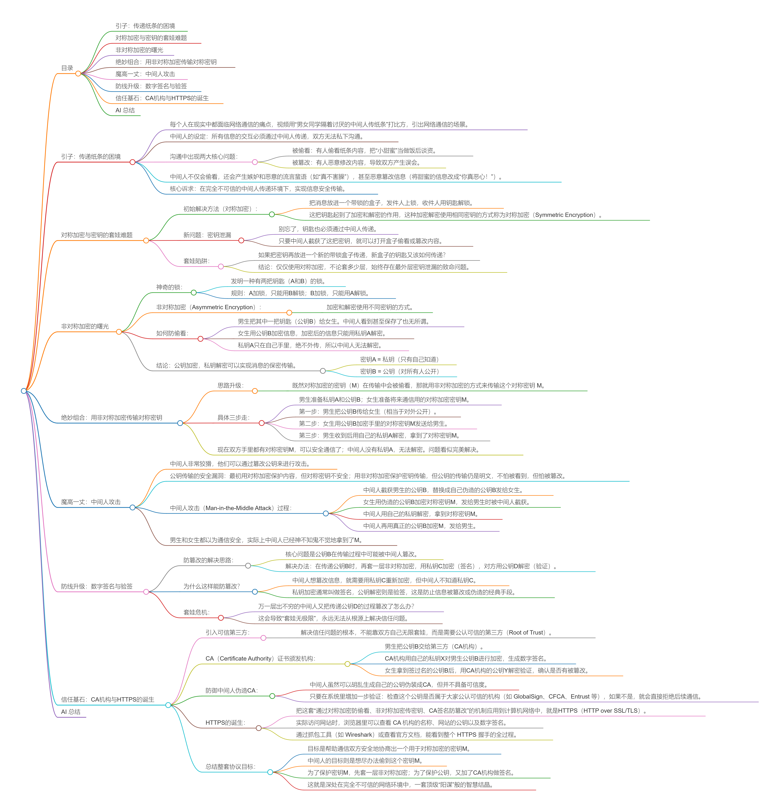

> 来源链接：https://www.bilibili.com/video/BV1tseyzCEoF?p=3

## 目录

- [引子：传递纸条的困境](#引子传递纸条的困境)
- [对称加密与密钥的套娃难题](#对称加密与密钥的套娃难题)
- [非对称加密的曙光](#非对称加密的曙光)
- [绝妙组合：用非对称加密传输对称密钥](#绝妙组合用非对称加密传输对称密钥)
- [魔高一丈：中间人攻击](#魔高一丈中间人攻击)
- [防线升级：数字签名与验签](#防线升级数字签名与验签)
- [信任基石：CA机构与HTTPS的诞生](#信任基石ca机构与https的诞生)
- [AI 总结](#ai-总结)

## 引子：传递纸条的困境

[原片 @ 00:00](https://www.bilibili.com/video/BV1tseyzCEoF?p=3&t=0)

- 每个人在现实中都面临网络通信的痛点，视频用“男女同学隔着讨厌的中间人传纸条”打比方，引出网络通信的场景。
- 中间人的设定：所有信息的交互**必须通过中间人**传递，双方无法私下沟通。
- 沟通中出现两大核心问题：
    - **被偷看**：有人偷看纸条内容，把“小甜蜜”当做饭后谈资。
    - **被篡改**：有人恶意修改内容，导致双方产生误会。
    
- 中间人不仅会偷看，还会产生嫉妒和恶意的流言蜚语（如“真不害臊”），甚至恶意篡改信息（将甜蜜的信息改成“你真恶心！”）。

- 核心诉求：在完全不可信的中间人传递环境下，实现**信息安全传输**。

## 对称加密与密钥的套娃难题
[原片 @ 00:24](https://www.bilibili.com/video/BV1tseyzCEoF?p=3&t=24)

- **初始解决方法（对称加密）**：
    - 把消息放进一个带锁的盒子，发件人上锁，收件人用钥匙解锁。
    - 这把钥匙起到了加密和解密的作用，这种加密解密使用**相同密钥**的方式称为**对称加密**（Symmetric Encryption）。
    
- **新问题：密钥泄漏**
    - 别忘了，钥匙也必须通过中间人传递。
    - 只要中间人截获了这把密钥，就可以打开盒子偷看或篡改内容。
    
- **套娃陷阱**：
    - 如果把密钥再放进一个新的带锁盒子传递，新盒子的钥匙又该如何传递？
    - **结论**：仅仅使用对称加密，不论套多少层，始终存在最外层密钥泄漏的致命问题。

## 非对称加密的曙光
[原片 @ 01:14](https://www.bilibili.com/video/BV1tseyzCEoF?p=3&t=74)

- **神奇的锁**：
    - 发明一种有两把钥匙（A和B）的锁。
    - 规则：**A加锁，只能用B解锁；B加锁，只能用A解锁。**
    
- **非对称加密（Asymmetric Encryption）**：
    - 加密和解密使用**不同密钥**的方式。
- **如何防偷看**：
    - 男生把其中一把钥匙（**公钥B**）给女生。中间人看到甚至保存了也无所谓。
    - 女生用**公钥B**加密信息，加密后的信息只能用**私钥A**解密。
    - 私钥A只在自己手里，绝不外传，所以中间人无法解密。
    
- **结论**：**公钥加密，私钥解密可以实现消息的保密传输**。
    - 密钥A = **私钥**（只有自己知道）
    - 密钥B = **公钥**（对所有人公开）

## 绝妙组合：用非对称加密传输对称密钥
[原片 @ 02:23](https://www.bilibili.com/video/BV1tseyzCEoF?p=3&t=143)
- **思路升级**：
    - 既然对称加密的密钥（M）在传输中会被偷看，那就用非对称加密的方式来传输这个对称密钥 M。
    
- **具体三步走**：
    - 男生准备**私钥A**和**公钥B**；女生准备将来通信用的**对称加密密钥M**。
    - **第一步**：男生把**公钥B**传给女生（相当于对外公开）。
    - **第二步**：女生用**公钥B**加密手里的**对称密钥M**发送给男生。
    - **第三步**：男生收到后用自己的**私钥A**解密，拿到了**对称密钥M**。
    
- 现在双方手里都有对称密钥M，可以安全通信了；中间人没有私钥A，无法解密。问题看似完美解决。

## 魔高一丈：中间人攻击
[原片 @ 03:12](https://www.bilibili.com/video/BV1tseyzCEoF?p=3&t=192)

- 中间人非常狡猾，他们可以通过**篡改公钥**来进行攻击。
- **公钥传输的安全漏洞**：最初用对称加密保护内容，但对称密钥不安全；用非对称加密保护密钥传输，但**公钥的传输仍是明文**，不怕被看到，但怕被**篡改**。

- **中间人攻击（Man-in-the-Middle Attack）过程**：
    - 中间人截获男生的**公钥B**，替换成自己伪造的**公钥B**发给女生。
    - 女生用伪造的公钥B加密对称密钥M，发给男生时被中间人截获。
    - 中间人用自己的私钥解密，拿到**对称密钥M**。
    - 中间人再用真正的公钥B加密M，发给男生。
    
- 男生和女生都以为通信安全，实际上中间人已经神不知鬼不觉地拿到了M。

## 防线升级：数字签名与验签
[原片 @ 04:22](https://www.bilibili.com/video/BV1tseyzCEoF?p=3&t=262)

- **防篡改的解决思路**：
    - 核心问题是公钥B在传输过程中可能被中间人篡改。
    - 解决办法：在传递公钥B时，再套一层非对称加密，用**私钥C**加密（签名），对方用**公钥D**解密（验证）。
    
- **为什么这样能防篡改？**
    - 中间人想篡改信息，就需要用**私钥C**重新加密，但中间人不知道私钥C。
    - 私钥加密通常叫做**签名**，公钥解密则是**验签**，这是防止信息被篡改或伪造的经典手段。
    
- **套娃危机**：
    - 万一层出不穷的中间人又把传递公钥D的过程篡改了怎么办？
    - 这会导致“套娃无极限”，永远无法从根源上解决信任问题。

## 信任基石：CA机构与HTTPS的诞生
[原片 @ 05:24](https://www.bilibili.com/video/BV1tseyzCEoF?p=3&t=324)

- **引入可信第三方**：
    - 解决信任问题的根本，不能靠双方自己无限套娃，而是需要**公认可信的第三方（Root of Trust）**。
    
- **CA（Certificate Authority）证书颁发机构**：
    - 男生把公钥B交给第三方（CA机构）。
    - CA机构用自己的**私钥X**对男生公钥B进行加密，生成**数字签名**。
    - 女生拿到签过名的公钥B后，用CA机构的**公钥Y**解密验证，确认是否有被篡改。
    
- **防御中间人伪造CA**：
    - 中间人虽然可以胡乱生成自己的公钥伪装成CA，但并不具备可信度。
    - 只要在系统里增加一步验证：检查这个公钥是否属于大家公认可信的机构（如 GlobalSign、CFCA、Entrust 等），如果不是，就会直接拒绝后续通信。
    
- **HTTPS的诞生**：
    - 把这套“通过对称加密防偷看、非对称加密传密钥、CA签名防篡改”的机制应用到计算机网络中，就是**HTTPS**（HTTP over SSL/TLS）。
    - 实际访问网站时，浏览器里可以查看 **CA 机构的名称**、**网站的公钥**以及**数字签名**。
    - 通过抓包工具（如 Wireshark）或查看官方文档，能看到整个 HTTPS 握手的全过程。
    
- **总结整套协议目标**：
    - 目标是帮助通信双方安全地协商出一个用于对称加密的**密钥M**。
    - 中间人的目标则是想尽办法偷到这个**密钥M**。
    - 为了保护**密钥M**，先套一层**非对称加密**；为了保护**公钥**，又加了**CA机构做签名**。
    - 这就是深处在完全不可信的网络环境中，一套顶级“阳谋”般的智慧结晶。

## AI 总结
视频通过通俗易懂的“传纸条”比喻，生动地讲述了网络通信中从“明文裸奔”到“HTTPS安全防护”的演进过程。由于网络环境是不可信的（中间人无处不在），我们需要先使用**对称加密**保护数据，但对称密钥面临被中间人窃听的问题；于是用**非对称加密**（公钥加密、私钥解密）来传输对称密钥，但公钥传输存在被**中间人攻击（MITM）**篡改的风险；进而引入了**数字签名与验签**机制，防止公钥被篡改；最后为了解决公钥本身“信任”的根本问题，引入了权威的**CA机构**进行证书颁发。这一系列从套娃到终极信任验证的过程，正是目前普遍使用的 HTTPS 协议的核心机制。