> 来源链接：https://www.bilibili.com/video/BV1TTxy6qE6L

# OpenAI_SDK

## 目录

- [课程导入与目标](#课程导入与目标)
- [理解通信链路与核心概念](#理解通信链路与核心概念)
- [环境配置与安全](#环境配置与安全)
- [第一次 Responses API 调用](#第一次-responses-api-调用)
- [参数详解](#参数详解)
- [输出与 Token 使用](#输出与-token-使用)
- [提示词工程](#提示词工程)
- [Mini Project - AI Sales Assistant](#mini-project---ai-sales-assistant)
- [测试与错误处理](#测试与错误处理)
- [能力边界与面试准备](#能力边界与面试准备)
- [AI 总结](#ai-总结)

---

## 课程导入与目标
[原片 @ 00:16](https://www.bilibili.com/video/BV1TTxy6qE6L?t=16)

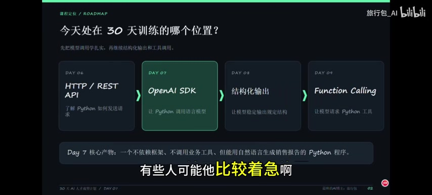

本节课是 30 天 AI 人才培养计划的 Day 7，核心产物是创造一个不依赖框架、不调用业务工具，但能用自然语言生成销售报告的 Python 程序。简而言之，就是通过输入普通话，程序能调用大模型生成带自然语言回复的销售报告。

**学完本课后必须做到的 5 件事**：
1. **配置 SDK 和 API Key**：会安装包、设置环境变量，并且不把 Key 写进源码。
2. **写出第一个 API 请求**：会区分 `OpenAI()`、`client.responses.create()` 等。
3. **读懂模型返回值**：会读取 `response.output_text`、`usage` 等信息。
4. **控制任务与输出要求**：知道 `model`、`input`、`instructions` 各负责什么。
5. **交付 AI Sales Assistant**：将零售数据组织为提示词并生成可核对的报告。

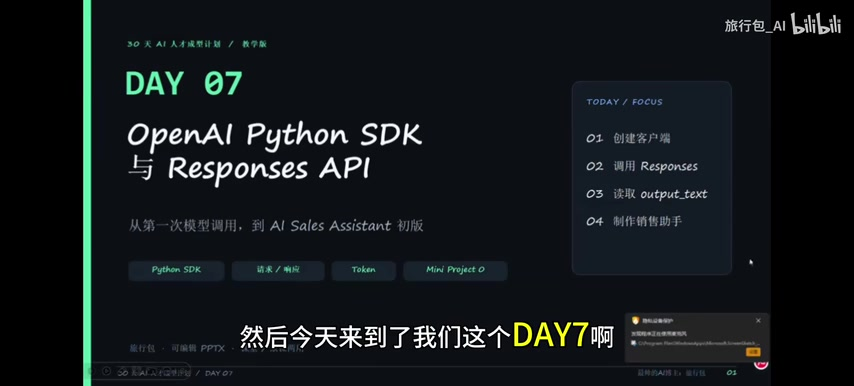

---

## 理解通信链路与核心概念

[原片 @ 02:12](https://www.bilibili.com/video/BV1TTxy6qE6L?t=132)

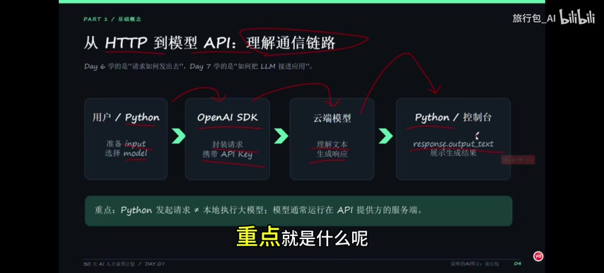

**从 HTTP 到模型 API 的通信链路**：
1. **用户 / Python**：准备 `input`，选择 `model`。
2. **OpenAI SDK**：封装请求，携带 `API Key`。
3. **云端模型**：理解文本，生成响应。
4. **Python / 控制台**：通过 `response.output_text` 展示生成结果。
*注意：Python 发起请求并不等于本地执行大模型，模型通常运行在 API 提供方的服务端。*

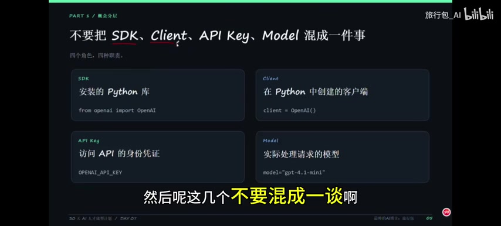

**不要把这 4 个概念混为一谈**：
- **SDK**：安装的 Python 库（如 `from openai import OpenAI`）。
- **Client**：在 Python 中创建的客户端（如 `client = OpenAI()`）。
- **API Key**：访问 API 的身份凭证（如 `OPENAI_API_KEY`）。
- **Model**：实际处理请求的模型（如 `model="gpt-4.1-mini"`）。

> Client 是 SDK 提供的类实例化出来的，接住 `from openai import OpenAI` 的 OpenAI，调出 SDK

---

## 环境配置与安全
[原片 @ 03:42](https://www.bilibili.com/video/BV1TTxy6qE6L?t=222)

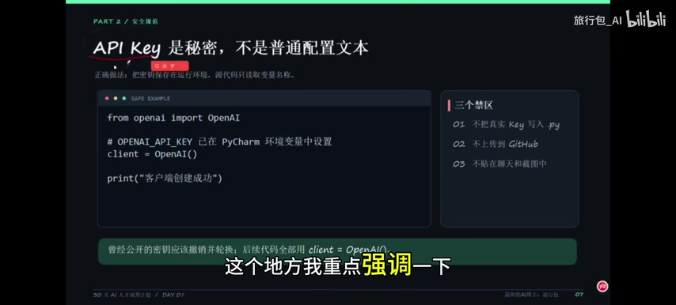

**PyCharm 三步准备好 API 开发环境**：
1. **安装 SDK**：在终端执行 `python -m pip install -U openai`。
2. **设置环境变量**：在 PyCharm 的 Run -> Edit Configurations 中，设置 `Name: OPENAI_API_KEY`, `Value: 新生成的密钥`。
3. **验证导入**：创建文件 `day7_sales_assistant.py`，输入 `from openai import OpenAI` 和 `client = OpenAI()`。
*注意：API 使用额度与 ChatGPT 订阅不是同一套计费，API 是单独计费的。*

**API Key 是秘密，不是普通配置文本**：
- **三个禁区**：不把真实 Key 写入 `.py` 文件、不上传到 GitHub、不贴在聊天和截图中。
- **正确做法**：把密钥保存在运行环境，源代码只读取变量名称。
- 曾经公开的密钥应该撤销并轮换；后续代码全部用 `client = OpenAI()` 读取环境变量。谁拿到 API Key，谁就是项目的主人。

---

## 第一次 Responses API 调用
[原片 @ 04:48](https://www.bilibili.com/video/BV1TTxy6qE6L?t=288)

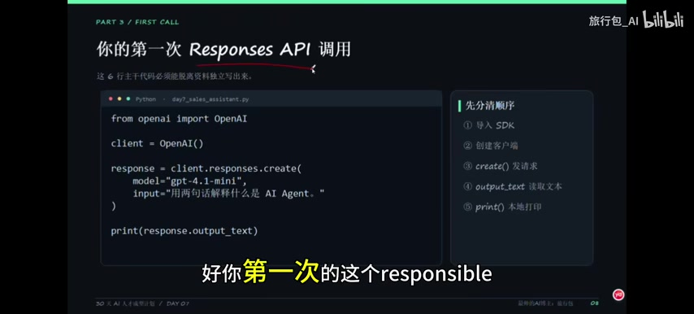

你的第一次 `Responses API` 调用（6 行核心代码）：
```python
from openai import OpenAI

client = OpenAI()

response = client.responses.create(
    model="gpt-4.1-mini",
    input="用两句话解释什么是 AI Agent。"
)

print(response.output_text)
```

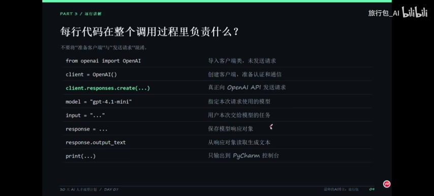

**每行代码在整个调用过程里负责什么**：
- `from openai import OpenAI`：导入客户端类，未发送请求。
- `client = OpenAI()`：创建客户端，准备认证和通信。
- `client.responses.create(...)`：真正向 OpenAI API **发送请求。**
- `model="gpt-4.1-mini"`：指定本次请求使用的模型。
- `input="..."`：用户本次交给模型的任务。
- `response = ...`：保存模型响应对象。
- `response.output_text`：从响应对象读取生成文本。
- `print(...)`：只输出到 PyCharm 控制台。

---

## 参数详解
[原片 @ 06:24](https://www.bilibili.com/video/BV1TTxy6qE6L?t=384)

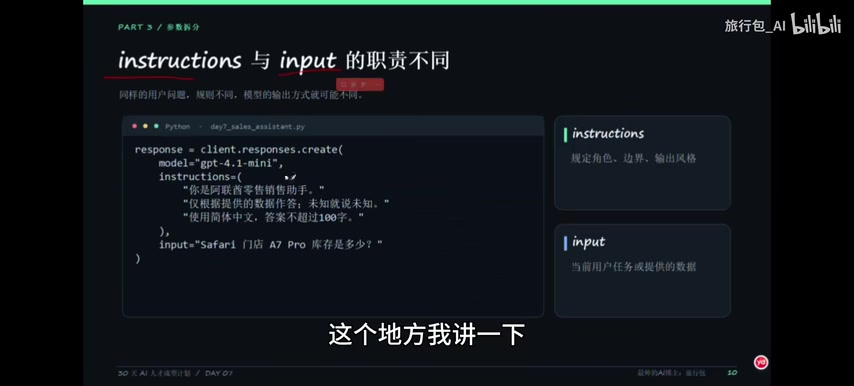

**`instructions` 与 `input` 的职责不同**：
- **`instructions`**：规定角色、边界、输出风格。比如：“你是 UAE 零售销售助手”、“仅根据提供的数据作答；未知就说未知”、“使用简体中文，答案不超过 100 字”。这给了模型角色设定和边界限制，防止 AI 产生幻觉（AI Hallucination）。
- **`input`**：当前用户任务或提供的数据。比如：“Safari 门店 A7 Pro 库存是多少？”

---

## 输出与 Token 使用
[原片 @ 07:18](https://www.bilibili.com/video/BV1TTxy6qE6L?t=438)

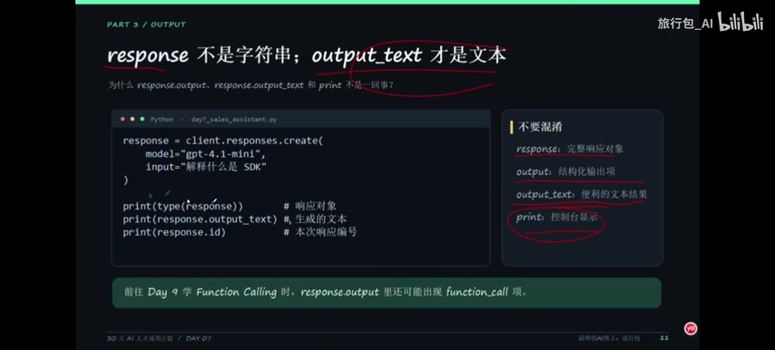

**`response` 不是字符串；`output_text` 才是文本**：
- `response`：完整的响应对象。
- `output`：结构化输出项。
- `output_text`：便利的文本结果（我们通常需要的）。
- `print`：控制台显示。

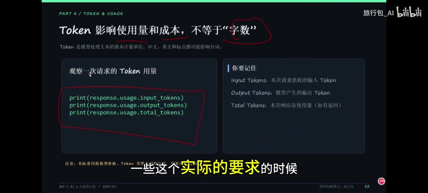

**Token 影响使用量和成本，不等于“字数”**：
Token 是模型处理文本的基本计量单位，中文、英文和标点都可能影响分词。
观察一次请求的 Token 用量：
```python
print(response.usage.input_tokens)   # 本次请求消耗的输入 Token
print(response.usage.output_tokens)  # 模型产生的输出 Token
print(response.usage.total_tokens)   # 本次响应总使用量
```
注意：实际费用按模型价格、Token 类型等规则计算，不能只看“请求次数”。

---

## 提示词工程
[原片 @ 08:24](https://www.bilibili.com/video/BV1TTxy6qE6L?t=504)

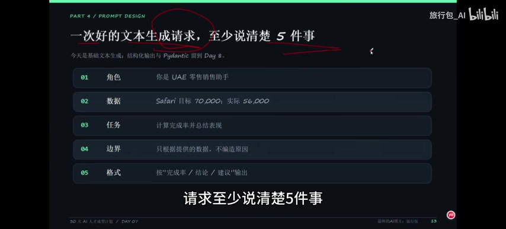

**一次好的文本生成请求，至少说清楚 5 件事**：
1. **角色**：比如“你是 UAE 零售销售助手”。
2. **数据**：把数据喂清楚，比如 Safari 目标 `70,000`；实际 `56,000`。
3. **任务**：计算完成率并总结表现。
4. **边界**：只根据提供的数据，不编造原因。
5. **格式**：按“完成率 / 结论 / 建议”输出（或 JSON 格式输出）。

---

## Mini Project - AI Sales Assistant
[原片 @ 09:18](https://www.bilibili.com/video/BV1TTxy6qE6L?t=558)

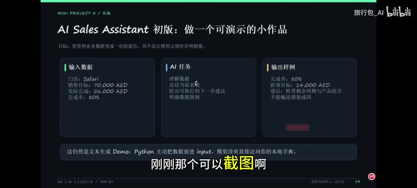

目标：把零售业务数据变成一份短报告，而不是让模型去猜库存和销量。

**完整项目 - 第 1 部分：准备数据与计算**
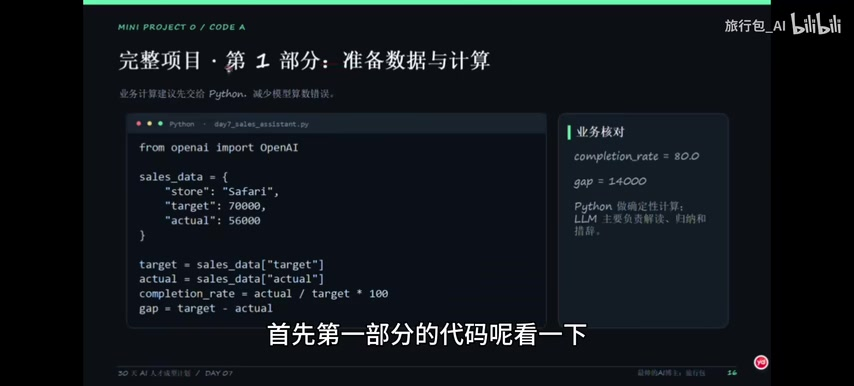
业务计算建议先交给 Python，减少模型算数错误。
```python
from openai import OpenAI

sales_data = {
    "store": "Safari",
    "target": 70000,
    "actual": 56000
}

target = sales_data["target"]
actual = sales_data["actual"]
completion_rate = actual / target * 100
gap = target - actual
```
*要点：Python 做确定性计算（如完成率 $80.0$，差额 $14000$），大模型主要负责解读、归纳和措辞，避免大模型算错。*

**完整项目 - 第 2 部分：生成报告**
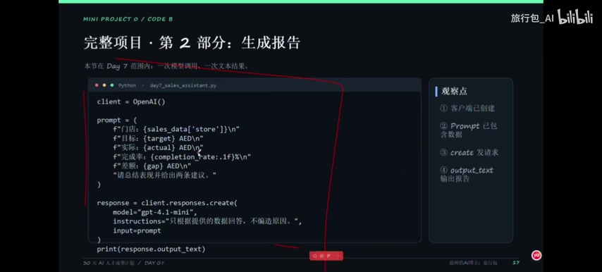
```python
client = OpenAI()

prompt = (
    f"门店：{sales_data['store']}\n"
    f"目标：{target} AED\n"
    f"实际：{actual} AED\n"
    f"完成率：{completion_rate:.1f}%\n"
    f"差额：{gap} AED\n"
    "请总结表现并给出两条建议。"
)

response = client.responses.create(
    model="gpt-4.1-mini",
    instructions="只根据提供的数据回答，不编造原因。",
    input=prompt
)

print(response.output_text)
```
*观察点*：客户端建立、Prompt 包含数据、`create` 发送请求、`output_text` 输出报告。模型会真正根据数据生成建议，而不是无脑回复。

---

## 测试与错误处理
[原片 @ 11:36](https://www.bilibili.com/video/BV1TTxy6qE6L?t=696)

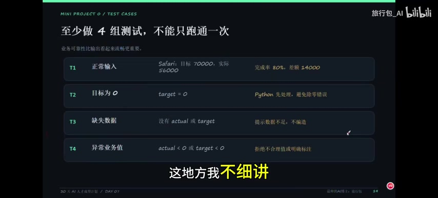

**至少做 4 组测试，不能只跑通一次**：
- **T1 正常输入**：完成任务，输出报告。
- **T2 目标为 0**：`target = 0`。Python 先处理，避免除零错误。
- **T3 缺失数据**：没有 `actual` 或 `target`。提示数据不足，不要编造。
- **T4 异常业务值**：`actual < 0` 或 `target < 0`。拒绝不合理值或明确标记。

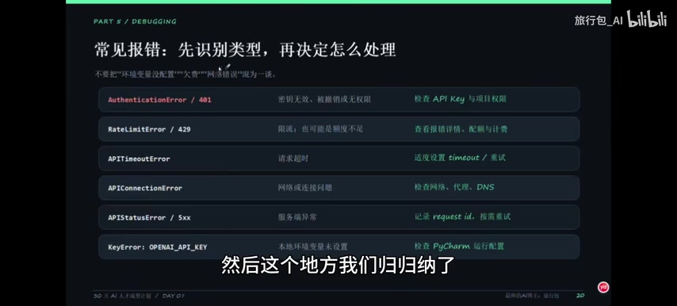

**常见报错**：
- `AuthenticationError / 401`：密钥无效或权限不足 -> 检查 API Key。
- `RateLimitError / 429`：限流或额度不足 -> 查看报错详情、配额的计费。
- `APITimeoutError`：请求超时 -> 适度设置 `timeout` / 重试。
- `APIConnectionError`：网络或连接问题 -> 检查网络、代理、DNS。
- `APIStatusError / 5xx`：服务端异常 -> 记录 `request_id`，按需重试。
- `KeyError: 'OPENAI_API_KEY'`：本地环境变量未设置 -> 检查 PyCharm 运行配置。

**错误处理与成本意识：做 Demo 也要规范**
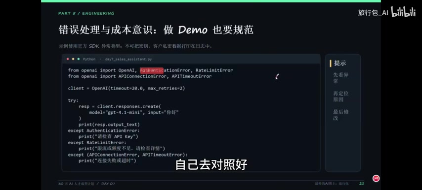
```python
from openai import OpenAI, AuthenticationError, RateLimitError
from openai import APIConnectionError, APITimeoutError

client = OpenAI(timeout=20.0, max_retries=2)

try:
    resp = client.responses.create(
        model="gpt-4.1-mini", input="你好"
    )
    print(resp.output_text)
except AuthenticationError:
    print("请检查 API Key")
except RateLimitError:
    print("限流或额度不足，请检查详情")
except (APIConnectionError, APITimeoutError):
    print("连接失败或超时")
```

---

## 能力边界与面试准备
[原片 @ 12:42](https://www.bilibili.com/video/BV1TTxy6qE6L?t=762)

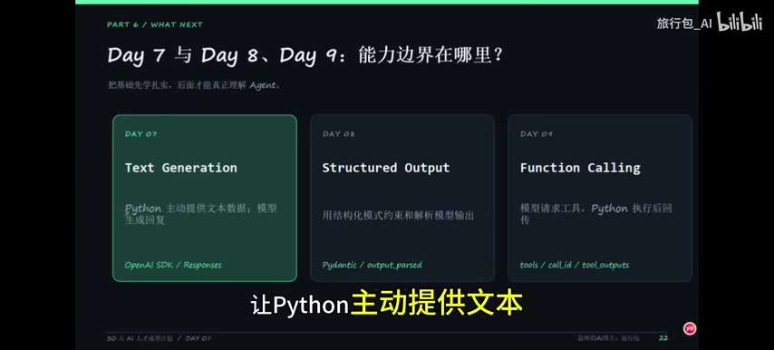

**Day 7 与 Day 8、Day 9 的能力边界在哪里？**
- **Day 7（Text Generation）**：Python 主动提供文本数据；模型生成回复（基于 OpenAI SDK / Responses）。
- **Day 8（Structured Output）**：用结构化模式约束和解析模型输出（基于 Pydantic）。
- **Day 9（Function Calling）**：模型请求工具、Python 执行后回传（基于 `tools` / `tool_outputs`）。

*思考题*：为什么模型不知道你 Python 字典里的实时数据？
因为 API 不会自动读取你的本地变量，模型能保证回答的前提是你主动把数据放进了 `input` 里。

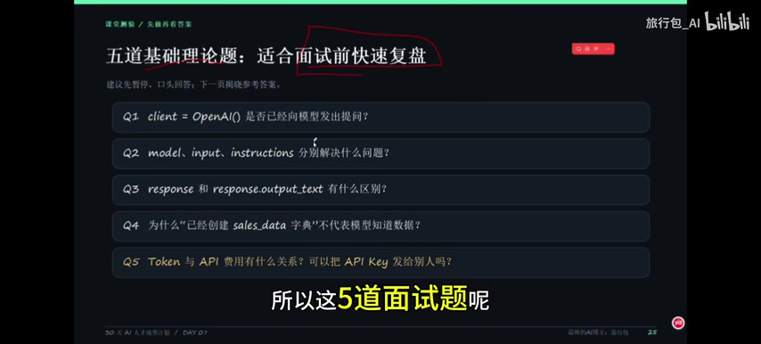

**五道基础理论题（适合面试前快速复盘）**：
- **Q1**：`client = OpenAI()` 是否已经向模型发出提问？（答：不会，创建客户端不等于发送请求）
- **Q2**：`model`、`input`、`instructions` 分别解决什么问题？（答：`model` 选模型，`input` 给任务，`instructions` 设行为规则）
- **Q3**：`response` 和 `response.output_text` 有什么区别？（答：`response` 是响应对象，`output_text` 是便捷文本结果）
- **Q4**：为什么“已经创建 `sales_data` 字典”不代表模型知道数据？（答：模型不能自动访问 Python 本地变量；需主动传入数据或后续接入工具）
- **Q5**：Token 与 API 费用有什么关系？可以把 API Key 发给别人吗？（答：Token 用量影响计费；密钥必须保密、放环境变量，泄露须轮换）

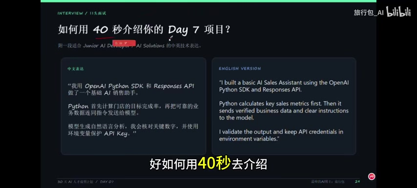

**如何用 40 秒介绍你的 Day 7 项目？**
- **中文表达**：“我用 OpenAI Python SDK 和 Responses API 做了一个基础 AI 销售助手。Python 首先计算门店的目标完成率，再把可靠的业务数据连同指令发送给模型。模型生成自然语言分析，我会核对关键数字，并使用环境变量保护 API Key。”
- **英文表达**：“I built a basic AI Sales Assistant using the OpenAI Python SDK and Responses API. Python calculates key sales metrics first. Then it sends verified business data and clear instructions to the model. I validate the output and keep API credentials in environment variables.”

---

## AI 总结

本节课（Day 7）以实战为导向，带领学习者从零构建了一个不依赖第三方框架的 AI Sales Assistant（销售报告生成器）。核心知识点涵盖了 OpenAI SDK 的基本使用，明确了 SDK、Client、API Key 与 Model 的本质区别。课程深入浅出地剖析了 `Responses API` 的核心参数（`instructions` 与 `input` 的职责划分）、响应对象（`response` 与 `output_text` 的区别）以及 Token 计费逻辑。在工程实践方面，强调了将确定性的数学计算交给 Python、把语义理解与生成交给 LLM 的设计哲学，并重点培训了 API Key 的安全管理、异常处理机制及多维度的业务边界测试。这不仅为后续的结构化输出与工具调用打下坚实基础，也为学习者积累了一个可直接用于面试展示的 AI 落地小项目经验。