> 来源链接：https://www.bilibili.com/video/BV1Pp4363EX2

## 目录

- [课程定位与学习目标](#课程定位与学习目标)
- [为什么需要 Prompt Engineering](#为什么需要-prompt-engineering)
- [提示词的五个组成部分与框架](#提示词的五个组成部分与框架)
- [模糊提示词与可执行提示词](#模糊提示词与可执行提示词)
- [自然语言到结构化数据](#自然语言到结构化数据)
- [JSON 的基本结构与常见错误](#json-的基本结构与常见错误)
- [Pydantic 的角色与模型校验](#pydantic-的角色与模型校验)
- [三种输出方式对比与 Responses API](#三种输出方式对比与-responses-api)
- [错误处理边界](#错误处理边界)
- [完整实操流程与模拟案例](#完整实操流程与模拟案例)
- [课堂实操任务与评分标准](#课堂实操任务与评分标准)
- [AI 总结](#ai-总结)

---

## 课程定位与学习目标
[原片 @ 00:00](https://www.bilibili.com/video/BV1Pp4363EX2?t=0)

本节课程为 Day 8 的内容，核心目标是让 AI 输出可用的数据。我们将会结合 **Prompt Engineering**、**Pydantic** 以及 **结构化输出**，最终产出能够自动生成 OPPO / UAE 销售分析报告的可用程序。

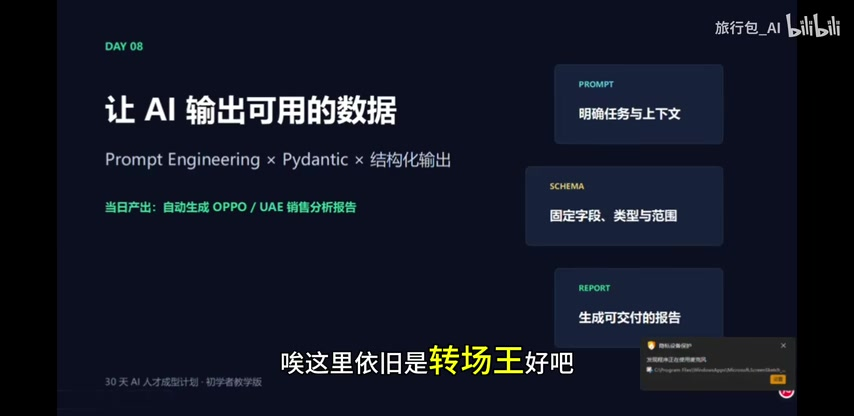


过去调用 AI 往往只是给一句简单的指令（例如生成一个帅哥），但由于缺乏具体的定义与框架，AI 的输出往往是不稳定的。为了让程序进入稳定的状态，我们需要给 AI 提供一个明确的“框架”。

本节的学习位置是从“会问 AI”进入“让程序稳定使用 AI 输出”。今日的完成标准如下：
- 输入一组模拟 UAE 销售数据。
- 程序得到 `SalesReport` 对象。
- 校验通过后生成中文报告。
- 错误数据能被明确拦截。

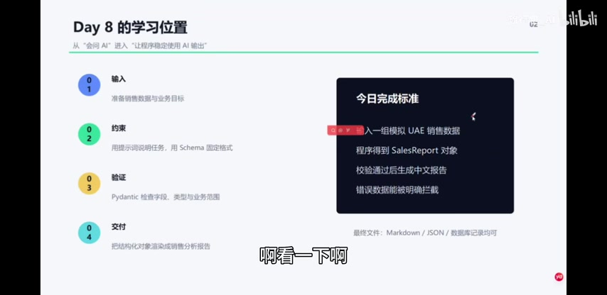
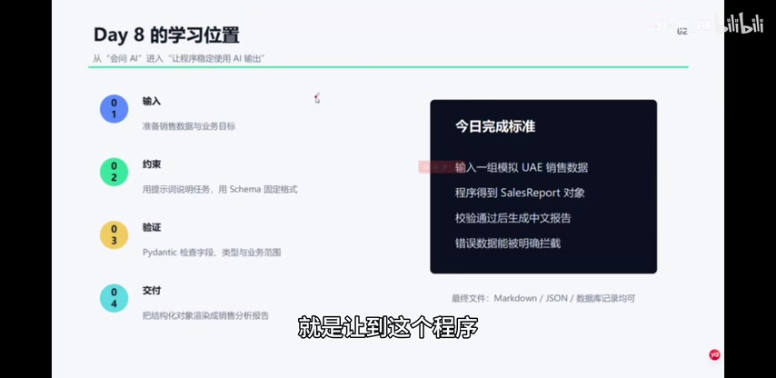

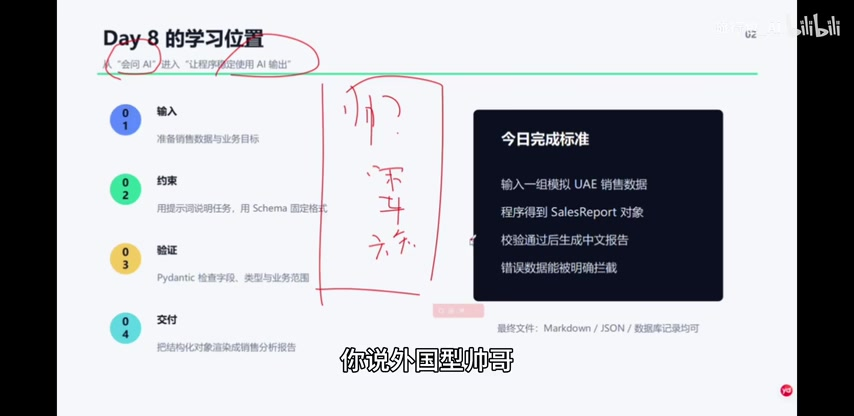

学习具体目标包括：
- 掌握**提示词**：把角色、任务、上下文、约束与输出要求写清楚。
- 掌握 **JSON**：读懂对象、数组、字符串、数字、布尔值与 null。
- 掌握 **Pydantic**：用 `BaseModel` 与 `Field` 定义数据契约并处理 `ValidationError`。
- 掌握**结构化输出**：通过 Responses API 获得已解析的 Pydantic 对象。

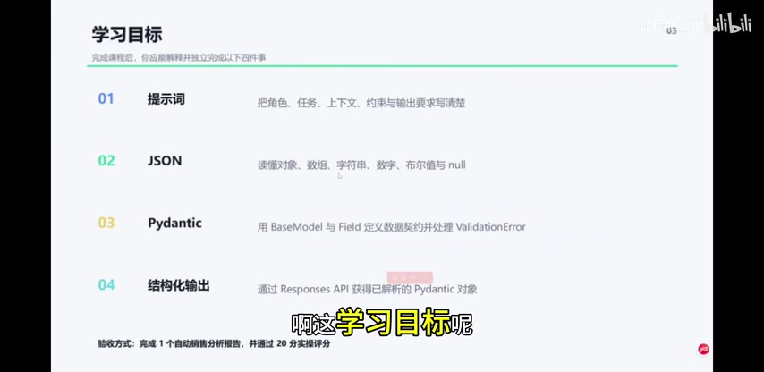

## 为什么需要 Prompt Engineering
[原片 @ 01:54](https://www.bilibili.com/video/BV1Pp4363EX2?t=114)

对于做 AIGC 方向的人，提示词工程是核心价值，决定了你能赚多少钱。如果是做项目落地的，现在高等模型（如 GPT-4/5.5、Claude 3/3.5 等）自身能力已经足够满足大部分下层市场需求（如标书、基础业务稿），但为了确保稳定输出，依然需要框架。

用一句话写需求（如“分析这份销售数据”），AI 会出现以下问题：字段每次不同、数字单位不统一、结论缺少数据依据、程序无法可靠读取。而写清任务契约，则能让程序稳定有效。

我们需要把提示词写清楚，包括：角色（UAE 智能手机零售分析师）、任务（计算总销量、收入、最佳城市与异常）、规则（结论必须引用输入数据中的数字）、格式（严格返回 `SalesReport` Schema）。
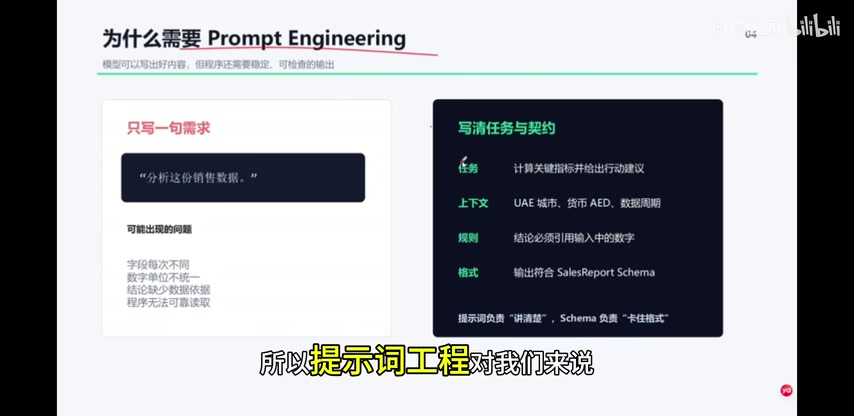
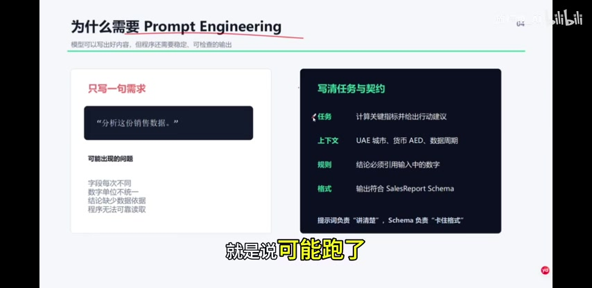

在实际业务中，如果只是简单扔一个文档给 AI（瞎许愿），输出是很不稳定的，容易出现看错、看混、看漏或者 AI 幻觉。如果将提示词工程与业务规则结合起来，效果会好很多。
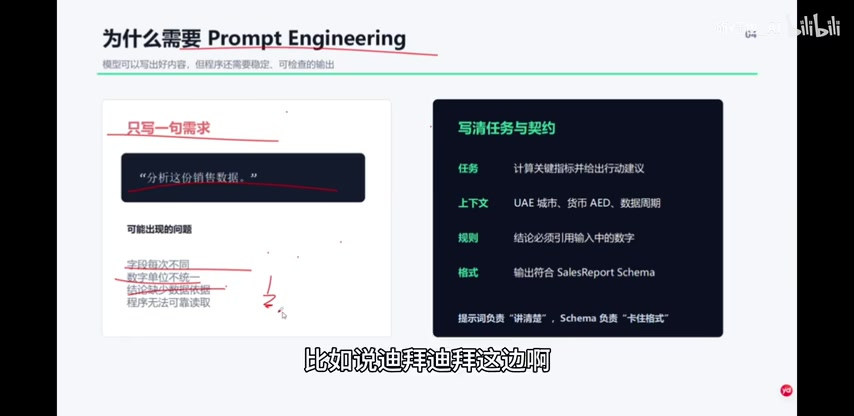


## 提示词的五个组成部分与框架
[原片 @ 04:54](https://www.bilibili.com/video/BV1Pp4363EX2?t=294)

一套规范的提示词包含五个核心部分：
- **身份**：例如，你是 UAE 零售分析师。
- **任务**：计算指标并生成销售报告。
- **上下文**：城市、产品、货币与周期。
- **约束**：只用输入数据，字段必须完整。
- **示例**：给一组输入与理想输出。

推荐顺序：身份与目标 -> 具体任务 -> 业务上下文 -> 输出规则 -> 少量高质量示例。提示词主要用来负责“讲清楚”业务，而 Schema 主要负责“卡住格式”。
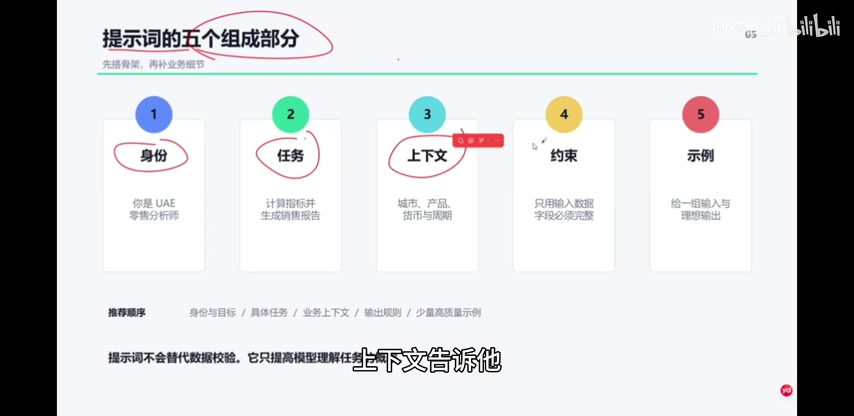
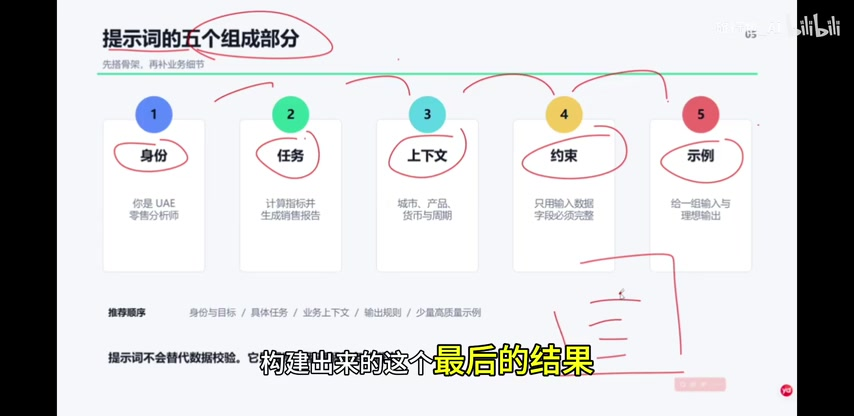

## 模糊提示词与可执行提示词
[原片 @ 06:54](https://www.bilibili.com/video/BV1Pp4363EX2?t=414)

模糊写法与可执行写法的对比如下：
- **角色**：无 vs. UAE 智能手机零售分析师。
- **任务**：分析销售 vs. 计算总销量、收入、最佳城市与异常。
- **数据范围**：无 vs. 仅使用提供的 2026-09 模拟数据。
- **输出格式**：写一段话 vs. 严格返回 `SalesReport` 结构。
- **质量规则**：无 vs. 每条洞察引用数字，不得编造原因。

如果你是做项目落地的，把提示词结构化，能够让你对项目的业务边界变得更加清晰。每个小公司、小商户都有自己的术语和边界，AI 无法直接触达，但你可以通过搭建框架，让 AI 理解这些业务边界。
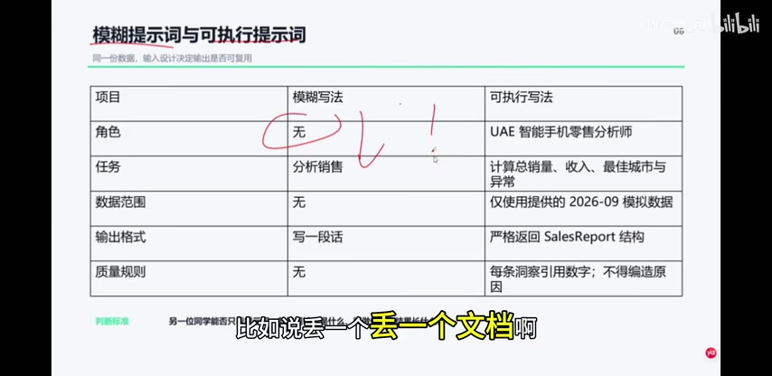
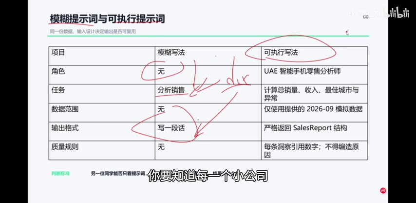
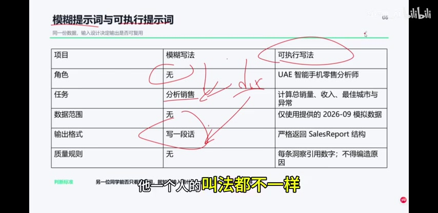

## 自然语言到结构化数据
[原片 @ 08:54](https://www.bilibili.com/video/BV1Pp4363EX2?t=534)

普通文本如：“迪拜表现最好。总销量不错，退货率需要注意。建议加强重点门店库存。”程序难以从中提取精确字段（不知道销量是多少、在哪、单位是什么）。

结构化 JSON 则能明确字段，程序直接读取：
```json
{
  "total_units": 2130,
  "top_city": "Dubai",
  "return_rate": 0.024,
  "actions": ["提高 Dubai 安全库存"]
}
```
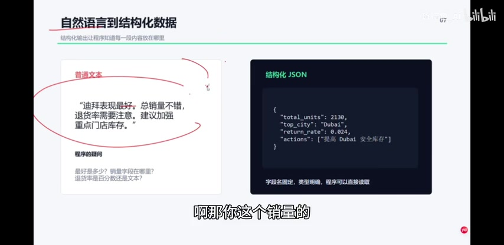

## JSON 的基本结构与常见错误
[原片 @ 09:18](https://www.bilibili.com/video/BV1Pp4363EX2?t=558)

JSON 是数据格式，不是 Python 字典。它的基本结构如下：
- **对象 `{}`**：一组键值对。
- **数组 `[]`**：一组有顺序的数据。
- **字符串**：必须使用双引号。
- **数字**：不加引号，才能进行计算。
- **布尔值**：true / false（小写）。
- **null**：当前没有值。

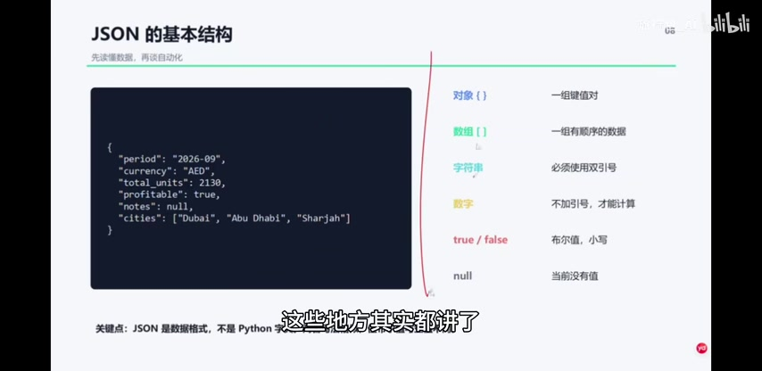
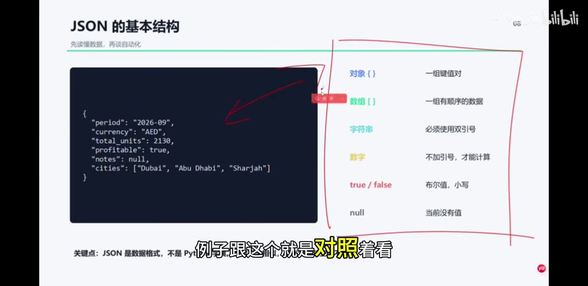

JSON 常见的 4 种错误：
- **单引号**：如 `{'city': 'Dubai'}`，应使用双引号。
- **尾随逗号**：最后一项后不能加逗号。
- **数字变文本**：如 `"units": "750"`，这样无法直接进行数学计算。
- **字段缺失**：如缺少 Schema 要求的 `revenue` 字段。

修复策略：先让 JSON 语法有效，再让 Pydantic 检查业务规则。
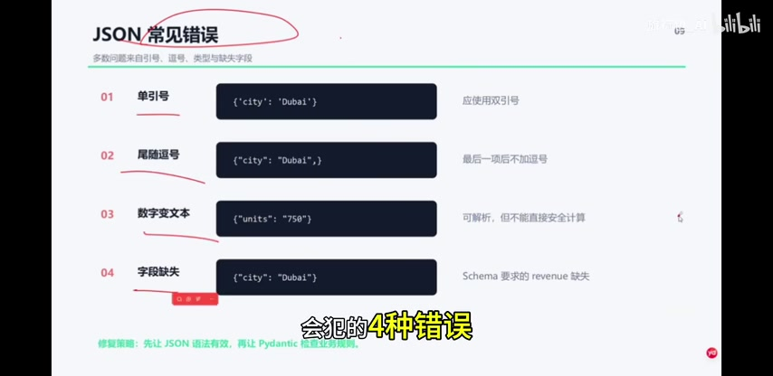
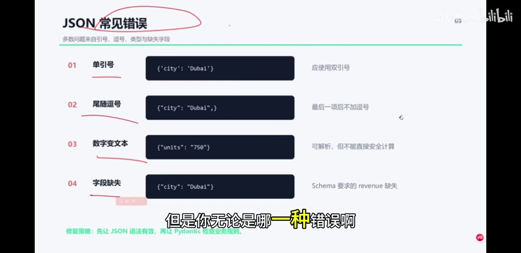

## Pydantic 的角色与模型校验
[原片 @ 10:24](https://www.bilibili.com/video/BV1Pp4363EX2?t=624)

**Pydantic** 的作用是将外部数据（JSON / API / CSV）转换为可信的 Python 对象（如 `SalesReport`），能进行类型检查、字段约束和错误定位。验证成功则得到带类型提示的对象；验证失败则抛出 `ValidationError`，告诉你哪个字段、哪条规则失败。

- **`BaseModel`**：定义字段与类型结构。
- **`Field`**：用于单字段增加边界（如 `ge` 最小值、`max_length` 最大长度等）。
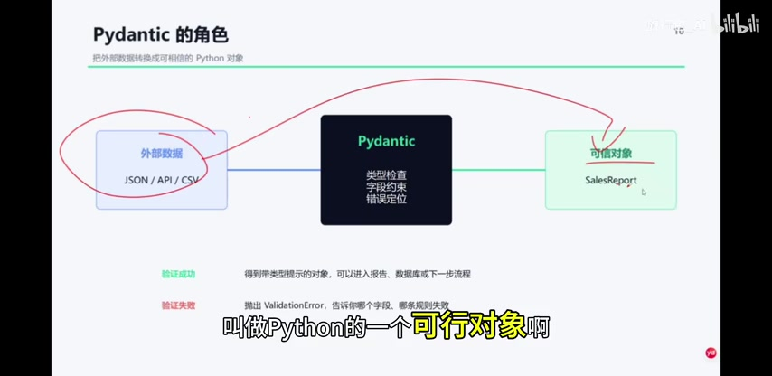
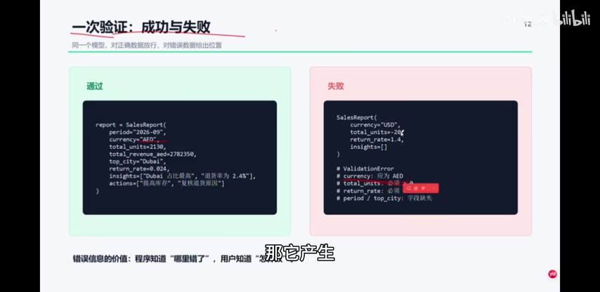

**字段校验与模型校验的区别**：
- **`Field`**：适合单个字段的类型、范围、长度与固定选项。
- **`@model_validator`**：自定义校验，适合多个字段之间的关系（例如退货量不能超过销量）。

进阶写法示例：
```python
class CitySales(BaseModel):
    city: str
    units: int = Field(ge=0)
    revenue_aed: float = Field(ge=0)
    returned_units: int = Field(ge=0)

    @model_validator(mode="after")
    def returned_not_above_units(self):
        if self.returned_units > self.units:
            raise ValueError("退货量不能高于销量")
        return self
```
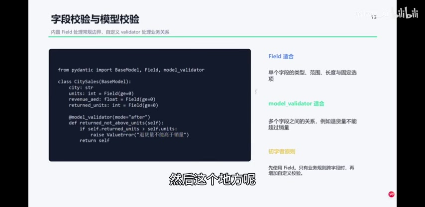
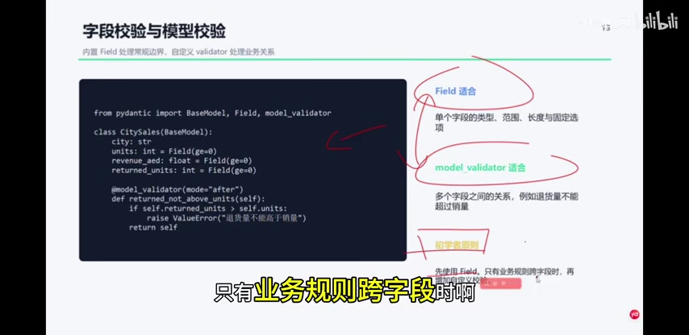

## 三种输出方式对比与 Responses API
[原片 @ 12:12](https://www.bilibili.com/video/BV1Pp4363EX2?t=732)

| 维度 | 普通文本 | JSON Mode | Structured Outputs |
| :--- | :--- | :--- | :--- |
| 保证有效 JSON | 否 | 是 | 是 |
| 保证符合 Schema | 否 | 否 | 是 |
| Python 结果 | 字符串 | 解析后的 dict | Pydantic 对象 |
| 适合场景 | 人直接阅读 | 旧模型或简单兼容 | 程序稳定消费输出 |

**结论**：在项目中强烈优先使用 **Structured Outputs**（结构化输出），避免程序稳定性问题。


**OpenAI 官方 Python SDK 可以直接把模型输出解析为 Pydantic 对象，校验是否符合**（注意，可以做到的是模型返回后 Pydantic 的本地校验，而不能保证完全约束模型生成时的行为）

你通过 `text_format=SalesReport` 传入模型时，SDK 会根据 Pydantic 模型生成一份 JSON Schema 发给 OpenAI API，用来引导模型按结构输出。问题在于：**你写的这些长度/数值约束，在发给 OpenAI 的 Schema 里可能被剥离或忽略。**这些在 JSON Schema 里对应 `minLength`、`minimum`、`minItems` 等**验证关键字**。而 OpenAI 的严格模式（strict structured outputs）只支持 JSON Schema 的一个子集，**这类"值范围"关键字不在支持范围内**

当前官方推荐的写法 (Responses API)：

- `responses.parse`：请求结构化解析。
- `text_format`：传入 Pydantic 模型。
- `output_parsed`：得到 `SalesReport` 对象。
- 设置 API Key。

```python
from openai import OpenAI
from pydantic import BaseModel, Field

client = OpenAI()

class SalesReport(BaseModel):
    summary:str = Field(min_length=20)
    total_units: int = Field(ge=0)
    top_city:str
    insights:list[str]=Field(min_length=2,max_length=4)
    actions:list[str] =Field(min_length=2,max_length=4)
    
response = client.responses.parse(  # 请求结构化解析
    model = "gpt－6－astra"
    instructions = "你是UAE零售销售分析师。只使用输入数据."
    input = sales_prompt,
    text_format = SalesReport,  # 传入 Pydantic 模型
)

report = response.output_parsed  # 得到 SalesReport 对象
```


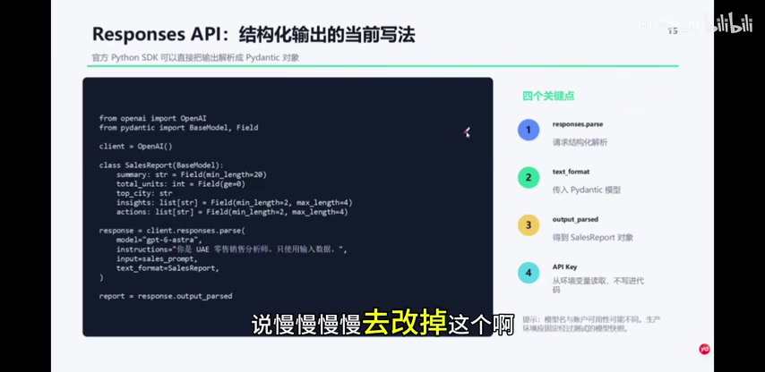
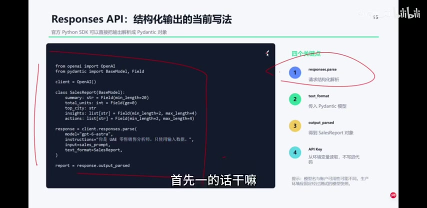

## 错误处理边界
[原片 @ 14:00](https://www.bilibili.com/video/BV1Pp4363EX2?t=840)

对于专业架构师和工程师来说，错误处理是保存可诊断错误信息的关键。如果项目出问题，不能只报一个“Error”或回退终止，必须能够精准定位。

错误处理包含四个方面：
- **输入校验失败**：如 CSV 缺字段、负数、城市名错误等，提示用户修改。
- **模型拒绝回答**：如安全策略触发或请求不可完成，记录并终止生成。
- **API / 网络异常**：如超时、限流或鉴权失败，应重试或返回可理解的错误。
- **输出校验失败**：模型输出未通过 Schema，记录 `ValidationError` 并安全失败。

工程原则：保留可诊断的错误信息，但向最终用户返回简洁提示。绝不能静默吞掉错误，以免脏数据继续向下流转。

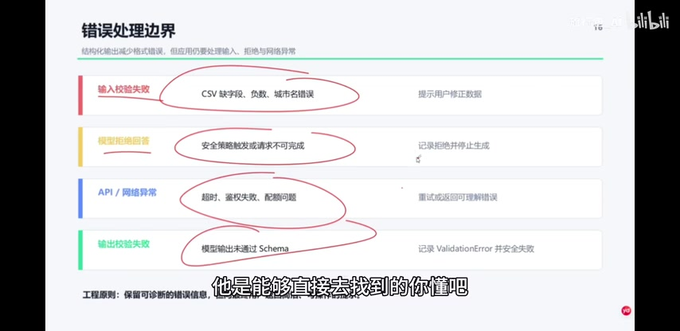
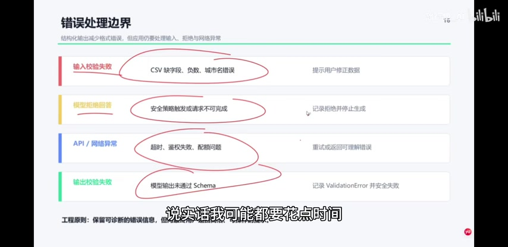

## 完整实操流程与模拟案例
[原片 @ 15:00](https://www.bilibili.com/video/BV1Pp4363EX2?t=900)

使用模拟的 OPPO UAE 月度销售数据（含城市、型号、销量、单价、收入、退货量）进行演示。

**销售分析提示词**：将业务逻辑写进 `instructions`，将具体数据写进 `input`（使用 f-string）。
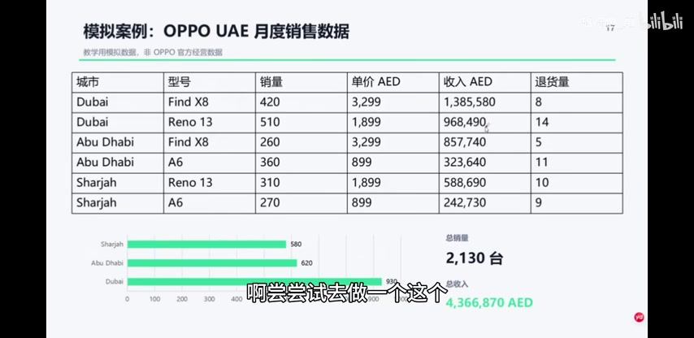
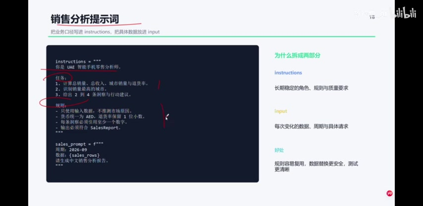

**完整实操流程**：
1. **读取数据**（CSV / JSON）。
2. **输入校验**（CitySales 模型）。
3. **指标计算**（销量与收入）。
4. **构造提示词**（规则 + 数据）。
5. **调用模型**（Responses API）。
6. **结构化解析**（SalesReport）。
7. **结果校验**（业务边界）。
8. **生成报告**（Markdown）。

**关键原则**：任何一步失败，都应停止并返回明确错误，绝不让错误数据继续进入后续报告。
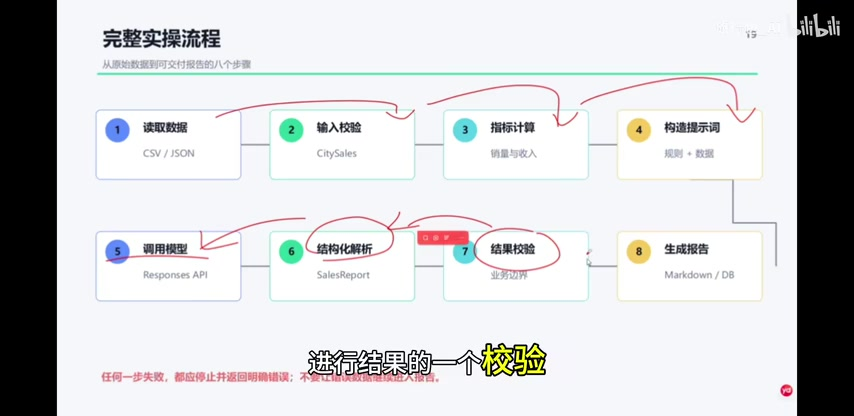
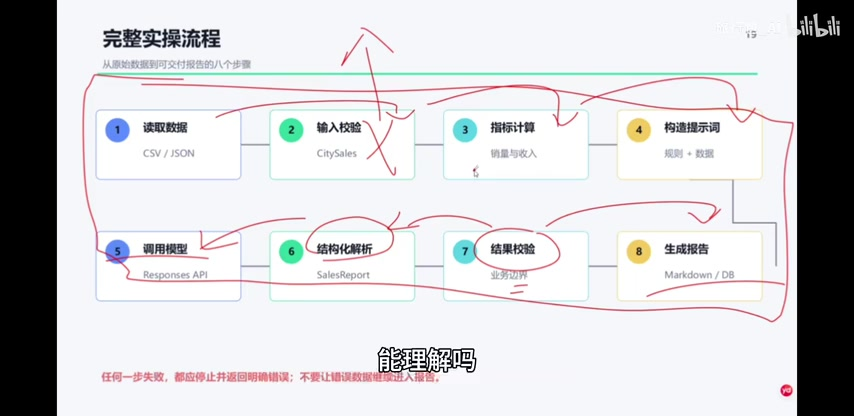

结构化结果示例拿到后，可渲染为人类可读的 Markdown 报告，并可留存为 JSON 结果。
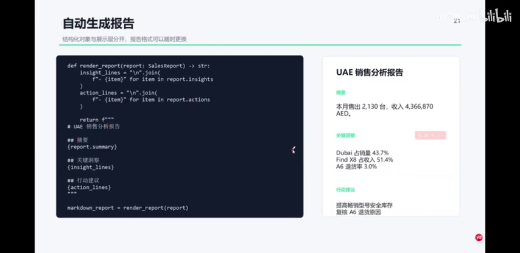

## 课堂实操任务与评分标准
[原片 @ 17:40](https://www.bilibili.com/video/BV1Pp4363EX2?t=1060)

**实操任务**：
在 60 分钟内，完成一个可重复运行的报告生成器。
- **模型定义（15 分钟）**：完成 `CitySales` 与 `SalesReport`，加入范围约束。
- **输入校验（10 分钟）**：验证 6 行模拟数据，故意制造 1 个错误并解释提示。
- **提示词（15 分钟）**：写清角色、任务、数据范围、计算口径与禁止事项。
- **API 调用（15 分钟）**：使用 `responses.parse` 与 `text_format` 得到对象。
- **报告导出（5 分钟）**：把结果渲染为 Markdown，并保留 JSON 结果。

提交物：Python 脚本 1 份，示例输入 1 份，成功报告 1 份，失败案例及错误文本 1 份。
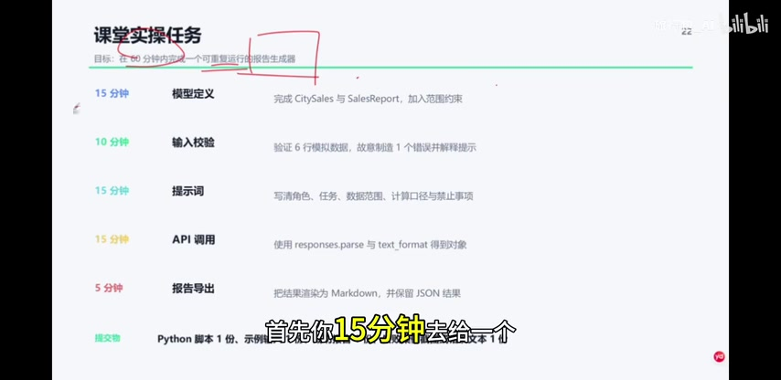
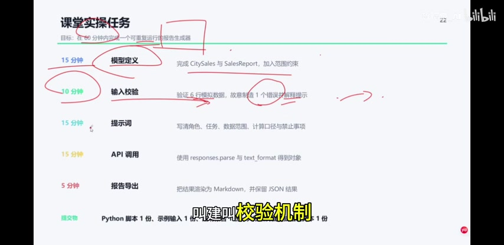

**评分标准（总分 20 分，16 分通过）**：
- **提示词设计 (4分)**：任务、上下文、约束清楚（常见扣分：缺少业务口径）。
- **Pydantic 模型 (5分)**：类型与范围合理（常见扣分：数字字段写成 `str`）。
- **结构化输出 (5分)**：`parse` + `text_format` + `output_parsed`（常见扣分：仍手动解析文本）。
- **错误处理 (3分)**：能处理校验与 API 异常（常见扣分：吞掉错误）。
- **报告质量 (3分)**：数字准确、建议可追溯（常见扣分：编造数据原因）。

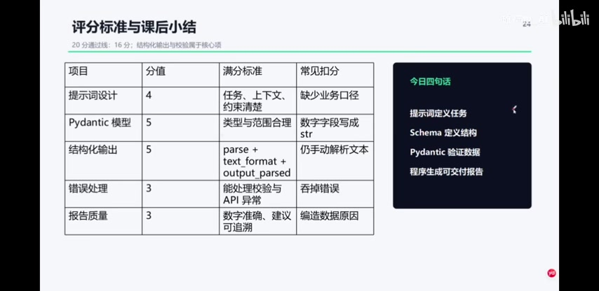
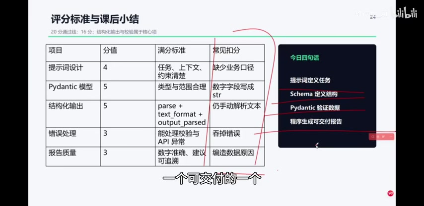

**课后小结**：
- 提示词定义任务
- Schema 定义结构
- Pydantic 验证数据
- 程序生成可交付报告

## AI 总结

本次课程围绕“让 AI 输出可用的数据”这一核心目标，详细讲解了如何结合 **Prompt Engineering**、**Pydantic** 和**结构化输出**构建稳定可靠的 AI 应用。讲师首先强调了提示词框架的重要性（包含身份、任务、上下文、约束、示例），并通过对比模糊提示词与可执行提示词，揭示了如何通过约束业务边界来提高程序输出的稳定性。接着，课程深入讲解了 **JSON** 数据格式与常见错误，并引入了 **Pydantic** 作为数据验证的关键工具，通过 `Field` 和 `model_validator` 实现单字段与跨字段的严格校验。最后，演示了通过 **Responses API** 获取结构化 Pydantic 对象的具体写法，并梳理了包含数据读取、校验、模型调用、解析、报告生成在内的完整实操流程，以及必须遵循的“错误处理边界”原则，确保整个系统在任何一步失败时均能精准反馈并终止运行，避免脏数据扩散。