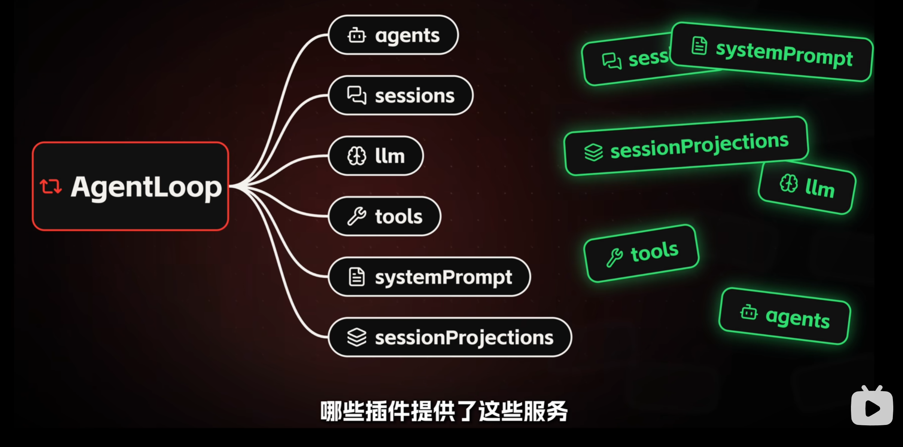
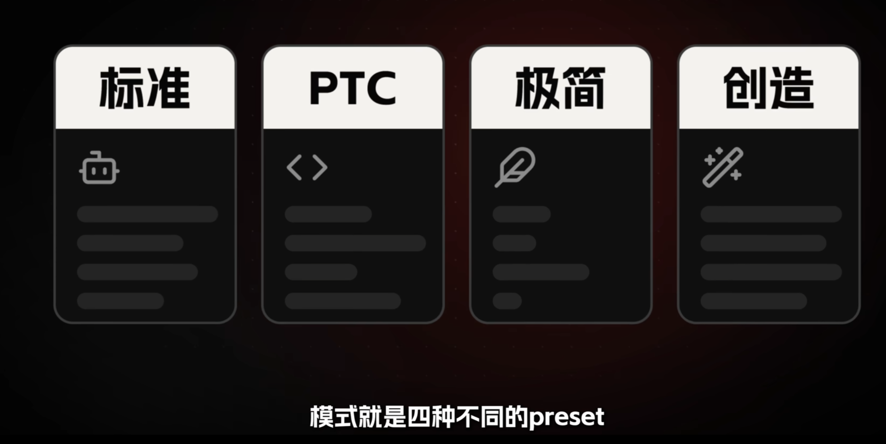
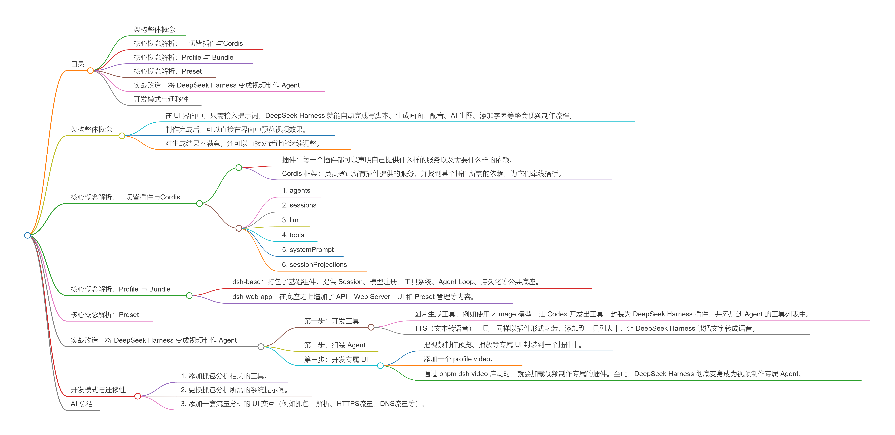

> 来源链接：https://www.bilibili.com/video/BV1YtaV6VE3K

## 目录

- [架构整体概念](#架构整体概念)
- [核心概念解析：一切皆插件与Cordis](#核心概念解析一切皆插件与cordis)
- [核心概念解析：Profile 与 Bundle](#核心概念解析profile-与-bundle)
- [核心概念解析：Preset](#核心概念解析preset)
- [实战改造：将 DeepSeek Harness 变成视频制作 Agent](#实战改造将-deepseek-harness-变成视频制作-agent)
- [开发模式与迁移性](#开发模式与迁移性)

---

## 架构整体概念
[原片 @ 00:00](https://www.bilibili.com/video/BV1YtaV6VE3K?t=0)

视频展示了如何将 **DeepSeek Harness** 从一款通用的 AI 编程 Agent 改造成一款专门的视频制作 Agent。

改造后的效果：
- 在 UI 界面中，只需输入提示词，DeepSeek Harness 就能自动完成写脚本、生成画面、配音、AI 生图、添加字幕等整套视频制作流程。
- 制作完成后，可以直接在界面中预览视频效果。
- 对生成结果不满意，还可以直接对话让它继续调整。

DeepSeek Harness 是 DeepSeek 发布的一款 Agent 产品，与 Codex 等产品类似，主要用于协助编写代码和处理文件。其最大的特点是**完全开源**，并且采用了**“一切皆插件”**的设计理念。

这种设计使得基于 DeepSeek Harness 开发垂直领域的 Agent 变得异常方便。在改造之前，我们需要先了解其整体架构和核心概念。

## 核心概念解析：一切皆插件与Cordis
[原片 @ 00:48](https://www.bilibili.com/video/BV1YtaV6VE3K?t=48)

所有插件堆积在一起只是一堆独立的零件，DeepSeek Harness 需要将它们组装并运行起来。

其设计如下：
- **插件**：每一个插件都可以声明自己**提供什么样的服务**以及**需要什么样的依赖**。

- **Cordis 框架**：负责登记所有插件提供的服务，并找到某个插件所需的依赖，为它们牵线搭桥。

**案例说明**：

在 DeepSeek Harness 中，`Agent Loop` 也是一个插件，它声明了自己需要六项服务：

1. `agents`
2. `sessions`
3. `llm`
4. `tools`
5. `systemPrompt`
6. `sessionProjections`

  Cordis 框架会去本次加载的其他插件列表中，寻找哪些插件提供了这些服务，找到后建立联系，从而把零散的插件盘活。需要注意的是，这里提到的是**“本次加载”**的插件。DeepSeek Harness 拥有大量插件，但并非每次启动都需要全部上场。
  

## 核心概念解析：Profile 与 Bundle

[原片 @ 01:54](https://www.bilibili.com/video/BV1YtaV6VE3K?t=114)

**Profile（运行方式）**：
决定**本次启动**需要加载哪些插件（DeepSeek Harness 拥有大量插件，但并非每次启动都需要全部上场）
我们常用的启动命令 `pnpm dsh web` 实际上是省略了参数名的简写。完整的命令为 `pnpm dsh --profile web`，指定了本次以 Web UI 的形式启动。

如果为每种运行方式都手动指定一个插件列表，会非常麻烦，因为插件数量太多，且不同运行方式之间有很多共同插件。因此，DeepSeek Harness 抽象出了 **Bundle** 概念。

**Bundle（插件打包）**：
用于将一堆完成特定功能的插件打包在一起。
- `dsh-base`：打包了基础组件，提供 Session、模型注册、工具系统、Agent Loop、持久化等公共底座。

- `dsh-web-app`：在底座之上增加了 API、Web Server、UI 和 Preset 管理等内容。

设置 Profile 时，就不需要挨个写插件名，直接写 Bundle 包名即可，不仅简洁还能复用。例如增加一个 `video` 运行方式，配置时复用 `dsh-base` 和 `dsh-web-app`，再写一个 `dsh-video-app` 来打包视频相关的插件即可。

**与 Profile 的关系**：**Bundle 是构件，Profile 是图纸**。Profile 通过在自己的清单里列出 Bundle 的名称，来决定本次运行要加载哪些构件。例如，内置的 `web` Profile 就是由 `@deepseek-ai/dsh-base` 和 `@deepseek-ai/dsh-web-app` 这两个 Bundle 组合而成的。

## 核心概念解析：Preset
[原片 @ 03:36](https://www.bilibili.com/video/BV1YtaV6VE3K?t=216)

Profile、Bundle、Plugin 属于软件系统层面的事情。而 **Preset** 是会话层面的概念，指 DeepSeek Harness 启动后，在创建会话时选择使用什么样的 Agent。

**Agent 的构成**：
一个 Agent 可以简单理解为一套：**大模型 + 系统提示词 + Agent 循环 + 工具列表 + Skills + 其他内容**组成的集合。通过调整这些内容，就可以把一个 Agent 变成另一个 Agent，而 Preset 就是负责这个事情的。

**Preset** 即是 Agent 的预设，里面配置了该 Agent 使用的系统提示词、工具列表等信息。DeepSeek Harness 提前配置了几组不同的 Preset，构建出一组不同的 Agent（内置四种模式：标准模式、PTC 模式、Agent 模式、创造模式）。

## 实战改造：将 DeepSeek Harness 变成视频制作 Agent
[原片 @ 04:42](https://www.bilibili.com/video/BV1YtaV6VE3K?t=282)

结合上述概念，将 DeepSeek Harness 改造成视频制作 Agent 只需分三步：

### 第一步：开发工具
[原片 @ 04:54](https://www.bilibili.com/video/BV1YtaV6VE3K?t=294)
把制作视频所需的 AI 工具开发出来，封装成插件的形式加入 DeepSeek Harness 中。
*   **图片生成工具**：例如使用 `z image` 模型，让 Codex 开发出工具，封装为 DeepSeek Harness 插件，并添加到 Agent 的工具列表中。

*   **TTS（文本转语音）工具**：同样以插件形式封装，添加到工具列表中，让 DeepSeek Harness 能把文字转成语音。

按照此方法，将其他视频制作相关的工具（如脚本、配乐、剪辑、视频、搜索等）都补充完善。

### 第二步：组装 Agent
[原片 @ 05:36](https://www.bilibili.com/video/BV1YtaV6VE3K?t=336)
在 DeepSeek Harness 中创建一个新的 **Preset**。在该 Preset 中，写上视频制作的系统提示词（包括视频的制作方法和流程），并把第一步开发的工具添加到该 Agent 的工具列表中。

### 第三步：开发专属 UI
[原片 @ 05:54](https://www.bilibili.com/video/BV1YtaV6VE3K?t=354)
前面的交互方式仍在通用 Agent 的对话界面中。为了获得更好的体验，需要开发一套视频专属的 UI 交互。
*   把视频制作预览、播放等专属 UI 封装到一个插件中。
*   添加一个 `profile video`。

*   通过 `pnpm dsh video` 启动时，就会加载视频制作专属的插件。至此，DeepSeek Harness 彻底变身成为视频制作专属 Agent。

## 开发模式与迁移性
[原片 @ 06:18](https://www.bilibili.com/video/BV1YtaV6VE3K?t=378)

**开发模式**：
上述所有操作（开发工具、组装 Agent、开发 UI）都不需要手动进行，完全可以交给 Codex 等编程 Agent 来完成，甚至可以直接交给 DeepSeek Harness 自己使用“创造模式”去完成。

**迁移性**：
这套方法具有极强的迁移性。例如制作一个“网络抓包分析”的 Agent：
1. 添加抓包分析相关的工具。
2. 更换抓包分析所需的系统提示词。
3. 添加一套流量分析的 UI 交互（例如抓包、解析、HTTPS流量、DNS流量等）。

即可快速定制出新的垂直领域 Agent。

---

## AI 总结
本期视频深入浅出地解析了 **DeepSeek Harness** 的底层架构及其“一切皆插件”的设计理念。视频首先厘清了四个核心概念：**Plugin**（提供与依赖服务）、**Cordis**（跨插件桥接的框架）、**Profile**（决定启动加载哪些包）、**Bundle**（插件打包组）以及 **Preset**（Agent 预设配置）。随后，视频展示了如何通过三个步骤（开发专属工具、组装配置 Preset、开发专属 UI 并添加 Profile），将通用的 DeepSeek Harness 改造为专属的“视频制作 Agent”。最后强调了底层的开发工作完全可以交由 AI（如 Codex 或 DeepSeek Harness 自身）完成，且该套组件化方案具备极强的迁移性，可轻松复用于创建各类垂直领域的定制化 Agent。

